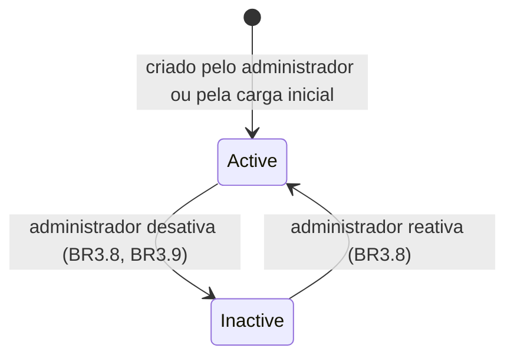
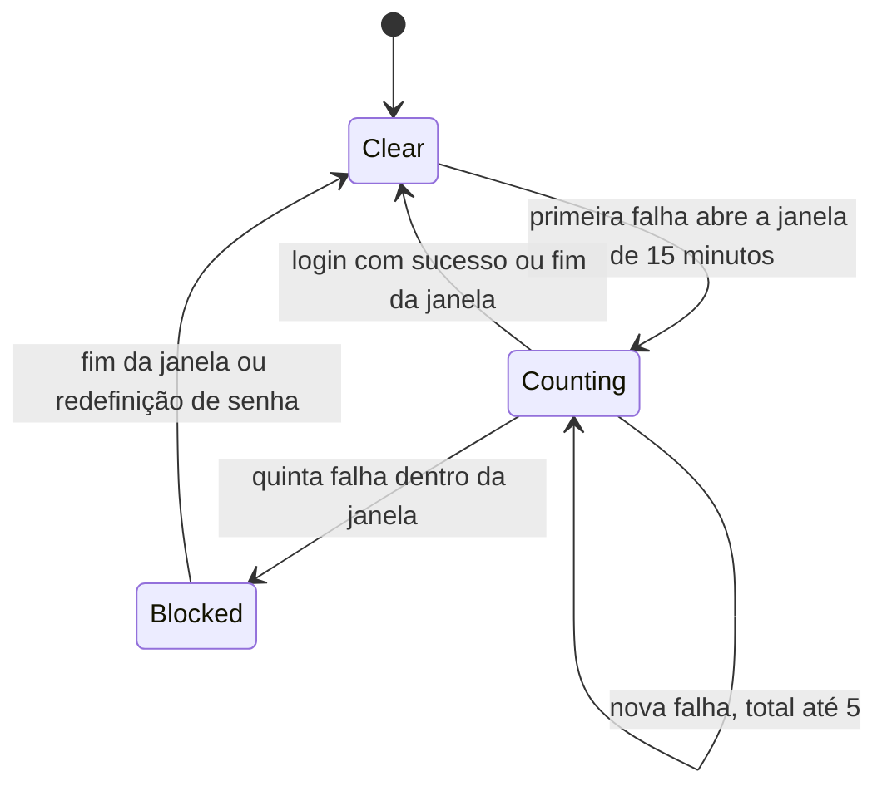
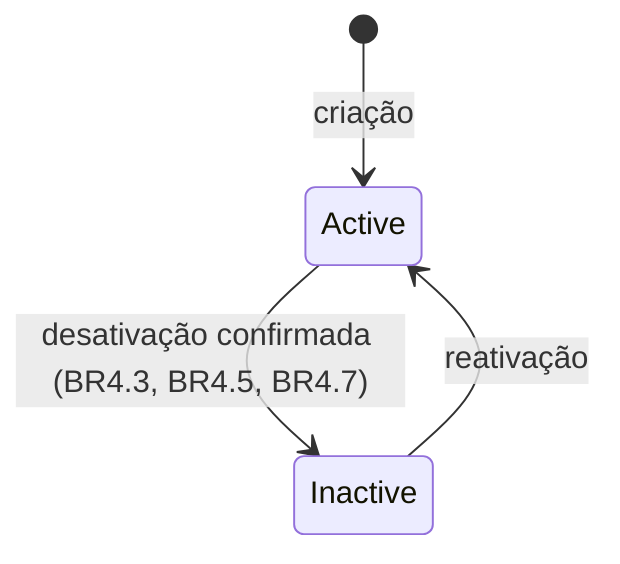
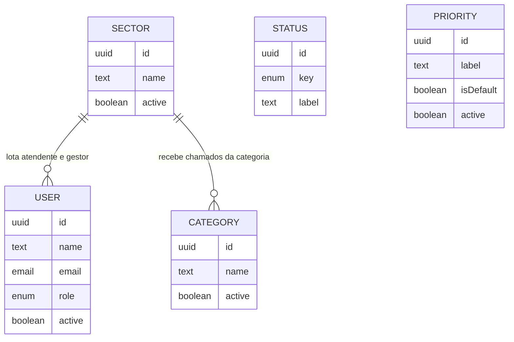

# Especificação Funcional — U1 Fundação (`u1-foundation`)

Derivado de `unit-of-work.md` e `unit-of-work-story-map.md` (em `../../../inception/units-generation/`), `requirements.md` (em `../../../inception/requirements-analysis/`), `components.md` (em `../../../inception/domain-design/`), `contract-summary.md` (em `../../../inception/contract-design/`) e das respostas confirmadas em `functional-design-questions.md`.

Este documento é a fonte da verdade dos **fluxos** e das **máquinas de estado** de U1. O modelo de dados está em `entities.md` e as regras em `rules.md`; o diagrama de entidades e o resumo de regras abaixo são visões derivadas desses dois arquivos.

## Escopo da Unidade

- **Histórias principais:** US1.1 (entrar no sistema), US4.1 (gerenciar usuários), US4.2 (manter catálogos), US5.1 (não ver o que não é meu), US5.3 (teclado), US5.4 (celular).
- **Blocos:** Auth, Users, Catalog.
- **Entidades:** User, Sector, Category, Status, Priority.
- **Operações:** as de API-U1 em `contract-summary.md`, com as divergências registradas no fim deste documento.

## Atores

| Ator | Perfil | O que faz em U1 |
|------|--------|-----------------|
| Qualquer pessoa | nenhum | Tenta entrar; sai |
| Usuário autenticado | STUDENT, PROFESSOR, AGENT, MANAGER, ADMIN | Consulta a própria sessão; lê catálogos |
| Administrador | ADMIN | Mantém usuários, setores, categorias, rótulos de status e prioridades |
| Sistema | — | Carga inicial e validação de configuração na subida |

---

## Fluxos

### WF1 — Entrar no sistema

1. A pessoa informa e-mail e senha.
2. O sistema normaliza o e-mail (BR1.1).
3. O sistema consulta a contagem de falhas desse e-mail. Se houver 5 falhas na janela aberta, responde 429 `AUTH_TOO_MANY_ATTEMPTS` com o tempo restante e encerra, sem verificar a senha (BR1.4).
4. O sistema procura o usuário pelo e-mail normalizado.
5. Se o usuário não existe, verifica a senha contra um hash de referência (BR1.3), registra uma falha para o e-mail e responde 401 `AUTH_INVALID_CREDENTIALS` (BR1.2).
6. Se a senha não confere, registra uma falha e responde 401 `AUTH_INVALID_CREDENTIALS`.
7. Se o usuário está inativo, registra uma falha e responde 401 `AUTH_INVALID_CREDENTIALS`.
8. Com senha correta e usuário ativo, zera a contagem do e-mail, emite o token de 8 horas no cookie de sessão (BR1.5) e devolve os dados da sessão atual: identificador, nome, e-mail, perfil e setor.
9. O frontend leva o usuário à tela de entrada do perfil (BR7.3).

**Casos de erro:** entrada malformada responde 400 `VALIDATION_FAILED` (BR6.3), sem contar como falha de credencial.

### WF2 — Requisição autenticada

1. Se a requisição altera estado e o cabeçalho de origem difere da origem do sistema, responde 403 `FORBIDDEN` (BR2.6).
2. Se a rota é pública, a operação executa.
3. Se a rota não tem marcação pública nem lista de perfis, responde 403 `FORBIDDEN` (BR2.1).
4. Se o token está ausente, inválido ou expirado, responde 401 `UNAUTHENTICATED` (BR1.7).
5. O sistema lê do banco o usuário do token. Se não existe ou está inativo, responde 401 `UNAUTHENTICATED` (BR1.8).
6. Se o perfil lido não está na lista da rota, responde 403 `FORBIDDEN`, sem ler o recurso (BR2.2).
7. A operação executa com o ator formado por identificador, perfil e setor lidos no passo 5.
8. Qualquer falha ao resolver o ator nega a requisição (BR2.3).

### WF3 — Sair

1. A pessoa pede para sair.
2. O sistema responde 204 e instrui o navegador a apagar o cookie, haja ou não sessão válida (BR1.6).
3. O frontend limpa os dados de sessão em memória e mostra a tela de login.

### WF4 — Criar usuário

1. O administrador informa nome, e-mail, perfil, senha e, para Atendente ou Gestor, setor.
2. Campos desconhecidos são descartados (BR6.2).
3. O sistema valida a forma dos campos e a política de senha (BR3.1, BR3.2, BR3.4). Se falhar, responde 400 `VALIDATION_FAILED` com os campos.
4. O sistema aplica a regra de setor (BR3.3).
5. O sistema verifica se o e-mail normalizado já existe, inclusive entre inativos. Se existir, responde 409 `USER_EMAIL_TAKEN`.
6. O sistema guarda o usuário ativo, só com o hash da senha (BR3.5), e responde 201 com o usuário, sem senha.

### WF5 — Alterar usuário

1. O administrador envia uma ou mais alterações: nome, perfil, setor, situação.
2. O sistema calcula o estado resultante do usuário.
3. O sistema aplica a regra de setor ao estado resultante (BR3.3).
4. Numa única operação atômica, o sistema verifica a proteção de administrador (BR3.9):
   1. se o alvo é o próprio ator e o resultado o desativa ou tira dele o perfil ADMIN, recusa com 422 `USER_SELF_MODIFICATION_FORBIDDEN`;
   2. se o alvo é o único ADMIN ativo e o resultado o desativa ou tira dele o perfil ADMIN, recusa com 422 `USER_LAST_ACTIVE_ADMIN`;
   3. aplica a alteração.
5. O sistema responde 200 com o usuário alterado. Perfil, setor e situação novos valem na próxima requisição do usuário (BR3.6, BR3.8).
6. Nenhuma alteração é recusada por causa de chamados (BR3.10).

**Casos de erro:** usuário inexistente responde 404 `USER_NOT_FOUND`.

### WF6 — Redefinir senha

1. O administrador informa a nova senha de um usuário.
2. O sistema valida a política de senha (BR3.4).
3. O sistema substitui o hash e zera a contagem de falhas do e-mail desse usuário (BR3.7).
4. O sistema responde 204. Sessões já abertas desse usuário continuam válidas até expirar.

### WF7 — Manter setor, categoria e prioridade

1. O administrador cria um item ou altera nome, setor (só categoria), situação ou marcação de padrão (só prioridade).
2. O sistema valida nome e unicidade (BR4.1).
3. Para categoria, valida o setor (BR4.2).
4. Para desativação, a interface já pediu confirmação (BR4.8). O sistema aplica BR4.3; para setor, BR4.5; para prioridade, BR4.7.
5. Para marcação de padrão, o sistema transfere a marcação numa única operação atômica (BR4.7).
6. O sistema responde 201 na criação e 200 na alteração, com o item.

### WF8 — Alterar rótulo de status

1. O administrador informa um novo rótulo para um dos quatro status.
2. O sistema valida o rótulo (BR4.1). Chave e situação enviadas são descartadas (BR4.6).
3. O sistema responde 200 com o status.

Não existe fluxo para criar nem desativar status (BR4.6).

### WF9 — Subida da aplicação

1. O sistema lê a configuração obrigatória. Se faltar algum item ou se a senha do administrador inicial violar BR3.4, encerra com mensagem que nomeia o item (BR5.3).
2. O sistema garante os quatro status e, se não houver prioridade nenhuma, cria as três iniciais (BR5.1).
3. Se não há ADMIN ativo, cria o administrador inicial. Se o e-mail configurado já pertence a outro usuário, encerra com mensagem explícita (BR5.2).
4. O sistema passa a aceitar requisições.

A carga é idempotente: subir de novo não duplica nem sobrescreve nada.

### WF10 — Abrir o sistema no navegador

1. O frontend pede a sessão atual.
2. Se a resposta é 401, mostra a tela de login.
3. Se é 200, guarda nome, perfil e setor em memória e leva à tela de entrada do perfil (BR7.3).
4. Durante o uso, qualquer 401 recebido limpa a sessão em memória e leva à tela de login (BR1.7).
5. Qualquer 403 mostra a mensagem traduzida do código, sem sair da tela atual (BR7.5).

---

## Máquinas de Estado

### SM1 — Situação do usuário

<!-- Text fallback: um usuário nasce ativo, criado pelo administrador ou pela carga inicial. O administrador pode desativá-lo, respeitada a proteção de administrador, e pode reativá-lo. Não existe estado apagado. -->

| De | Para | Disparo | Guarda |
|----|------|---------|--------|
| — | Active | Criação (WF4) ou carga inicial (WF9) | BR3.1, BR3.3, BR3.4 |
| Active | Inactive | Alteração de situação (WF5) | BR3.9: não pode ser o próprio ator nem o último ADMIN ativo |
| Inactive | Active | Alteração de situação (WF5) | Nenhuma |

### SM2 — Tentativas de login por e-mail

<!-- Text fallback: cada e-mail começa sem falhas. A primeira falha abre uma janela de 15 minutos e começa a contagem. Novas falhas somam até 5. Na quinta falha dentro da janela, o e-mail fica bloqueado. A contagem volta a zero com login bem-sucedido, fim da janela ou, no bloqueio, redefinição de senha pelo administrador. -->

| Estado | Resposta a uma nova tentativa |
|--------|-------------------------------|
| Clear | Verifica credenciais normalmente |
| Counting | Verifica credenciais normalmente |
| Blocked | 429 `AUTH_TOO_MANY_ATTEMPTS`, sem verificar a senha |

O estado vive só na memória do processo e é perdido ao reiniciar (Q6).

### SM3 — Situação de setor, categoria e prioridade

<!-- Text fallback: setor, categoria e prioridade nascem ativos, podem ser desativados após confirmação na interface e podem ser reativados. A prioridade padrão não pode ser desativada. Status não têm esta máquina: são sempre os quatro iniciais. -->

| Entidade | Guarda para desativar | Efeito |
|----------|-----------------------|--------|
| Sector | Nenhuma | Categorias dele somem das opções de abertura; não recebe usuários nem transferências (BR4.4, BR4.5) |
| Category | Nenhuma | Some das opções de abertura (BR4.3) |
| Priority | Não pode ser a padrão (BR4.7) | Some das opções (BR4.3) |
| Status | Não existe desativação (BR4.6) | — |

---

## Contratos de Serviço Expostos a Outras Unidades

U1 exporta, conforme SVC-01, SVC-02, SVC-04 e SVC-06 de `contract-summary.md`, o ator autenticado e dois serviços públicos de leitura. A tabela diz a regra de negócio de cada método; as assinaturas continuam as do contrato, com as divergências registradas mais abaixo.

| Método | Consumidores | Regra | Recusa ou falha |
|--------|-------------|-------|-----------------|
| Ator autenticado e marcações de rota | U2, U3, U4, U5 | BR8.1 | 401 ou 403, conforme BR1.7, BR1.8 e BR2.2 |
| `UsersPublicService.findSummariesByIds` | U2, U3 | BR8.2 | Nenhuma: identificadores desconhecidos são omitidos |
| `UsersPublicService.isAssignableInSector` | U2 | BR8.3 | Devolve falso; U2 responde `TICKET_ASSIGNEE_NOT_IN_SECTOR` |
| `CatalogPublicService.getActiveCategory` | U2 | BR8.4 | `CATALOG_ITEM_NOT_FOUND`, `CATALOG_ITEM_INACTIVE` |
| `CatalogPublicService.getActiveSector` | U2, e U1 internamente | BR8.5 | `CATALOG_ITEM_NOT_FOUND`, `CATALOG_ITEM_INACTIVE` |
| `CatalogPublicService.getActivePriority` | U2 | BR8.5 | `CATALOG_ITEM_NOT_FOUND`, `CATALOG_ITEM_INACTIVE` |
| `CatalogPublicService.getDefaultPriority` | U2 | BR8.6 | `INTERNAL_ERROR` só se a invariante de BR4.7 estiver quebrada |
| `CatalogPublicService.getStatusByKey` | U2 | BR8.7 | `CATALOG_ITEM_NOT_FOUND` |
| `CatalogPublicService.findLabels` | U2, U4, U5 | BR8.8 | Nenhuma: identificadores desconhecidos são omitidos. A lista de status vem como `StatusLabelRef` (`id`, `name`), sem `active` — divergência declarada abaixo |

Regra comum a todos: BR8.9. Nenhum método público grava dados nem repete a verificação de perfil da rota.

## Cobertura Parcial de Critérios

Critérios de aceitação de histórias de U1 que U1 realiza só em parte. A parte restante é rastreada pelas unidades indicadas, conforme `unit-of-work-story-map.md`. Os critérios que U1 não consegue verificar de forma alguma estão marcados como `Deferred` em `traceability.json`.

| Critério | O que U1 realiza | O que fica para outra unidade | Onde | Marcação |
|----------|------------------|-------------------------------|------|----------|
| AC4.1.5 | Usuário desativado não entra e perde a sessão na requisição seguinte (BR3.8, BR1.8) | Chamados e mensagens do usuário desativado continuam visíveis | U2, U3 | OK |
| AC4.2.3 | Item inativo sai da lista de categorias disponíveis (BR4.3, BR4.4, BR8.4) | O formulário de abertura de chamado não o oferece | U2 | OK |
| AC4.2.4 | O nome do item desativado continua disponível para exibição (BR4.3, BR8.8) | Chamados existentes exibem o item inalterado — só verificável quando existem chamados | U2 | Deferred |
| AC5.1.1, AC5.1.2 | Mecanismo de negação e testes negativos das rotas de U1 (BR2.1 a BR2.7) | Testes negativos das rotas de cada unidade seguinte | U2, U3, U4, U5 | OK |
| AC5.3.1 a AC5.3.6 | Casca, login e administração (BR7.1) | Cada tela nova | U2, U3, U4, U5 | OK |
| AC5.4.1 | Tela de login sem rolagem horizontal em 375px (BR7.2) | Meus Chamados, Novo Chamado, Detalhe e Notificações | U2, U3, U5 | OK |
| AC5.4.2 | Nada: U1 não tem listagem de chamados | Listagem de chamados em cartões | U2 | Deferred |
| AC5.4.4 | Tabelas de administração com rolagem contida no próprio contentor (BR7.2) | Fila do setor e painel | U2, U4 | OK |

## Diagrama de Entidades (derivado de `entities.md`)

<!-- Text fallback: um setor lota zero ou mais usuários, só Atendentes e Gestores. Um setor recebe zero ou mais categorias, e cada categoria pertence a exatamente um setor. Status e Priority não se relacionam com outras entidades de U1; são referenciados pelos chamados de U2. -->

## Resumo das Regras (derivado de `rules.md`)

| Grupo | Regras | Tema |
|-------|--------|------|
| BR1 | BR1.1 a BR1.9 | Login, resposta indistinguível, bloqueio por tentativas, token de 8 horas, logout, 401, perfil lido do banco, sem auto-cadastro |
| BR2 | BR2.1 a BR2.7 | Negação por padrão, 403 sem dados, falha fechada, enumeração de rotas, origem, perfis por operação |
| BR3 | BR3.1 a BR3.10 | Criação e alteração de usuário, setor obrigatório, política de senha, hash, redefinição, desativação, proteção de administrador |
| BR4 | BR4.1 a BR4.8 | Unicidade, categoria com setor ativo, desativação sem efeito retroativo, status fixos, prioridade padrão, confirmação |
| BR5 | BR5.1 a BR5.3 | Carga inicial idempotente, administrador inicial, falha na subida sem configuração |
| BR6 | BR6.1 a BR6.3 | Envelope de erro, campos desconhecidos, validação por campo |
| BR7 | BR7.1 a BR7.6 | Acessibilidade, tela estreita, entrada por perfil, estados de tela, tradução de códigos, navegação |
| BR8 | BR8.1 a BR8.9 | Contratos de serviço expostos: ator, resumo de usuários, quem pode receber atribuição, categoria, setor e prioridade ativos, prioridade padrão, status por chave, rótulos |

## Divergências em Relação a Artefatos Anteriores

Registradas conforme a regra de `bolt-plan.md`: o contrato é o desenho inicial, e toda divergência fica escrita aqui.

| Artefato | O que diverge | Decisão que causa |
|----------|---------------|-------------------|
| `components.md`, entidade Priority | Atributo `key` removido | Q2 |
| `components.md`, entidade Status | Atributo `active` removido: status não são desativados | Q3 |
| `contract-summary.md`, API-U1 `updateStatus` | O corpo aceita só `label`; o campo `active` deixa de existir | Q3 |
| `contract-summary.md`, API-U1 esquema `Status` | O campo `active` sai da resposta | Q3 |
| `contract-summary.md`, SVC-01 `StatusRef` | Deixa de herdar `active` | Q3 |
| `contract-summary.md`, SVC-01 `CatalogLabels.statuses`, em `findLabels` | Também deixa de trazer `active`, pelo mesmo motivo de `StatusRef`: status não têm situação. A lista de status passa a ter tipo próprio (`StatusLabelRef`, com `id` e `name`) em vez de `CatalogItemRef`, para que a unidade consumidora não receba um campo ausente onde o tipo compartilhado prometia um booleano. Categorias, setores e prioridades continuam com `active` | Q3, BR8.8 |
| `contract-summary.md`, API-U1 `login` | Nova resposta 429 `AUTH_TOO_MANY_ATTEMPTS`, com o tempo restante | Q6 |
| `contract-summary.md`, catálogo de códigos (X-01) | Novos códigos, por adição: `AUTH_TOO_MANY_ATTEMPTS` (429), `USER_SELF_MODIFICATION_FORBIDDEN` (422), `USER_LAST_ACTIVE_ADMIN` (422), `CATALOG_NAME_TAKEN` (409), `CATALOG_DEFAULT_PRIORITY_REQUIRED` (422) | Q6, Q9, BR4.1, BR4.7 |
| `requirements.md`, FR9.2 | Status não têm criação nem desativação | Q3, desvio consciente |
| `wireframes.md`, barra superior | Sem campo de busca | Q4 |
| `wireframes.md`, Tela 2 | Perfis não administradores vão para uma tela provisória até U2 existir | BR7.3 |

## Implicações de Segurança

| Decisão | Risco tratado | Risco que permanece |
|---------|---------------|---------------------|
| Resposta e tempo idênticos para e-mail inexistente, senha errada e usuário inativo (BR1.2, BR1.3) | Descoberta de contas existentes | — |
| Bloqueio por e-mail após 5 falhas (BR1.4) | Adivinhação de senha de uma conta específica | Tentativas espalhadas por muitos e-mails não são contidas; reiniciar o processo zera a contagem; um terceiro pode bloquear temporariamente o login de outra pessoa por até 15 minutos |
| Perfil lido do banco a cada requisição (BR1.8) | Usuário desativado ou rebaixado continuando a agir até o token expirar | Token roubado continua válido por até 8 horas, sem invalidação no servidor (consequência aceita em `team.md`) |
| Negação por padrão, falha fechada e enumeração de rotas (BR2.1, BR2.3, BR2.4) | Rota nova esquecida sem proteção | — |
| Proteção do último administrador (BR3.9) | Perda definitiva da capacidade de administrar | Um administrador mal-intencionado ainda pode rebaixar os outros, mas não o último |
| Senha só como hash lento, nunca devolvida (BR3.5) | Vazamento de senha em claro | — |
| Configuração obrigatória sem exibir valores (BR5.3) | Segredo exposto em log | A senha do administrador inicial fica na configuração local; trocá-la pela interface depois da primeira subida é recomendável |

## Assumptions & Open Questions

- [assumption] O limite máximo de 128 caracteres de senha é proteção de entrada, e não política; a Q8 fixou só o mínimo e a composição.
- [assumption] Unicidade de nome de setor, de nome de categoria dentro do setor e de rótulos de status e prioridade, sem distinção de maiúsculas, foi derivada para evitar opções indistinguíveis na tela; nenhum requisito a pede.
- [assumption] O e-mail informado no login é normalizado antes de contar tentativas, para que variações de maiúsculas não contornem o bloqueio.
- [assumption] A tela provisória de entrada para perfis não administradores existe só enquanto U2 não registra as telas de Meus Chamados e Fila do Setor.
- [assumption] O algoritmo de hash é argon2id ou outro de custo comparável; a escolha final da biblioteca é da geração de código.
- [assumption] O nome do administrador inicial é fixo ("Administrador") e pode ser alterado pela interface.

## Review

**Verdict:** READY
**Reviewer:** aidlc-architecture-reviewer-agent
**Date:** 2026-10-05T12:12:59Z
**Iteration:** 1
**Request Challenge:** review:b922c733f8bbeee5780c0f041eae4deb

### Findings

| ID | Severity | Location | Finding | Required action | Status |
|---|---|---|---|---|---|
| R-01 | Critical | `construction/u1-foundation/functional-design/rules.md` BR8.1–BR8.9 e `functional-spec.md` § "Contratos de Serviço Expostos a Outras Unidades" | Corrigido. A seção BR8 de `rules.md` especifica, para cada método de `UsersPublicService` e `CatalogPublicService` de SVC-01/02/04/06, o gatilho, a lógica exata e a resposta de erro, e a tabela de contratos de `functional-spec.md` aponta cada método à sua regra BR8.x. A lacuna de negócio está fechada. | — | Resolved |
| R-02 | Major | `construction/u1-foundation/functional-design/traceability.json` (`AC5.4.2`, `AC4.2.4`) | Corrigido e reverificado nesta iteração: `traceability.json` linha 32 (`AC4.2.4`) e linha 46 (`AC5.4.2`) trazem `"status": "Deferred"` com `target` textual remetendo a "Cobertura Parcial de Critérios" em `functional-spec.md`. O sensor `aidlc-sensor-traceability` roda limpo (`"pass":true`, zero gaps e zero órfãos). | — | Resolved |
| R-03 | Minor | `construction/u1-foundation/functional-design/rules.md` BR4.1 | Corrigido. BR4.1 declara que a comparação de unicidade considera itens ativos e inativos, que o nome de um item desativado não é reaproveitado e que o administrador reativa o item existente; o esquema confirma a aplicação (`apps/api/prisma/schema.prisma`, `Sector.name` e `Priority.label` com `@unique @db.Citext`, `Category` com `@@unique([sectorId, name])`). | — | Resolved |
| R-04 | Major | `construction/u1-foundation/functional-design/rules.md` BR8.8 vs `inception/contract-design/contract-summary.md` (interfaces `CatalogItemRef`, `CatalogLabels`, método `findLabels`) | Corrigido, e o reparo corresponde ao código em primeira mão. A tabela de divergências traz a linha `contract-summary.md`, SVC-01 `CatalogLabels.statuses`, em `findLabels`, declarando a perda de `active` e o tipo próprio `StatusLabelRef` (`id`, `name`); a linha de `CatalogPublicService.findLabels` na tabela de contratos repete a assinatura efetiva e remete à divergência. `apps/api/src/catalog/catalog.types.ts` define `StatusLabelRef` com `id` e `name` e `CatalogLabels.statuses` como `StatusLabelRef[]`, e `apps/api/src/catalog/catalog-public.service.ts` (`findLabels`) mapeia `statuses` para `{ id, name: status.label }`, sem `active`. Um consumidor (U2, U4, U5) que leia o desenho implementa o consumo certo: o tipo declarado é exatamente o devolvido. | — | Resolved |
| R-05 | Major | `aidlc/spaces/default/intents/260907-chamados-academicos/construction/u1-foundation/functional-design/functional-spec.md` § "Contratos de Serviço Expostos a Outras Unidades" e `rules.md` BR8 | O desenho descreve dois métodos de `UsersPublicService` (`findSummariesByIds`, `isAssignableInSector`), mas U1 expõe três: `apps/api/src/users/users-public.service.ts:57` implementa `findAssignableInSector(sectorId)`, consumido por outra unidade em `apps/api/src/tickets/tickets.service.ts:248`. O método não aparece na tabela de contratos, não tem regra BR8.x que fixe sua semântica (apenas AGENT e MANAGER ativos do setor, ordem por nome, identificador inválido ou desconhecido devolve lista vazia) e não está na tabela de divergências, embora seja aditivo a SVC-01 — `contract-summary.md` linhas 1469–1473 e 1520 listam apenas os dois primeiros. Uma busca no diretório de desenho de U1 por `findAssignable` não retorna nada. O argumento de que a regra pertence à unidade consumidora não se sustenta: `contract-summary.md` linha 1682 atribui a U1 a propriedade dos serviços públicos de U1, logo é o desenho de U1 que precisa declarar o método. Reconstruir U1 a partir deste desenho quebraria essa integração. | Acrescentar à tabela de contratos a linha de `findAssignableInSector` com consumidor e regra; criar a regra BR8.x correspondente (usuário ativo, perfil AGENT ou MANAGER, pertencente ao setor informado, ordenado por nome, lista vazia para identificador inválido ou desconhecido); e registrar na tabela de divergências que o método é adição a SVC-01. | New |
| R-06 | Major | `aidlc/spaces/default/intents/260907-chamados-academicos/construction/u1-foundation/functional-design/functional-spec.md` § "Escopo da Unidade" e § "Divergências em Relação a Artefatos Anteriores" | O desenho afirma que as operações são "as de API-U1 em `contract-summary.md`, com as divergências registradas no fim deste documento", mas a API construída tem um parâmetro de consulta que o contrato não prevê: `GET /categories` aceita `available` (`apps/api/src/catalog/dto/catalog-input.dto.ts` em `ListCategoriesQueryDto`, `apps/api/src/catalog/categories.controller.ts` no método `list`, e `availabilityWhere` em `apps/api/src/catalog/categories.service.ts`), enquanto o contrato declara para esse caminho apenas `active` e `sectorId`. A divergência não está registrada, e uma busca por `available` no diretório de desenho de U1 não retorna nada. Não é parâmetro ocioso: o formulário de abertura de chamado de outra unidade depende dele (`apps/web/src/features/tickets/tickets-api.ts:121`, `useAvailableCategories`, que chama `/categories` com `available: true`, usado por `apps/web/src/features/tickets/NewTicketForm.tsx:26`). BR4.4 define a condição de disponibilidade, mas nenhuma regra nem fluxo diz que ela é exposta como filtro de API. | Registrar o parâmetro `available` de `listCategories` como divergência aditiva de API-U1 e dizer, em WF7 ou em BR4.4, que a listagem de categorias expõe o filtro de disponibilidade (categoria ativa E setor ativo), que é o contrato do qual a abertura de chamado depende. | New |
| R-07 | Minor | `aidlc/spaces/default/intents/260907-chamados-academicos/construction/u1-foundation/functional-design/rules.md` BR3.3 e BR4.5 | BR3.3 diz "IF o setor informado está inativo THEN recusar como item inativo" e BR4.5 repete "IF um setor inativo é informado como setor de usuário ... THEN recusar", com 422 `CATALOG_ITEM_INACTIVE`. O sistema construído só valida setor recém-atribuído: `apps/api/src/users/user-rules.ts` (`resolveSector`) devolve `keep` quando o setor enviado é igual ao atual, e `apps/api/src/users/users.service.ts` (`resolveSectorOrThrow`) chama `getActiveSector` apenas no caso `assign`. Reenviar o mesmo setor, já desativado, é aceito. A escolha é deliberada e testada (`apps/api/src/users/user-rules.spec.ts:25`, "keeps the current sector when none is sent or the same one is sent"), mas nenhuma das duas regras declara essa exceção. | Declarar em BR3.3 e BR4.5 que a verificação de setor existente e ativo vale para setor recém-atribuído, e que manter o setor atual, mesmo inativo, não é recusado, com o motivo registrado. | New |
| R-08 | Minor | `aidlc/spaces/default/intents/260907-chamados-academicos/construction/u1-foundation/functional-design/rules.md` BR5.3 | BR5.3 enumera a configuração obrigatória como "segredo de assinatura do token, conexão com o banco, e-mail ou senha do administrador inicial", mas o sistema construído também exige a origem da aplicação: `apps/api/src/config/app-config.ts` (`readOrigin`) usa `readRequired(env, 'APP_ORIGIN')` e encerra a subida sem ela, e BR2.6 é inimplementável sem esse valor, porque é com ele que a origem da requisição é comparada (`apps/api/src/auth/guards/auth.guard.ts`, `this.config.appOrigin`). O mesmo arquivo impõe mínimo de 32 caracteres ao segredo do token (`JWT_SECRET_MIN_LENGTH`), condição que BR5.3 não menciona. | Acrescentar a origem da aplicação à lista de configuração obrigatória de BR5.3, ligando-a a BR2.6, e registrar o mínimo de comprimento exigido do segredo de assinatura. | New |
| R-09 | Minor | `aidlc/spaces/default/intents/260907-chamados-academicos/construction/u1-foundation/functional-design/rules.md` BR1.4 (enunciado) | O enunciado de BR1.4 diz "Mais de cinco tentativas falhas ... bloqueiam novas tentativas", mas a própria lógica da regra ("já tem 5 falhas registradas na janela"), WF1 passo 3 e SM2 ("quinta falha dentro da janela") fixam o bloqueio em exatamente cinco, e é isso que o sistema faz (`apps/api/src/auth/login-attempt-limiter.ts`: `MAX_FAILED_ATTEMPTS` igual a 5, com `blockedForSeconds` positivo quando as falhas alcançam esse limite). O enunciado é o único texto fora de linha e, lido isolado, autoriza seis tentativas. | Corrigir o enunciado de BR1.4 para cinco falhas na janela, alinhando-o à própria lógica, a WF1 e a SM2. | New |
| R-10 | Minor | `aidlc/spaces/default/intents/260907-chamados-academicos/construction/u1-foundation/functional-design/functional-spec.md` WF7 e WF8 | WF5 registra "Casos de erro: usuário inexistente responde 404 `USER_NOT_FOUND`", mas WF7 e WF8 não registram caso de erro algum, embora a alteração de item de catálogo inexistente responda 404 `CATALOG_ITEM_NOT_FOUND` no sistema construído (`apps/api/src/catalog/categories.service.ts` e `apps/api/src/catalog/priorities.service.ts` no método `update`, `apps/api/src/catalog/statuses.service.ts` em `updateLabel`), e nenhuma regra de BR4 lista esse código para item alvo inexistente. | Acrescentar a WF7 e WF8 o caso de erro de item inexistente com 404 `CATALOG_ITEM_NOT_FOUND`, ou citá-lo na violação da regra BR4 correspondente. | New |

### Validation Tool Results

| Tool | Result | Interpretation |
|---|---|---|
| `aidlc-sensor-traceability` | PASS (`"pass":true`, zero gaps, zero órfãos, zero entradas inválidas) | Confirma R-02 como `Resolved`: `AC4.2.4` e `AC5.4.2` estão como `Deferred` com destino declarado, e nenhum critério ficou sem rastreio. |
| `aidlc-sensor-required-sections` | PASS (11 cabeçalhos de nível 2 reconhecidos, zero achados) | Estrutura do documento íntegra; nenhuma seção exigida falta. |
| `aidlc-sensor-upstream-coverage` | PASS vazio (`"reason":"no upstream"`, nenhum arquivo varrido) | Resultado vácuo: o sensor não tinha contrato a montante configurado para este caminho, logo não serve de evidência a favor nem contra o desenho. A verificação de cobertura a montante foi feita à mão contra `contract-summary.md`, `unit-of-work.md`, `requirements.md` e `stories.md`, e produziu R-05 e R-06. |
| `aidlc-sensor-linter` | PASS (`"pass":true`, zero erros; um aviso de arquivo ignorado) | Executado com `--stage functional-design --file-path <functional-spec.md>`. O ESLint ignora o caminho do artefato, logo o resultado é vácuo: não há evidência de forma de código nem a favor nem contra. |
| `aidlc-sensor-type-check` | Não produziu resultado (`no-tsconfig-found`) | Sem `tsconfig` para o caminho do artefato, o sensor não tem o que verificar. Também vácuo. O código de U1 foi conferido diretamente, arquivo por arquivo. |
| `aidlc-sensor-claim-sources` | Não declarado para esta etapa | A etapa `functional-design` declara `required-sections`, `upstream-coverage`, `linter`, `type-check` e `traceability`; `claim-sources` não está entre eles e, executado fora de lugar, procura o arquivo de perguntas de outra etapa. Sua saída foi descartada por não ser aplicável. |

### Summary

O reparo de R-04 sobrevive à verificação em primeira mão: `StatusLabelRef` existe no código exatamente como a divergência o declara, e `findLabels` devolve status sem `active`, de modo que um consumidor que leia o desenho implementa o consumo certo. Os quatro achados anteriores estão fechados. A preocupação arquitetural que resta é de outra natureza e tem sempre a mesma forma: a superfície que U1 realmente expõe é maior do que a que o desenho declara — o método público `findAssignableInSector` (R-05) e o filtro `available` de `listCategories` (R-06), ambos consumidos por outra unidade e ambos ausentes do contrato compartilhado e da tabela de divergências. O veredito é READY pela regra de veredito: nenhum achado crítico e dois achados maiores, dentro do limite de dois. R-05 e R-06 são lacunas de registro, não defeitos de projeto, e ficam como ponto que o autor deve pesar no portão antes de o desenho ser tratado como contrato pelas unidades seguintes.
