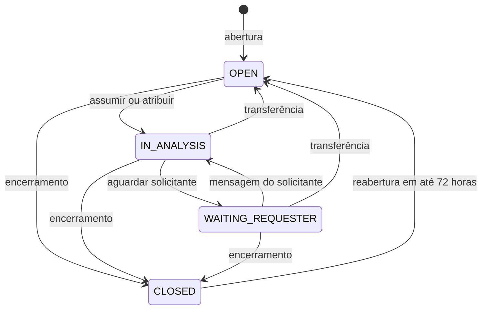
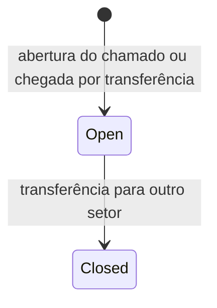
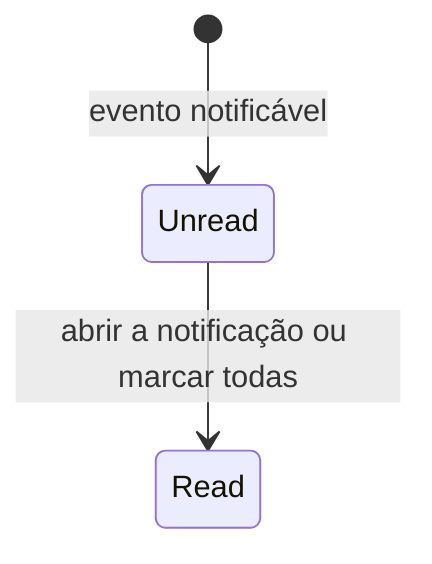
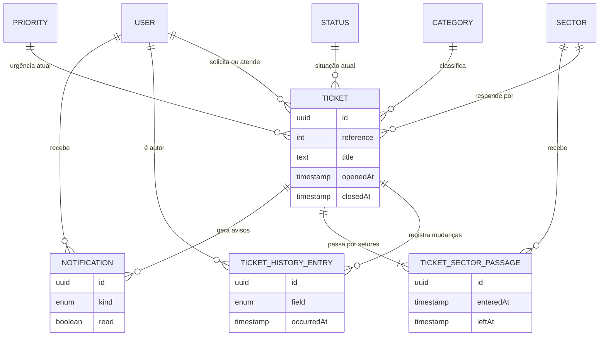

# Especificação Funcional — U2 Chamados (`u2-tickets`)

Derivado de `unit-of-work.md` e `unit-of-work-story-map.md` (em `../../../inception/units-generation/`), `requirements.md` (em `../../../inception/requirements-analysis/`), `components.md` (em `../../../inception/domain-design/`), `contract-summary.md` (em `../../../inception/contract-design/`), do desenho funcional e do código de U1, e das respostas confirmadas em `functional-design-questions.md`.

Este documento é a fonte da verdade dos **fluxos** e das **máquinas de estado** de U2. O modelo de dados está em `entities.md` e as regras em `rules.md`; o diagrama de entidades e o resumo de regras abaixo são visões derivadas desses dois arquivos.

## Escopo da Unidade

- **Histórias principais:** US1.2 (abrir), US1.3 (acompanhar), US1.5 (notificações), US1.6 (reabrir e encerrar), US2.1 (fila), US2.2 (assumir), US2.3 (andamento e prioridade), US2.4 (transferir), US3.1 (atribuir), US5.2 (não revelar).
- **Critérios de outras histórias realizados aqui:** AC4.1.5 (chamados de usuário desativado continuam visíveis), AC4.2.3 e AC4.2.4 (itens inativos), AC5.1.1 e AC5.1.2 (autorização das rotas novas), US5.3 e US5.4 nas telas novas.
- **Blocos:** Tickets e Notifications.
- **Entidades:** Ticket, TicketHistoryEntry, TicketSectorPassage, Notification.
- **Fora de U2:** mensagens e a aba Conversa (U3); contagens e tempos médios dos indicadores (U4); avaliação (U5).

## Atores

| Ator | Perfil | O que faz em U2 |
|------|--------|-----------------|
| Solicitante | STUDENT, PROFESSOR | Abre, acompanha, encerra e reabre os próprios chamados; lê as próprias notificações |
| Atendente | AGENT | Trabalha a fila do setor: assume, aguarda solicitante, encerra, transfere, altera prioridade; lê em leitura os chamados que passaram pelo setor |
| Gestor | MANAGER | Tudo o que o Atendente faz no seu setor, mais atribuir e reatribuir |
| Administrador | ADMIN | Lê todos os chamados, sem ações |
| U3 (Conversa) | — | Consulta chamado visível, avisa mensagem do solicitante e grava notificação de mensagem |

---

## Fluxos

Toda operação de escrita abaixo roda numa transação ambiente (BR7.1): se qualquer passo falhar, nada do que ela gravou permanece.

### WF1 — Abrir chamado

1. O solicitante escolhe a categoria; a tela mostra o setor derivado (BR9.3).
2. O solicitante informa título, descrição e, opcionalmente, prioridade, e envia.
3. O sistema recusa com 403 se o perfil não é Aluno nem Professor (BR1.1).
4. O sistema descarta campos desconhecidos, inclusive setor (X-01), e valida título e descrição (BR1.2).
5. O sistema obtém a categoria disponível de U1; se inexistente ou indisponível, recusa (BR1.3).
6. O sistema obtém a prioridade informada, que precisa estar ativa, ou a prioridade padrão (BR1.4).
7. O sistema grava o chamado com o próximo identificador da sequência, status Aberto, sem responsável, e a passagem inicial no setor da categoria (BR1.5, BR1.6).
8. O sistema responde 201 com o detalhe; a tela leva ao detalhe com confirmação.

### WF2 — Listar e consultar chamados

1. O ator pede uma das listagens: meus chamados (solicitante), fila do setor com recorte (Atendente e Gestor) ou listagem geral (Administrador) (BR2.9).
2. Na fila, ator sem setor recebe 403 `TICKET_QUEUE_NO_SECTOR` (BR2.2).
3. O sistema consulta com a condição de visibilidade dentro da consulta, filtros, ordenação e paginação (BR2.1 a BR2.3, BR2.5, BR2.6).
4. O sistema resolve nomes de categoria, setor, status, prioridade e pessoas pelos serviços públicos de U1, e calcula a marca de responsável indisponível (BR2.7, BR3.9).
5. O sistema responde com a página e o total.
6. No detalhe, histórico ou passagens de um chamado, identificador inexistente ou invisível responde 404 idêntico (BR2.4, BR2.8).

### WF3 — Assumir

1. O Atendente ou Gestor pede para assumir.
2. O sistema lê o chamado aplicando a visibilidade; invisível responde 404.
3. Encerrado responde 403 `TICKET_CLOSED`; visível só por passagem responde 403 (BR3.8).
4. Em operação atômica sobre o chamado (BR7.2):
   1. se há responsável disponível diferente do ator, recusa com 409 `TICKET_ALREADY_ASSIGNED` e o nome do responsável;
   2. senão, grava o ator como responsável; se o status é Aberto, aplica a transição para Em análise (BR4.1).
5. O sistema grava histórico de responsável e, se mudou, de status (BR4.2, BR5.1).
6. O sistema notifica o solicitante com `ASSIGNEE_CHANGED` (BR6.1).

### WF4 — Atribuir

1. O Gestor abre o diálogo; o sistema lista quem pode receber atribuição no setor atual (BR8.5).
2. O Gestor escolhe e confirma.
3. O sistema valida perfil, visibilidade, encerramento e setor do ator (BR3.2).
4. O sistema confirma com U1 que o destinatário pode receber atribuição no setor; senão, 422 `TICKET_ASSIGNEE_NOT_IN_SECTOR`.
5. Se o destinatário já é o responsável, responde 200 sem mudança.
6. Em operação atômica, troca o responsável; se o status é Aberto, aplica a transição para Em análise (BR7.2, BR4.1).
7. Grava histórico e notifica o solicitante com `ASSIGNEE_CHANGED`.

### WF5 — Marcar aguardando solicitante

1. O responsável atual ou o Gestor do setor pede a marcação (BR3.4).
2. Qualquer outro ator do setor recebe 403; status diferente de Em análise recebe 409 `TICKET_INVALID_TRANSITION`.
3. O sistema aplica a transição, grava histórico de status e notifica o solicitante com `STATUS_CHANGED`.

### WF6 — Encerrar

1. O solicitante encerra o próprio chamado (BR3.6), ou o responsável atual ou o Gestor do setor encerra (BR3.5).
2. Encerrado de novo recebe 409 `TICKET_INVALID_TRANSITION`.
3. O sistema aplica a transição para Encerrado, grava `closedAt` e histórico de status.
4. Notificação com `STATUS_CHANGED`: ao solicitante quando quem encerrou foi o atendimento; ao responsável, se houver, quando quem encerrou foi o solicitante (BR6.1, BR6.2).

### WF7 — Reabrir

1. O solicitante pede a reabertura do próprio chamado encerrado (BR4.3).
2. Atendente, Gestor ou Administrador recebem 403; chamado de outro solicitante responde 404; não encerrado recebe 409 `TICKET_INVALID_TRANSITION`.
3. O sistema calcula, pela fonte de tempo, o intervalo desde `closedAt`; 72 horas ou mais recebem 409 `TICKET_REOPEN_WINDOW_EXPIRED`.
4. O sistema aplica a transição para Aberto, limpa `closedAt`, mantém o responsável e grava histórico de status.
5. Se há último responsável, ele recebe `TICKET_REOPENED`; se ele estiver indisponível, o chamado aparece com a marca (BR3.9).

### WF8 — Transferir

1. O Atendente ou Gestor do setor atual abre o diálogo e escolhe o setor de destino e a justificativa (BR9.7).
2. O sistema valida visibilidade, encerramento, setor do ator, justificativa, destino ativo e destino diferente (BR3.3).
3. O sistema encerra a passagem aberta com `leftAt`, justificativa e autor, e abre a passagem no destino (BR5.2).
4. O sistema troca o setor, remove o responsável e, se o status não era Aberto, aplica a transição para Aberto (BR4.1).
5. O sistema grava histórico de setor, de responsável (se havia) e de status (se mudou) (BR5.1).
6. O solicitante recebe `SECTOR_CHANGED` (BR6.1).

### WF9 — Alterar prioridade

1. O Atendente ou Gestor do setor atual escolhe outra prioridade ativa (BR3.7).
2. Solicitante recebe 403; chamado encerrado recebe 403 `TICKET_CLOSED`; mesma prioridade responde 200 sem mudança.
3. O sistema troca a prioridade e grava histórico; o solicitante não é notificado de mudança de prioridade.

### WF10 — Retorno automático por mensagem do solicitante

1. U3 grava a mensagem e, na mesma transação, chama o aviso de mensagem do solicitante (BR8.2).
2. Se o ator é o solicitante e o status é Aguardando solicitante, o sistema aplica a transição para Em análise e grava histórico com o solicitante como autor (BR4.4).
3. Não há notificação própria: U3 já grava `MESSAGE_RECEIVED` para o responsável.

### WF11 — Notificações

1. A barra superior consulta a contagem de não lidas do ator (BR6.4, BR9.6).
2. O painel lista as notificações do ator, da mais recente para a mais antiga.
3. Clicar numa notificação marca como lida e abre o chamado, que segue a visibilidade atual (BR6.5).
4. Marcar todas grava `readAt` nas não lidas do ator; o contador zera.
5. Marcar notificação de outro usuário responde 404 `NOTIFICATION_NOT_FOUND`.

---

## Máquinas de Estado

### SM1 — Status do chamado

<!-- Text fallback: o chamado nasce Aberto. Assumir ou atribuir leva a Em análise. Em análise vai a Aguardando solicitante quando o atendimento marca, e volta a Em análise quando o solicitante responde. Transferência leva Em análise ou Aguardando solicitante de volta a Aberto; transferir um chamado Aberto não muda o status. Aberto, Em análise e Aguardando solicitante podem ser encerrados. Encerrado volta a Aberto por reabertura do solicitante em até 72 horas. -->

| De | Para | Ação | Quem | Guarda |
|----|------|------|------|--------|
| — | OPEN | abertura | STUDENT, PROFESSOR | BR1.1 a BR1.4 |
| OPEN | IN_ANALYSIS | assumir | AGENT, MANAGER do setor atual | sem responsável disponível diferente do ator (BR3.1) |
| OPEN | IN_ANALYSIS | atribuir | MANAGER do setor atual | destinatário pode receber atribuição (BR3.2) |
| IN_ANALYSIS | WAITING_REQUESTER | aguardar solicitante | responsável ou MANAGER do setor | BR3.4 |
| WAITING_REQUESTER | IN_ANALYSIS | mensagem do solicitante | solicitante, via U3 | BR4.4 |
| IN_ANALYSIS | OPEN | transferência | AGENT, MANAGER do setor atual | BR3.3 |
| WAITING_REQUESTER | OPEN | transferência | AGENT, MANAGER do setor atual | BR3.3 |
| OPEN | CLOSED | encerramento | solicitante; responsável ou MANAGER do setor | BR3.5, BR3.6 |
| IN_ANALYSIS | CLOSED | encerramento | solicitante; responsável ou MANAGER do setor | BR3.5, BR3.6 |
| WAITING_REQUESTER | CLOSED | encerramento | solicitante; responsável ou MANAGER do setor | BR3.5, BR3.6 |
| CLOSED | OPEN | reabertura | solicitante | menos de 72 horas desde `closedAt` (BR4.3) |

Toda outra combinação responde 409 `TICKET_INVALID_TRANSITION` (BR4.1). Assumir ou atribuir um chamado em Em análise ou Aguardando solicitante — possível só com responsável indisponível ou por reatribuição do Gestor — troca o responsável sem transição.

### SM2 — Passagem por setor

<!-- Text fallback: uma passagem nasce aberta quando o chamado é criado no setor da categoria ou chega a um setor por transferência, e é encerrada quando o chamado é transferido para outro setor, registrando saída, justificativa e autor. Cada chamado tem exatamente uma passagem aberta. -->

### SM3 — Notificação

<!-- Text fallback: a notificação nasce não lida no momento do evento e passa a lida quando o destinatário a abre ou marca todas como lidas. Nunca volta a não lida e nunca é apagada. -->

---

## Diagrama de Entidades (derivado de `entities.md`)

<!-- Text fallback: um chamado tem várias entradas de histórico, uma ou mais passagens por setor e várias notificações. Usuário, categoria, setor, status e prioridade são entidades de U1 referenciadas pelo chamado. Cada passagem aponta um setor; cada entrada de histórico aponta seu autor; cada notificação aponta seu destinatário. -->

## Resumo das Regras (derivado de `rules.md`)

| Grupo | Regras | Tema |
|-------|--------|------|
| BR1 | BR1.1 a BR1.6 | Abertura: perfil, limites, categoria, prioridade, estado inicial, identificador |
| BR2 | BR2.1 a BR2.9 | Visibilidade, 404 idêntico, listagens, fila, detalhe, perfis por operação |
| BR3 | BR3.1 a BR3.9 | Assumir, atribuir, transferir, aguardar, encerrar, prioridade, leitura sem ação, responsável indisponível |
| BR4 | BR4.1 a BR4.4 | Nove transições, histórico de status, reabertura em 72 horas, retorno automático |
| BR5 | BR5.1 a BR5.3 | Histórico, passagens, itens desativados |
| BR6 | BR6.1 a BR6.6 | Destinatários, ator não notificado, mesma transação, só as próprias, só no sistema |
| BR7 | BR7.1 a BR7.4 | Transação ambiente e concorrência |
| BR8 | BR8.1 a BR8.6 | Serviços públicos e lista de quem pode receber atribuição |
| BR9 | BR9.1 a BR9.9 | Navegação, tela estreita, formulário, detalhe, fila, notificações, diálogos, estados, acessibilidade |

## Divergências em Relação a Artefatos Anteriores

| Artefato | O que diverge | Decisão que causa |
|----------|---------------|-------------------|
| `contract-summary.md`, API-U2 `listTickets` | `view` ganha o valor `all` (Administrador); `queue` ganha o valor `passed` (chamados que passaram pelo setor) | Q4, BR2.6 |
| `contract-summary.md`, API-U2 `TicketListItem` e `TicketDetail` | Novo campo `assigneeUnavailable` (booleano). `reference` continua texto, com o formato fixado como cerquilha seguida do número sequencial (`#42`) | Q6, Q1 |
| `contract-summary.md`, API-U2 `TicketHistoryEntry` | Novo campo `justification` (texto ou nulo), preenchido nas entradas de setor, para que o histórico mostre a justificativa da transferência (AC2.4.4); `previousValue` e `newValue` trazem nomes resolvidos na leitura | BR5.1 |
| `contract-summary.md`, SVC-03 `onRequesterMessage` | O comentário diz que o método notifica o responsável; em U2 ele não notifica, porque U3 já grava a notificação de mensagem recebida para o responsável na mesma operação, e a regra é uma notificação por destinatário por operação | BR4.4, BR6.1 |
| `contract-summary.md`, API-U2 | Nova operação `GET /tickets/{ticketId}/assignable-users`, só para MANAGER do setor | BR8.5 |
| `contract-summary.md`, SVC-01 | `UsersPublicService` ganha, por adição, `findAssignableInSector(sectorId)`, implementado no Bolt de U2 no módulo de U1 | BR8.5 |
| `contract-summary.md`, SVC-05 | `countTickets` e `getDurationAverages` não são implementados em U2: entram por adição no Bolt de U4, que é condicional; `searchTickets` é implementado em U2 | U4 condicional em `bolt-plan.md` |
| `contract-summary.md`, API-U2 | Valores fixados: `field` do histórico (STATUS, ASSIGNEE, SECTOR, PRIORITY) e `kind` da notificação (MESSAGE_RECEIVED, STATUS_CHANGED, ASSIGNEE_CHANGED, SECTOR_CHANGED, TICKET_REOPENED) | Questões em aberto de API-U2 |
| `contract-summary.md`, API-U2 `openTicket` e `transferTicket` | Limites fixados: título de 5 a 120, descrição de 10 a 2000 e justificativa de 5 a 500 caracteres (o contrato trazia mínimo 1 na justificativa) | Q3 |
| `stories.md`, AC2.2.2 | Assumir chamado com responsável **indisponível** é permitido | Q6 |
| U1, `apps/web` | O item provisório "Início" e a tela provisória de entrada são removidos; "Meus Chamados" aparece só para Aluno e Professor | Q2, BR7.3 de U1 |
| `wireframes.md`, Tela 5 | A aba Conversa não existe em U2; U3 a acrescenta | Fronteira de unidades |
| U1, código | U1 introduziu um emissor de eventos internos (`AppEvents`) para zerar o bloqueio de login na redefinição de senha, contra a decisão de chamada direta sem camada de eventos (Q5 do Desenho de Domínio). U2 não usa eventos: toda integração é por chamada de serviço. **Risco para a transação ambiente de BR7.1 e para a atomicidade de BR6.3: nenhum.** O único evento emitido é `user.password-reset`, consumido pelo limitador de tentativas de login, que mantém contagem em memória e não grava nada no banco; não há evento de U1 que toque entidade lida ou escrita por U2 durante uma operação, logo nenhum efeito pode escapar da transação nem desalinhar leitura feita dentro dela | Registro para o portão |

## Cobertura Parcial de Critérios

Critérios que U2 realiza só em parte, conforme `unit-of-work-story-map.md`. A parte restante é rastreada pela unidade indicada.

| Critério | Parte realizada em U2 | Parte realizada em outra unidade |
|----------|-----------------------|----------------------------------|
| AC1.3.4 | Detalhe com descrição, metadados e histórico em abas (BR2.7, BR2.8, BR9.4) | Aba de mensagens — U3 |
| AC1.5.1 | Notificação de mudança de status, responsável e setor (BR6.1) | Notificação de mensagem recebida — U3, pelo registro de notificação de U2 (BR8.4) |
| AC2.1.3 | Chamado que passou pelo setor visível em leitura (BR2.2, BR2.6, BR3.8) | Mensagens desse chamado — U3, a partir dos setores de passagem devolvidos por BR8.1 |
| AC2.3.2 | Retorno automático para Em análise, com histórico (BR4.4, BR8.2) | Gatilho da mensagem e notificação do responsável — U3 |
| AC4.1.5 | Chamados de usuário desativado continuam visíveis com o nome dele (BR2.7) | Login recusado — U1; mensagens visíveis — U3 |
| AC5.1.1, AC5.1.2 | Teste de 403 e de acesso alheio para cada rota nova de U2 (BR2.9, BR2.1, BR6.4) | Mecanismo de negação por padrão e enumeração de rotas (AC5.1.3, AC5.1.4) — U1 |
| AC5.3.1 a AC5.3.6, AC5.4.1, AC5.4.2, AC5.4.4 | Telas novas de U2 no roteiro de inspeção manual e nos testes de componente (BR9.2, BR9.9) | Casca, tema e menu recolhível — U1 |

## Implicações de Segurança

| Decisão | Risco tratado | Risco que permanece |
|---------|---------------|---------------------|
| Visibilidade dentro da consulta e 404 idêntico (BR2.1 a BR2.4) | Leitura de chamado alheio e descoberta de existência por tentativa | Um método novo que esqueça o filtro; mitigado pelo teste de acesso alheio obrigatório por recurso com dono |
| Condição de setor e de responsável verificada no servidor em cada ação (BR2.9, BR3) | Ação por quem vê o chamado mas não deveria atuar | — |
| Leitura em passagem e Administrador sem ações (BR3.8, BR2.3) | Setor de origem ou administrador alterando chamado que não atende | — |
| Transação ambiente (BR7.1) | Estado parcial: status sem histórico, mensagem sem transição, notificação de mudança desfeita | Transações longas em pedidos simultâneos; o volume local é baixo |
| Operações atômicas de assumir e de transição (BR7.2, BR7.3) | Dois responsáveis ou transições sobrepostas | — |
| Identificador visível sequencial (BR1.6) | — | Revela o volume de chamados; aceito porque o identificador não dá acesso, e o endereço usa UUID |
| Notificação nunca para o ator e só para destinatários definidos (BR6.1, BR6.2) | Vazamento de existência de chamado alheio por notificação | Notificação antiga continua listada para quem perdeu visibilidade, mostrando título e número do chamado; aceito, porque o destinatário já teve acesso legítimo quando o evento ocorreu |
| Lista de quem pode receber atribuição só para o Gestor do setor (BR8.5) | Enumeração de usuários por perfis sem direito | — |

## Assumptions & Open Questions

- [assumption] Transferir um chamado Aberto não é transição de status; só troca setor e passagem.
- [assumption] Assumir ou atribuir um chamado em Em análise ou Aguardando solicitante mantém o status e só troca o responsável.
- [assumption] O responsável que já é o responsável de um chamado reaberto usa "assumir" para retomá-lo, levando-o de Aberto a Em análise.
- [assumption] Alteração de prioridade não notifica o solicitante; FR7.1 lista só mensagem, status, responsável e setor.
- [assumption] A fila não inclui chamados com responsável indisponível no recorte "não atribuídos", porque isso exigiria ler a tabela de usuários de U1 dentro da consulta, o que DB-01 proíbe; a marca aparece em todos os recortes.
- [assumption] A abertura do chamado não gera entrada de histórico; o histórico registra mudanças depois da criação.
- [assumption] Alteração de prioridade em chamado encerrado é recusada, por coerência com transferir e atribuir.
- Os marcos de tempo médio de atendimento e resolução continuam com U4; U2 garante que histórico, `openedAt` e `closedAt` bastam para calculá-los.

## Review

**Verdict:** READY
**Reviewer:** aidlc-architecture-reviewer-agent
**Date:** 2026-10-05T12:24:15Z
**Iteration:** 1
**Request Challenge:** review:c72aad424bb9cdb9f8a194935bbda2fc

### Findings

| ID | Severity | Location | Finding | Required action | Status |
|---|---|---|---|---|---|
| R-01 | Major | `rules.md` > BR7.1, BR6.3; `functional-spec.md` > WF10, § "Fluxos" (nota de transação ambiente) | `contract-summary.md` já havia marcado como achado Major (R-01 daquela revisão) que a atomicidade entre U2 e U3 é tecnicamente delicada, e deixou o mecanismo explicitamente para esta etapa, exigindo que ele "explicite como evita expor tipos do Prisma na assinatura pública". BR7.1 responde apenas repetindo o objetivo da opção A de Q5 ("a operação abre a transação; todo serviço chamado dentro dela... participa automaticamente, sem receber nada novo na assinatura"), sem nomear nenhum mecanismo concreto (por exemplo, um contexto de execução assíncrono/`AsyncLocalStorage`, um provedor de escopo de requisição, ou um padrão de interceptor) pelo qual um serviço de U3 (`onRequesterMessage`, chamado depois de U3 já ter gravado a mensagem, conforme o docstring de SVC-03 em `contract-summary.md`) passaria a enxergar a mesma transação Postgres aberta por U2/U3 sem receber um parâmetro novo nem tocar em `PrismaClient`. Sem esse mecanismo nomeado, um desenvolvedor implementando U2 ou U3 tem que adivinhar exatamente a decisão técnica que a revisão anterior pediu para ser tomada aqui, com risco real de reimplementar de um jeito que fure a regra "nenhum tipo do Prisma atravessa uma fronteira" (X-01, Q3). | Nomear em BR7.1 (ou numa nova regra BR7.x) o mecanismo concreto de propagação da transação ambiente entre módulos/unidades (por exemplo, contexto assíncuo com `AsyncLocalStorage` injetado por um provedor comum, com a assinatura exata de como um serviço obtém o cliente transacional ativo), suficiente para que U2 e U3 o implementem de forma idêntica sem expor `PrismaClient` nas interfaces públicas. | Resolved |
| R-02 | Minor | `rules.md` > BR2.6, BR3.9; `functional-spec.md` > Assumptions & Open Questions | O recorte "não atribuídos" da fila (BR2.6) exclui, por decisão assumida, os chamados com responsável marcado como indisponível, "porque isso exigiria ler a tabela de usuários de U1 dentro da consulta". Mas BR3.9 promete que "qualquer Atendente do setor pode assumi-lo como se estivesse sem responsável" — ou seja, o chamado é funcionalmente "não atribuído" para fins de ação, mas fica invisível justamente no recorte que um Atendente abriria para encontrar trabalho livre; só aparece em "todos" (BR2.6) ou, se for o próprio Atendente, em "meus". Isso não contraria nenhum critério de aceitação citado, mas reduz na prática a garantia de BR3.9 a quem souber olhar o recorte "todos". | Registrar explicitamente em BR9.5 ou BR2.6 que o Atendente precisa consultar o recorte "todos" para localizar chamados com responsável indisponível, ou avaliar mostrar a marca de forma destacada também no recorte "não atribuídos" via um segundo campo booleano gravado no próprio chamado (sem precisar ler a tabela de usuários na consulta). | Resolved |
| R-03 | Minor | `functional-spec.md` > "Divergências em Relação a Artefatos Anteriores", linha sobre `AppEvents` de U1 | A linha registra que U1 introduziu um emissor de eventos internos (`AppEvents`) em contradição com a decisão de chamada direta sem camada de eventos (Q5 do Desenho de Domínio), e a marca apenas como "Registro para o portão", sem declarar se isso representa algum risco para o modelo de transação ambiente de U2/U3 (BR7.1) ou para a garantia de atomicidade (BR6.3) — por exemplo, se algum evento de U1 dispara fora da transação ambiente e pode desalinhar leituras feitas por U2 durante uma operação. | Acrescentar uma frase avaliando explicitamente se o uso de `AppEvents` em U1 tem algum ponto de contato com os fluxos de U2 (mesmo que a conclusão seja "nenhum"), em vez de só registrar a divergência sem avaliação de risco. | Resolved |
| R-04 | Minor | `rules.md` > BR7.1; `functional-spec.md` > § "Implicações de Segurança", linha "Transação ambiente (BR7.1)" | O mecanismo nomeado tem um modo de falha silenciosa que o texto não registra: `db()` devolve `this.prisma` (o pool) quando não há contexto ativo, então um caminho de escrita que esqueça de abrir `run` grava fora da transação ambiente sem erro algum, quebrando BR6.3 e BR7.1 sem sinal em tempo de execução nem de compilação. O próprio código traz o candidato a guarda, `isInTransaction()` em `apps/api/src/common/prisma/transaction-runner.ts:45`, mas a varredura por `isInTransaction` em `apps/api/src/` devolve apenas a definição, sem nenhum chamador. A linha de segurança registra só "transações longas em pedidos simultâneos" como risco remanescente. | Registrar em BR7.1 (ou na linha de segurança correspondente) que o acessor cai no cliente do pool fora de `run`, e dizer o que impede uma escrita fora da transação — asserção no acessor de escrita, uso efetivo de `isInTransaction()`, ou teste que cubra o caso — em vez de deixar a garantia apoiada só na disciplina de quem escreve o serviço. | New |
| R-05 | Minor | `functional-spec.md` > "Divergências em Relação a Artefatos Anteriores", linha "`contract-summary.md`, API-U2 `TicketListItem` e `TicketDetail`" | A superfície devolvida é maior do que a divergência declara. A linha registra para `TicketListItem` apenas o campo novo `assigneeUnavailable` e o formato de `reference`, mas o item de lista implementado traz também `requester` e `openedAt` (`apps/api/src/tickets/tickets.types.ts`, `TicketListItemView`; `apps/api/src/tickets/dto/ticket-response.dto.ts`, `TicketListItemDto`; preenchidos em `apps/api/src/tickets/tickets.presenter.ts`), e no contrato esses dois campos pertencem a `TicketDetail`, não a `TicketListItem` (`contract-summary.md`, § API-U2: `TicketListItem` exige `[id, reference, title, category, sector, status, priority, assignee, updatedAt]`). A adição é coerente com o desenho — `QueueTable` em `frontend-components.md` mostra "solicitante" e "tempo desde a abertura" —, mas não está registrada como divergência, que é o lugar onde o portão humano a veria. | Acrescentar `requester` e `openedAt` à linha de divergência de `TicketListItem`, com a origem (colunas do `QueueTable`, BR9.5), para que a divergência declarada cubra toda a diferença em relação ao contrato. | New |
| R-06 | Minor | `rules.md` > BR6.1; `functional-spec.md` > WF4 passo 7, WF8 passo 6 | Transferência e reatribuição retiram o chamado do responsável atual sem notificá-lo, e nenhuma regra ou suposição registra essa consequência. `transfer` em `apps/api/src/tickets/ticket-actions.service.ts` grava `assigneeId: null`, e `assign` troca o responsável; `planTicketNotifications` em `apps/api/src/notifications/rules/notification-recipients.ts` só usa `previousAssigneeId` nos casos `CLOSE` pelo solicitante e `REOPEN`, então o responsável que perdeu o chamado não recebe nada. A lista de destinatários de BR6.1 é fechada, o código a cumpre e FR7.1 a sustenta ("a notificação aparece para o solicitante e para mais ninguém"), mas o efeito — quem estava trabalhando o chamado descobre a perda só ao reabrir a fila — não aparece como decisão aceita em nenhuma suposição, ao contrário de outras assimetrias que o desenho declara. | Registrar em BR6.1 (ou como suposição em `functional-spec.md`) que o responsável anterior não é notificado em transferência nem em reatribuição, com a razão (FR7.1), para que a omissão seja decisão declarada e não lacuna da lista de destinatários. | New |
| R-07 | Minor | `functional-spec.md` > WF3 passo 6; `functional-spec.md` > Assumptions & Open Questions (terceira suposição, retomada de chamado reaberto) | WF3 passo 6 afirma sem condição que assumir "notifica o solicitante com `ASSIGNEE_CHANGED`", mas no caso que a própria suposição prevê — o responsável que já é o responsável de um chamado reaberto usa "assumir" para retomá-lo — o responsável não muda e só o status muda, então `kindForChanges` em `apps/api/src/notifications/rules/notification-recipients.ts` devolve `STATUS_CHANGED`, não `ASSIGNEE_CHANGED`. A precedência de BR6.1 resolve o caso corretamente, mas o texto do fluxo descreve um tipo de notificação que o sistema não emite nesse caminho. | Condicionar o passo 6 de WF3 à mudança efetiva de responsável, remetendo à precedência de BR6.1 (`ASSIGNEE_CHANGED` quando o responsável muda, `STATUS_CHANGED` na retomada pelo mesmo responsável). | New |

### Verificação dos reparos

| Reparo | Evidência da verificação |
|---|---|
| R-01 (reparo) | BR7.1 agora nomeia um executor compartilhado no módulo comum (`TransactionRunner`) que abre uma transação interativa, guarda o cliente num `AsyncLocalStorage` e o entrega por acessor, reaproveitando a transação já aberta — exatamente `apps/api/src/common/prisma/transaction-runner.ts` (`run` devolve `work()` quando `storage.getStore()` existe; `db()` devolve o cliente da transação). O uso casa em `apps/api/src/tickets/ticket-actions.service.ts` (as oito operações de escrita abrem `this.transactions.run`), em `apps/api/src/tickets/tickets.service.ts` (`open`), em `apps/api/src/notifications/notifications-public.service.ts` (`record`, que participa da transação do chamador) e no aninhamento de WF10, onde `applyRequesterMessage` roda dentro do `run` aberto por U3. Nenhuma assinatura pública de U2 recebe cliente nem tipo de persistência: `TicketsPublicService` expõe `getVisibleTicket`, `onRequesterMessage`, `searchTickets`, `countTickets` e `getDurationAverages` sem `Prisma` nos parâmetros, `TicketsModule` exporta só `TicketsPublicService` (e `RatingService`, de U5), `NotificationsModule` só `NotificationsPublicService`, e nenhum arquivo fora de `tickets/` e `notifications/` importa serviço interno. A regra de que nenhum tipo do Prisma atravessa fronteira de unidade não é furada. |
| R-02 (reparo) | `queueSliceCondition` em `apps/api/src/tickets/rules/ticket-visibility.ts` monta `unassigned` como `{ sectorId, assigneeId: null }` — sem leitura da tabela de usuários, o que confirma a justificativa por DB-01 — e `all` como `{ sectorId }`, onde o chamado aparece. A marca vem de `isAssigneeUnavailable` em `apps/api/src/tickets/rules/assignee-availability.ts`, calculada na apresentação a partir do resumo de usuários de U1, e `AssigneeCell` a exibe em texto. `ticketActionRefusal` não recusa assumir por responsável indisponível, então BR3.9 continua valendo. |
| R-03 (reparo) | `apps/api/src/common/events/app-events.ts` declara um único evento no mapa (`user.password-reset`); o único emissor é `apps/api/src/users/users.service.ts:144` e o único consumidor é `apps/api/src/auth/login-attempt-limiter.ts:33`, que apenas chama `reset(email)` sobre contagem em memória, sem escrita no banco. Não há segundo emissor nem segundo consumidor, logo nenhum efeito escapa da transação ambiente nem desalinha leitura feita dentro dela: a conclusão "nenhum" se sustenta. |

### Validation Tool Results

| Tool | Result | Interpretation |
|---|---|---|
| Parsing de `traceability.json` e checagem de identificadores | PASS | Os 56 identificadores `BR` de `rules.md` aparecem todos em `traceability.json`; as duas referências não resolvidas (`BR3.10`, `BR8.8`) estão declaradas na própria tabela como regras de U1 citadas como origem, com status `N/A`. Nenhum `AC` da cobertura falta em `stories.md`. |
| Comparação de códigos de erro desenho × código | PASS | Os dez códigos emitidos por `apps/api/src/tickets` e `apps/api/src/notifications` estão todos registrados no desenho e todos constam da tabela de códigos de `contract-summary.md`. |
| Comparação de atributos `entities.md` × `apps/api/prisma/schema.prisma` | PASS | Ticket, TicketHistoryEntry, TicketSectorPassage e Notification têm exatamente os mesmos campos nos dois lados; nenhuma coluna existe no esquema sem estar no desenho. |
| Varredura de exportações de módulo e de importações entre unidades | PASS | `TicketsModule` exporta `TicketsPublicService` (mais `RatingService`, de U5) e `NotificationsModule` exporta `NotificationsPublicService`; nenhum serviço interno é importado de fora das pastas `tickets/` e `notifications/`, o que confirma BR8.6. |
| Varredura de emissores e consumidores de `AppEvents` | PASS | Um evento, um emissor, um consumidor — confirma a avaliação de risco de R-03. |
| Varredura de `isInTransaction` em `apps/api/src/` | FAIL (nenhum chamador) | Base de R-04: a guarda do modelo de transação ambiente existe no código mas não é usada, e o desenho não diz o que a substitui. |

### Summary

Os três reparos desta iteração se sustentam contra o código: o mecanismo da transação ambiente está nomeado em BR7.1 e é literalmente o `TransactionRunner` implementado, sem tipo de persistência em fronteira de unidade e com a fronteira de módulo confirmada pelas exportações; o recorte `unassigned` confere com a consulta real e a consequência está declarada; e a avaliação de risco do `AppEvents` resiste à varredura de emissores e consumidores. O que resta são quatro lacunas de registro, nenhuma bloqueante: o modo de falha silenciosa do acessor fora de `run` (R-04), dois campos do item de lista que excedem a divergência declarada (R-05), a ausência de notificação ao responsável anterior em transferência e reatribuição (R-06) e o tipo de notificação descrito em WF3 para a retomada de chamado reaberto (R-07). Um desenvolvedor consegue implementar U2 a partir deste desenho sem orientação arquitetural adicional.
