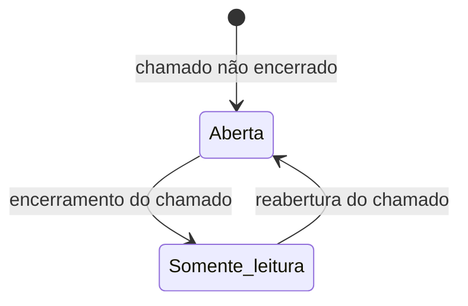
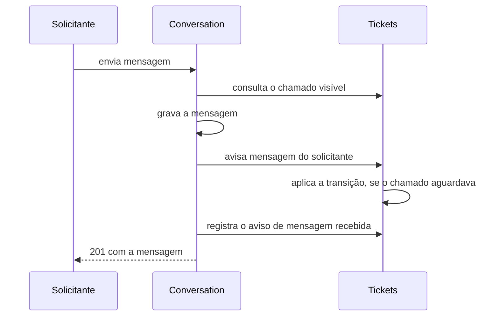
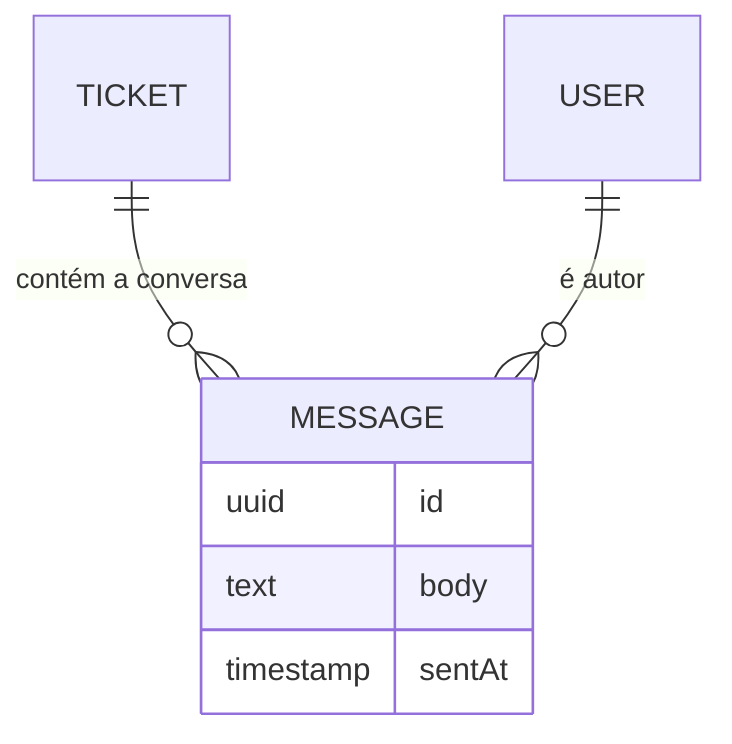

# Especificação Funcional — U3 Conversa (`u3-conversation`)

Derivado de `unit-of-work.md` e `unit-of-work-story-map.md` (em `../../../inception/units-generation/`), `requirements.md` (em `../../../inception/requirements-analysis/`), `components.md` (em `../../../inception/domain-design/`), `contract-summary.md` (em `../../../inception/contract-design/`), do desenho e do código de U1 e U2, e das respostas confirmadas em `functional-design-questions.md`.

Este documento é a fonte da verdade dos **fluxos** e das **máquinas de estado** de U3. O modelo de dados está em `entities.md` e as regras em `rules.md`; o diagrama de entidades e o resumo de regras abaixo são visões derivadas desses dois arquivos.

## Escopo da Unidade

- **História principal:** US1.4 (conversar dentro do chamado).
- **Critérios de outras histórias realizados aqui:** AC1.3.4 na parte da aba de mensagens; AC1.5.1 no evento de mensagem recebida; AC2.1.3 na parte das mensagens e AC2.1.7; AC2.2.3 e AC2.2.5; AC2.3.2 no gatilho; AC4.1.5 na parte das mensagens; AC5.1.1 e AC5.1.2 nas rotas novas; AC5.2.1 e AC5.2.2 no recurso de mensagens; US5.3 e US5.4 na aba nova.
- **Bloco:** Conversation.
- **Entidade:** Message.
- **Fora de U3:** o ciclo de vida do chamado, o histórico, as passagens por setor e a gravação da notificação, todos de U2; indicadores (U4) e avaliação (U5).

## Atores

| Ator | Perfil | O que faz em U3 |
|------|--------|-----------------|
| Solicitante | STUDENT, PROFESSOR | Lê e escreve na conversa do próprio chamado |
| Atendente responsável | AGENT | Lê e escreve na conversa do chamado que atende |
| Atendente do setor, não responsável | AGENT | Lê a conversa dos chamados do setor; não escreve |
| Gestor | MANAGER | Lê e escreve na conversa dos chamados do seu setor |
| Atendente ou Gestor de setor de passagem | AGENT, MANAGER | Lê a conversa de chamado que passou pelo seu setor; não escreve |
| Administrador | ADMIN | Nada: a conversa responde como chamado inexistente |

---

## Fluxos

### WF1 — Ler a conversa

1. O ator abre a aba Conversa no detalhe do chamado. A aba é oferecida ao solicitante e a todo Atendente e Gestor, nunca ao Administrador; quem não lê descobre pelo 404 da primeira leitura, que retira a aba (BR5.1).
2. O sistema obtém os fatos do chamado pelo serviço público de U2; chamado inexistente ou invisível responde 404 idêntico (BR1.1).
3. O sistema aplica a regra de leitura sobre esses fatos: solicitante, responsável atual, ou Atendente ou Gestor do setor atual ou de um setor de passagem (BR1.2). Administrador recebe 404 (BR1.4).
4. O sistema lê as mensagens do chamado em ordem cronológica, paginadas (BR3.1, BR3.2).
5. O sistema resolve o nome de cada autor pelo serviço público de U1, inclusive de usuários desativados (BR3.3).
6. A aba mostra os balões com autor e momento, e o campo de envio conforme a permissão e a situação do chamado (BR5.2).

### WF2 — Enviar mensagem

1. O ator escreve no campo e envia (BR5.2).
2. Na fronteira HTTP, a validação de forma do corpo acontece **antes** das recusas de regra: um corpo fora de 1 a 2000 caracteres responde 400 mesmo para quem não lê o chamado ou em chamado encerrado. Não revela nada, porque a validação de forma não consulta o chamado. A ordem descrita nos passos seguintes é a das recusas de regra, verificada no serviço, que também revalida o corpo como guarda de chamada direta.
3. O sistema obtém os fatos do chamado e aplica a regra de leitura; quem não lê recebe 404 (BR1.1, BR1.2, BR1.4).
4. O sistema aplica a regra de escrita: solicitante, responsável atual ou Gestor do setor atual. Quem lê mas não escreve recebe 403 (BR1.3).
5. O sistema recusa com 409 `MESSAGE_TICKET_CLOSED` se o chamado está encerrado (BR2.2).
6. O sistema revalida o corpo: de 1 a 2000 caracteres depois de remover espaços nas pontas (BR2.1).
7. Dentro de uma única transação (BR4.1):
   1. grava a mensagem com autor e momento (BR2.3);
   2. chama o aviso de mensagem do solicitante no serviço de U2, que devolve o chamado a Em análise quando ele aguardava o solicitante (BR4.2);
   3. registra o aviso de mensagem recebida para os destinatários da regra, nunca para o autor (BR4.3).
8. O sistema responde 201 com a mensagem gravada; a aba a acrescenta ao fim da conversa e limpa o campo.

### WF3 — Falha no envio

1. O envio falha por rede, por 5xx ou por recusa da regra.
2. A tela mantém o texto digitado e marca o balão como "Não enviado", com ação de tentar novamente (BR5.3).
3. Recusa de regra mostra a mensagem traduzida do código de erro: encerrado, sem permissão ou corpo inválido (BR5.7).
4. Nada foi gravado: nem mensagem, nem transição, nem notificação (BR4.1).

### WF4 — Conversa longa e atualização

1. A aba pede a primeira página em ordem decrescente, com as últimas 50 mensagens, e as exibe em ordem cronológica; "Carregar mensagens anteriores" busca a página seguinte (BR3.2, BR5.4).
2. A conversa é recarregada ao abrir a aba, depois de cada envio e pelo botão "Atualizar" (BR5.5).
3. Mensagens novas trazidas por essas cargas são anunciadas na região de anúncio educado (BR5.5, BR5.6).

---

## Máquinas de Estado

U3 não tem máquina de estados própria: a mensagem nasce gravada e imutável (BR2.3). O que muda o comportamento da conversa é o status do chamado, que pertence a U2.

### SM1 — Efeito do status do chamado sobre a conversa

<!-- Text fallback: enquanto o chamado não está encerrado, a conversa aceita mensagens novas de quem pode escrever. Quando o chamado é encerrado, a conversa passa a somente leitura e o envio é recusado. Se o chamado é reaberto, a conversa volta a aceitar mensagens. A leitura nunca é interrompida para quem tem acesso. -->

| Situação do chamado | Leitura | Envio |
|---------------------|---------|-------|
| Aberto, Em análise, Aguardando solicitante | Permitida a quem vê o chamado (BR1.2) | Permitido a quem escreve (BR1.3) |
| Encerrado | Permitida | Recusado com 409 `MESSAGE_TICKET_CLOSED` (BR2.2) |

### SM2 — Efeito da mensagem sobre o status do chamado

<!-- Text fallback: o solicitante envia a mensagem; U3 consulta o chamado visível em U2, grava a mensagem, avisa U2 da mensagem do solicitante — e U2 aplica a transição de Aguardando solicitante para Em análise, se for o caso —, registra a notificação pelo serviço de U2 e responde com a mensagem gravada. Todos os passos de escrita ocorrem na mesma transação. -->

---

## Diagrama de Entidades (derivado de `entities.md`)

<!-- Text fallback: cada mensagem pertence a exatamente um chamado e tem exatamente um autor. Chamado é entidade de U2 e usuário é entidade de U1; a chave estrangeira existe só na tabela de mensagens. -->

## Resumo das Regras (derivado de `rules.md`)

| Grupo | Regras | Tema |
|-------|--------|------|
| BR1 | BR1.1 a BR1.4 | Acesso: chamado visível, quem lê, quem escreve, Administrador fora |
| BR2 | BR2.1 a BR2.3 | Corpo da mensagem, chamado encerrado, imutabilidade |
| BR3 | BR3.1 a BR3.3 | Ordem, paginação e autores |
| BR4 | BR4.1 a BR4.4 | Transação única, retorno automático, notificação, fronteira entre unidades |
| BR5 | BR5.1 a BR5.7 | Aba, campo de envio, estados, conversa longa, atualização, acessibilidade, tradução de erro |

## Contratos Consumidos de Outras Unidades

| Contrato | Método | Para que U3 usa |
|----------|--------|-----------------|
| SVC-03 (U2) | `getVisibleTicket` | Existência, visibilidade e situação do chamado: solicitante, responsável, setor atual, setores de passagem e status (BR1.1, BR1.2, BR2.2) |
| SVC-03 (U2) | `onRequesterMessage` | Pedir o retorno automático de status depois de gravar a mensagem do solicitante (BR4.2) |
| SVC-03 (U2) | `NotificationsPublicService.record` | Registrar o aviso `MESSAGE_RECEIVED` para os destinatários (BR4.3) |
| SVC-02 (U1) | `findSummariesByIds` | Nome do autor de cada mensagem, inclusive de usuário desativado (BR3.3) |
| SVC-02 (U1) | Ator e decorators de rota | Perfil do ator e marcação de perfil das rotas novas (BR1.3, AC5.1.1) |
| Infraestrutura de U2 | Transação ambiente | Gravar mensagem, transição e notificação juntas (BR4.1) |

## Divergências em Relação a Artefatos Anteriores

| Artefato | O que diverge | Decisão que causa |
|----------|---------------|-------------------|
| `contract-summary.md`, API-U3 | `x-actor-rule` de `listMessages` e de `sendMessage` deixam de valer para o Administrador, que recebe 404 nas duas | Q2 |
| `contract-summary.md`, API-U3 `sendMessage` | A regra de ator do envio é mais estreita que a da leitura: solicitante, responsável atual e Gestor do setor atual. Atendente do setor que não assumiu, e leitor por passagem, recebem 403 | Q1 |
| `contract-summary.md`, API-U3 `sendMessage` | `body` passa a ter máximo de 2000 caracteres; o contrato trazia só o mínimo de 1 | Q3 |
| `wireframes.md`, Tela 5 | A aba Conversa não é a primeira nem a padrão: o detalhe abre em Detalhes, como U2 implementou; a ordem das abas passa a ser Detalhes, Histórico e Conversa | Implementação de U2 |
| `contract-summary.md`, SVC-03 `onRequesterMessage` | O comentário do método diz que ele notifica o responsável; na implementação de U2 e neste desenho ele não notifica, porque BR4.3 de U3 já avisa o responsável na mesma operação e dois avisos ao mesmo destinatário violariam BR6.1 de U2. É a mesma divergência registrada no desenho de U2 | BR4.2, BR4.3 |
| `contract-summary.md`, API-U3 `listMessages` | A forma da operação muda por adição: parâmetro novo `order`, com `asc` e `desc` e padrão `asc`, para a aba pedir a página mais recente numa única chamada. A convenção de X-01 já previa `sort`/`order` onde houvesse ordenação; foi esta operação que não os adotou no desenho de contratos. Consequência a registrar: a descrição da resposta `200` no contrato ("Messages in chronological order") deixa de valer literalmente com `order=desc`, quando a API responde em ordem inversa e é a tela que reordena para exibir | BR3.2, BR5.4, Q6 |

## Cobertura Parcial de Critérios

Critérios que U3 realiza só em parte, conforme `unit-of-work-story-map.md`. A parte restante é rastreada pela unidade indicada.

| Critério | Parte realizada em U3 | Parte realizada em outra unidade |
|----------|-----------------------|----------------------------------|
| AC1.3.4 | Aba de mensagens do detalhe (BR5.1) | Descrição, metadados e histórico em abas — U2 |
| AC1.5.1 | Notificação de mensagem recebida (BR4.3) | Notificação de status, responsável e setor — U2 |
| AC2.1.3 | Mensagens do chamado que passou pelo setor, em leitura (BR1.2) | Visibilidade do próprio chamado — U2 |
| AC2.3.2 | Gatilho da mensagem do solicitante e o pedido a U2 (BR4.2) | Transição e histórico — U2 |
| AC4.1.5 | Mensagens de usuário desativado continuam legíveis com o nome dele (BR3.3) | Login recusado — U1; chamados visíveis — U2 |
| AC5.1.1, AC5.1.2 | Teste de 403 e de acesso alheio nas rotas novas de U3 (BR1.2, BR1.3) | Mecanismo de negação por padrão e enumeração de rotas — U1 |
| AC5.3.1 a AC5.3.6, AC5.4.1 | A aba Conversa no roteiro de inspeção manual e nos testes de componente (BR5.6) | Casca, tema e telas anteriores — U1 e U2 |

## Implicações de Segurança

| Decisão | Risco tratado | Risco que permanece |
|---------|---------------|---------------------|
| Acesso derivado de `getVisibleTicket` (BR1.1) | Regra de visibilidade duplicada e divergente entre unidades, que é o jeito típico de vazar dado entre setores | U3 depende de U2 responder corretamente; o teste de acesso alheio existe nos dois lados |
| 404 idêntico para quem está fora da regra (BR1.1, BR1.2, BR1.4) | Descoberta da existência de chamado alheio pela rota de mensagens (AC2.1.7) | — |
| Escrita mais estreita que a leitura (BR1.3) | Alguém que só acompanha o caso responder ao solicitante em nome do setor | O Gestor escreve sem assumir; é decisão explícita, e a autoria fica registrada na mensagem |
| Administrador fora da conversa (BR1.4) | Leitura de conteúdo pessoal por quem administra o sistema | O Administrador continua vendo título, descrição e histórico do chamado |
| Texto puro, sem interpretar marcação (BR2.1) | Injeção de conteúdo ativo pela mensagem, que é texto de usuário exibido a outro usuário | — |
| Mensagem imutável (BR2.3) | Reescrita da conversa depois do fato | Uma mensagem enviada por engano não pode ser retirada; é consequência aceita de FR6.4 |
| Tudo na mesma transação (BR4.1) | Mensagem sem transição, ou notificação de mensagem que não existe | — |

## Assumptions & Open Questions

- [assumption] O Gestor do setor escreve sem assumir o chamado, e isso não o torna responsável; a autoria da mensagem fica registrada nela.
- [assumption] Um responsável que deixou de pertencer ao setor não alcança a conversa, porque a visibilidade de U2 já o exclui; a marca de responsável indisponível continua aparecendo no chamado.
- [assumption] A aba Conversa não mostra contagem de mensagens não lidas: não existe marca de leitura por mensagem, e o aviso de mensagem recebida já cumpre esse papel.
- [assumption] Mensagens não são apagadas quando um usuário é desativado, nem anonimizadas; a conversa precisa continuar legível (AC4.1.5).
- [assumption] O limite de 2000 caracteres é validado no cliente e no servidor com a mesma contagem de caracteres, depois de remover espaços nas pontas.
- [assumption] AC1.4.5 condiciona o aviso a "quando o chamado tem responsável", então não avisar ninguém num chamado sem responsável preenche a lacuna que o critério deixou aberta, em vez de contrariá-lo; a decisão é a da Q4, e por isso não entra na tabela de divergências.

## Review

**Verdict:** READY
**Reviewer:** aidlc-architecture-reviewer-agent
**Date:** 2026-10-05T12:34:38Z
**Iteration:** 1
**Request Challenge:** review:6d78a6815647a48c712124d21d1a5456

### Findings

| ID | Severity | Location | Finding | Required action | Status |
|---|---|---|---|---|---|
| R-01 | Major | `rules.md` BR4.2; `functional-spec.md` > Divergências, linha SVC-03 `onRequesterMessage` | Verificado contra o código de U2: `onRequesterMessage` não notifica ninguém no próprio comentário; a operação `REQUESTER_MESSAGE` retorna lista vazia de `planTicketNotifications`. A divergência declarada bate com o comportamento implementado: um único aviso `MESSAGE_RECEIVED`, emitido só por BR4.3 de U3. | — | Resolved |
| R-02 | Major | `rules.md` BR5.1; `frontend-components.md` > ConversationTab, "Abrir a aba" | Verificado: o detalhe não expõe `passedSectorIds` ao cliente. BR5.1 declara o mecanismo real — a aba é oferecida de forma ampla (solicitante e todo AGENT/MANAGER, nunca ADMIN) e o 404 da primeira leitura a retira — com a proteção real em BR1.2/BR1.4 no servidor. | — | Resolved |
| R-03 | Major | `rules.md` BR3.2, BR5.4; `functional-spec.md` > Divergências, linha `order` | O parâmetro aditivo `order` (`asc`/`desc`, padrão `asc`) resolve o problema original: `listMessages` do contrato só referenciava `Page`/`PageSize`. O registro como mudança aditiva ao contrato de U3 é a forma correta, e BR5.4/WF4 descrevem o algoritmo. | — | Resolved |
| R-04 | Minor | `rules.md` BR4.3 | BR4.3 traz a guarda explícita: "Mensagem do solicitante: o responsável atual, se houver; sem responsável, ninguém, porque o chamado já está na fila do setor." | — | Resolved |
| R-05 | Minor | `functional-spec.md` > Assumptions & Open Questions | A linha de AC1.4.5 saiu da tabela de divergências e passou a assumption, com justificativa correta. | — | Resolved |
| R-06 | Major | `rules.md` BR3.1 e BR3.2; `functional-spec.md` WF4; `frontend-components.md` > "Pontos de Integração com a API" | Continua válido como lacuna de desenho, com a metade mais grave refutada pelo código. BR3.1 segue declarando o desempate por identificador só para a ordem crescente ("Ordem por sentAt crescente e, em empate, por identificador"), e nenhum artefato registra o deslocamento de janela da paginação por offset. O código já depende do que o desenho não diz: `apps/api/src/conversation/conversation.service.ts` ordena por `[{ sentAt: order }, { id: order }]`, com o desempate na mesma direção da ordem pedida, e `apps/api/prisma/schema.prisma` linha 280 documenta `@@index([ticketId, sentAt, id])` como "Serves both reading orders and the identifier tie-break of each one (BR3.1, BR3.2)", citando duas regras que não declaram esse desempate. Quanto à perda de mensagem: refutada. Como a mensagem é imutável e nunca apagada (BR2.3) e entra sempre no início da ordem decrescente, a janela deslizada só pode repetir mensagem já carregada, nunca esconder uma; `mergeMessagePages`, em `apps/web/src/features/conversation/conversation-api.ts`, descarta identificadores repetidos. O risco residual é de desenho, não de execução. | Declarar em BR3.1 o desempate por identificador também para a ordem decrescente, simétrico ao de `asc`, e registrar em BR3.2 ou em WF4 por que a paginação por offset é segura aqui: coleção somente-adição, entrada sempre no início da ordem decrescente e junção das páginas descartando identificadores repetidos. | Resolved |
| R-07 | Minor | `rules.md` BR3.2 | Continua válido. BR3.2 ainda afirma "a paginação de X-01 não tem ordenação", contradito por `contract-summary.md` linha 51: "Listas aceitam `page` (a partir de 1), `pageSize` (padrão 20, máximo 100) e, onde houver ordenação, `sort` (nome do campo) e `order` (`asc` ou `desc`)" — e a linha 743 do mesmo arquivo já usa `order` em outra operação. A lacuna real era a operação `listMessages` de API-U3 não ter adotado esses parâmetros. BR3.2 também segue introduzindo `order` sem `sort` e sem justificar a omissão; a justificativa existe apenas no código (`apps/api/src/conversation/dto/message-input.dto.ts`: "`sort` is omitted because `sentAt` is the only sortable field"), não no desenho. | Reformular a frase para atribuir a lacuna à operação `listMessages` de API-U3, e registrar em BR3.2 por que `sort` é omitido, sendo `sentAt` o único campo ordenável. | Resolved |
| R-08 | Minor | `functional-spec.md` > Divergências em Relação a Artefatos Anteriores, as duas linhas de `API-U3 listMessages` | Contradição interna na mesma tabela: uma linha afirma que "a operação continua cronológica e paginada, sem mudança de forma", enquanto a outra registra "Parâmetro novo `order`" — acrescentar um parâmetro de consulta é mudança de forma da operação. Além disso, a resposta `200` de `listMessages` em `contract-summary.md` linha 1175 é descrita como "Messages in chronological order", e com `order=desc` a API responde em ordem inversa, sendo a tela quem reordena; essa consequência sobre a descrição do contrato não está registrada em nenhuma linha da tabela. | Reconciliar as duas linhas numa só, declarando que a forma muda por adição, e registrar que a descrição da resposta `200` de `listMessages` deixa de valer literalmente quando `order=desc`. | Resolved |
| R-09 | Minor | `functional-spec.md` WF2, passos 2 a 5 | WF2 fixa a ordem de recusa como acesso (404), escrita (403), encerrado (409) e só então validação do corpo (400). A API implementada inverte os dois extremos: `apps/api/src/app.setup.ts` linha 41 registra um `ValidationPipe` global, então `SendMessageDto` valida o corpo antes de o controlador chamar o service — um corpo vazio ou acima de 2000 caracteres responde 400 mesmo em chamado encerrado ou para quem não lê. Sem consequência de segurança, porque a validação de forma não depende do chamado e não revela sua existência, mas o desenho descreve uma precedência de erro que o sistema não produz, e a revalidação dentro do service sugere que a ordem de WF2 é observável. | Declarar em WF2 que a validação de forma do corpo precede as recusas de regra na fronteira HTTP, e manter a revalidação no service apenas como guarda de chamada direta. | Resolved |
| R-10 | Minor | `rules.md` BR3.2, última frase | O desenho aceita um risco em primeira pessoa: "Aceitamos o deslocamento em vez de paginação por cursor". O reparo pedido por R-06 era registrar por que o deslocamento é inofensivo aqui, e isso está feito; declarar a aceitação do risco residual, porém, é decisão do portão, e a Q6 nunca ofereceu ao autor a escolha entre deslocamento e cursor — ela decidiu só o formato da tela (últimas 50 e "Carregar mensagens anteriores"). Atenuante verificado: a paginação por deslocamento não é escolha livre desta unidade, é a convenção transversal de listas de `contract-summary.md` linha 51 (`page`, `pageSize`), já aprovada antes desta etapa; o que falta afirmar é apenas a consequência residual. | Reformular a frase para apresentar o deslocamento como consequência da convenção de X-01 e o risco residual como ponto a afirmar no portão, em vez de aceito pelo desenho. | New |
| R-11 | Major | `functional-spec.md` WF3, passo 4; `rules.md` BR5.3 | WF3 passo 4 garante "Nada foi gravado: nem mensagem, nem transição, nem notificação (BR4.1)" para qualquer envio que falhe, incluindo a falha de rede do passo 1. A garantia não se sustenta no tempo limite do cliente: `apps/web/src/app/api/api-client.ts` linha 3 aborta a requisição em `REQUEST_TIMEOUT_MS = 15_000`, enquanto `apps/api/src/common/prisma/transaction-runner.ts` linha 13 admite `maxWait: 5_000` mais `timeout: 15_000` — até 20 segundos entre pedir a transação e confirmá-la, sem contar o tempo anterior ao pedido. Um aborto por tempo limite chega ao cliente como erro de rede, não como `ApiError`, então `MessageComposer.tsx` linha 62 marca o balão "Não enviado" e oferece "Tentar novamente" (o comentário da linha 61 repete a garantia: "the message was never stored"). Se o servidor confirmou depois do aborto, a nova tentativa grava uma segunda mensagem e um segundo aviso `MESSAGE_RECEIVED`, e BR2.3 torna a duplicata impossível de remover: não existe rota de edição nem de exclusão. Não há chave de idempotência no envio. | Declarar em WF3 e em BR5.3 que a garantia de "nada foi gravado" vale para a recusa de regra e para o 5xx, mas não para o tempo limite do cliente, cujo desfecho é indeterminado; e decidir o tratamento — tempo limite do cliente maior que a janela da transação, chave de idempotência no envio, ou a duplicata como risco aceito no portão, com o aviso correspondente na tela. | New |
| R-12 | Minor | `functional-spec.md` WF3, passos 1 e 2; `rules.md` BR5.3 | WF3 inclui "recusa da regra" entre as falhas do passo 1 e, no passo 2, manda marcar o balão como "Não enviado" com ação de tentar novamente; BR5.3 repete isso sem distinguir o tipo de falha. O código reserva esse balão à falha de rede e ao 5xx (`apps/web/src/features/conversation/MessageComposer.tsx` linha 62 só marca o balão quando o erro não é `ApiError` ou tem status 500 ou maior), e trata 400, 403 e 409 como erro junto ao campo ou aviso de encerrado. O próprio `frontend-components.md`, seção "Enviar", descreve essa distinção corretamente, então a contradição é interna ao desenho. | Separar em WF3 e em BR5.3 as duas situações: recusa de regra mostra a mensagem traduzida junto ao campo, mantendo o texto digitado; falha de rede ou 5xx marca o balão "Não enviado" com "Tentar novamente". | New |
| R-13 | Minor | `functional-spec.md` WF2, passos 3 a 7 | WF2 coloca a leitura do chamado e as três recusas (404, 403, 409) fora da transação, que começa só no passo 7. O código abre a transação ambiente antes de tudo: `apps/api/src/conversation/conversation.service.ts` linha 97 chama `this.transactions.run` e só dentro dele executa `getVisibleTicket`, `sendRefusal` e a revalidação do corpo. A consequência é de leitura do desenho, não de correção: um envio recusado abre e desfaz uma transação, e o tempo limite de 15 segundos da transação passa a cobrir também a consulta a U2. | Declarar em WF2 que a transação ambiente envolve a operação de envio inteira — leitura dos fatos do chamado, recusas e escritas —, em vez de apenas as três escritas do passo 7. | New |
| R-14 | Minor | `functional-spec.md` WF2, numeração dos passos | A renumeração que atendeu R-09 deixou uma citação pendurada: `apps/api/src/conversation/rules/conversation-access.ts` linha 80 documenta `sendRefusal` como "WF2 steps 2 to 4, in this order", e esses passos agora são 3 a 5. Nenhuma outra citação de passo de WF2 ficou obsoleta dentro da pasta de desenho (verificado por busca em `functional-design/`). | Registrar a renumeração como divergência a corrigir no comentário de `conversation-access.ts`, para que a citação volte a apontar os passos 3 a 5. | New |

### Validation Tool Results

| Tool | Result | Interpretation |
|---|---|---|
| — | A definição da etapa (`.claude/aidlc-common/stages/construction/functional-design.md`) não lista ferramenta de validação executável pelo revisor; declara apenas sensores do motor (`required-sections`, `upstream-coverage`, `linter`, `type-check`, `traceability`) | Verificação feita por leitura cruzada do desenho contra o código de `apps/api/src/conversation/`, `apps/web/src/features/conversation/`, `apps/api/prisma/schema.prisma`, `apps/api/src/app.setup.ts`, `transaction-runner.ts` e os contratos de inception |

### Evidência da Verificação dos Reparos

- **R-06 — Resolved.** BR3.1 (linhas 103 a 105) declara o desempate por identificador acompanhando a direção pedida, exatamente como `conversation.service.ts` linha 78 ordena por `sentAt` e por `id` na mesma direção, o que valida também o comentário do índice `@@index([ticketId, sentAt, id])` em `schema.prisma` linha 280. BR3.2 (linhas 123 a 127) registra o deslocamento da janela e os três fatos que o tornam inofensivo — coleção somente-adição, entrada sempre no início da ordem decrescente, junção descartando identificador repetido —, confirmados em `conversation-api.ts` (`mergeMessagePages`). A ressalva de método virou R-10.
- **R-07 — Resolved.** BR3.2 (linhas 119 a 122) atribui a lacuna à operação `listMessages` de API-U3, sem generalizar X-01, e justifica a omissão de `sort` por `sentAt` ser o único campo ordenável — a mesma razão que estava só em `dto/message-input.dto.ts`. Confere com `contract-summary.md` linha 51, que já previa `sort` e `order` onde houvesse ordenação.
- **R-08 — Resolved.** A tabela de divergências tem agora uma única linha de `listMessages` (linha 153): declara a mudança de forma por adição e registra que a descrição da resposta `200` do contrato ("Messages in chronological order", bloco API-U3 de `contract-summary.md`) deixa de valer literalmente com `order=desc`.
- **R-09 — Resolved.** WF2 ganhou o passo 2 declarando a validação de forma na fronteira HTTP, coerente com o `ValidationPipe` global de `app.setup.ts` linha 41, e aponta a revalidação do serviço como guarda de chamada direta. A renumeração está íntegra: passos 1 a 8, sem repetição nem salto. O efeito colateral da renumeração sobre o comentário do código virou R-14.
- **Refutados, sem achado.** O `400` e o `401` de `listMessages` (declarados em `conversation.controller.ts`) não são superfície não declarada: X-01 fixa os dois como convenção de toda operação HTTP (`contract-summary.md` linhas 37, 44 e 72), e BR3.2 já declara o `400` de paginação inválida. O código de erro `MESSAGE_TICKET_CLOSED` consta do catálogo de X-01 (`contract-summary.md` linha 105), não é código novo sem registro. A superfície de consulta de `listMessages` é exatamente `page`, `pageSize` e `order` (`ListMessagesQueryDto` estende `PageQueryDto`, sem outro campo), e os campos de resposta batem com `entities.md` e com o modelo `Message` de `schema.prisma`.
