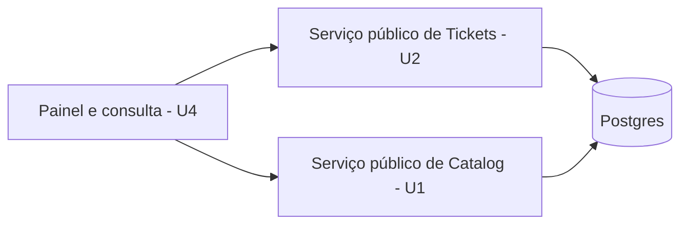

# Especificação Funcional — U4 Indicadores (`u4-reporting`)

Derivado de `unit-of-work.md` e `unit-of-work-story-map.md` (em `../../../inception/units-generation/`), `requirements.md` (em `../../../inception/requirements-analysis/`), `components.md` e `decisions.md` (em `../../../inception/domain-design/`), `contract-summary.md` (em `../../../inception/contract-design/`), `wireframes.md` (Tela 9), do desenho e do código de U1, U2 e U3, e das respostas confirmadas em `functional-design-questions.md`.

Este documento é a fonte da verdade dos **fluxos** e dos **cálculos** de U4. Os modelos de leitura estão em `entities.md` e as regras em `rules.md`.

## Escopo da Unidade

- **Histórias principais:** US6.1 (acompanhar o desempenho do setor) e US6.2 (consultar listagens filtradas).
- **Critérios de outras histórias realizados aqui:** AC5.1.1 e AC5.1.2 nas rotas novas; US5.3 e US5.4 nas telas novas.
- **Bloco:** Reporting.
- **Entidades:** nenhuma. U4 não grava e não é dona de dado.
- **Fora de U4:** o ciclo de vida do chamado e suas agregações de base (U2); a avaliação (U5), que estende esta unidade se for construída.

## Atores

| Ator | Perfil | O que faz em U4 |
|------|--------|-----------------|
| Gestor | MANAGER | Abre o painel e a consulta filtrada, restritos ao que ele vê: setor atual e chamados que passaram pelo setor |
| Administrador | ADMIN | Abre o painel, com todos os chamados e o gráfico por setor; não usa a consulta filtrada |
| Demais perfis | STUDENT, PROFESSOR, AGENT | Nada: as rotas respondem 403 |

---

## Fluxos

### WF1 — Abrir o painel

1. O Gestor ou o Administrador abre o item "Painel" (BR7.5).
2. A tela envia o período padrão dos últimos 30 dias (BR7.2).
3. O sistema valida o período: fechado no início, aberto no fim, em UTC (BR2.1).
4. O sistema pede a U2 as contagens por status, por categoria e — só para o Administrador — por setor, sempre recortadas pela abertura do chamado e filtradas pela visibilidade do ator (BR1.2, BR3.1).
5. O sistema resolve os rótulos pelo catálogo de U1, inclusive de itens desativados (BR3.3), e lê a lista de status de U1 para completar com zero os status sem chamado no período (BR7.1).
6. O sistema pede a U2 os tempos médios do período, calculados sobre os chamados encerrados (BR4.1 a BR4.3).
7. A tela mostra os cartões e os gráficos; o estado vazio explicativo só aparece quando as duas populações do período estão vazias — nenhum chamado aberto no recorte das contagens e nenhum encerrado no recorte dos tempos —, e não no lugar de zeros legítimos (BR2.2, BR7.3).

### WF2 — Trocar o período

1. O ator escolhe outro período no seletor.
2. A escolha vai para a URL, e todas as consultas do painel são refeitas com o novo recorte (BR7.2).
3. Os números passam a refletir apenas aquele período (AC6.1.2).

### WF3 — Consultar a listagem filtrada

1. O Gestor abre a aba Consulta; o Administrador não a vê (BR1.1, BR7.5).
2. O Gestor combina filtros de status, categoria, setor e período.
3. O sistema busca os chamados pelo serviço de U2, que aplica a visibilidade dentro da consulta, e devolve a página com a contagem total (BR5.1).
4. A tela lista os chamados; não há ação de exportar nem rota de download (BR5.2).

### WF4 — Perfil sem direito

1. Um Aluno, Professor ou Atendente tenta abrir uma rota de U4.
2. A marcação de perfil da rota recusa antes de qualquer consulta, com 403 (BR1.1).
3. O item "Painel" não aparece na navegação desses perfis; a proteção real é a da rota.

---

## Cálculos

Esta seção fixa a pendência que a revisão de requisitos deixou em aberto (achado R-06) e que `unit-of-work.md` mandou resolver antes da construção.

### CA1 — Tempo de atendimento

```
atendimento(chamado) = momento da primeira entrada de histórico de responsável − momento de abertura
```

- A primeira entrada de responsável é a primeira vez que o chamado deixou de estar sem responsável, por "assumir" ou por "atribuir" (BR4.1).
- Um chamado que foi encerrado sem nunca ter tido responsável não entra nesta média, e só nesta.
- Transferência não zera o marco: o que conta é a **primeira** atribuição da vida do chamado.

### CA2 — Tempo de resolução

```
resolução(chamado) = momento do encerramento mais recente − momento de abertura
```

- Um chamado reaberto e encerrado de novo conta uma vez, pelo encerramento mais recente (BR4.2).
- O tempo de resolução inclui, por construção, todo o tempo em que o chamado esteve aguardando o solicitante.

### CA3 — Amostra e recorte

| Número | Quem entra | O que o período recorta |
|--------|------------|-------------------------|
| Contagens por status, categoria e setor | Chamados visíveis ao ator | A **abertura** do chamado |
| Tempo médio de resolução | Chamados visíveis já encerrados | O **encerramento** mais recente |
| Tempo médio de atendimento | O subconjunto desses que teve responsável | O **encerramento** mais recente |
| Listagem filtrada | Chamados visíveis ao ator | A **abertura** do chamado |

Os dois recortes são diferentes de propósito: contagem responde "quanto entrou no período", e tempo médio responde "o que fechou no período levou quanto tempo". A tela diz isso em texto, ao lado dos cartões de tempo, para o número não ser lido como se fosse do mesmo recorte das contagens.

Cada média vem com a sua própria amostra: a de resolução conta todos os chamados encerrados do período, e a de
atendimento conta apenas os que chegaram a ter responsável. Sem amostra, a média correspondente vem vazia e a sua
contagem é zero; a tela mostra um traço e a explicação, nunca zero (BR2.2, BR4.3).

---

## Diagrama de Dependências



<!-- Text fallback: o painel e a consulta de U4 falam apenas com o serviço público de chamados de U2 e com o serviço público de catálogo de U1; são esses dois que tocam o banco. U4 não acessa o banco diretamente e não é dona de nenhuma tabela. -->

## Resumo das Regras (derivado de `rules.md`)

| Grupo | Regras | Tema |
|-------|--------|------|
| BR1 | BR1.1 a BR1.3 | Perfis, visibilidade e Gestor sem setor |
| BR2 | BR2.1 e BR2.2 | Período e resultado vazio |
| BR3 | BR3.1 a BR3.3 | Contagens, total e rótulos |
| BR4 | BR4.1 a BR4.4 | Os dois tempos, a amostra e a ausência de meta |
| BR5 | BR5.1 e BR5.2 | Listagem filtrada e ausência de exportação |
| BR6 | BR6.1 e BR6.2 | Fronteira entre unidades e extensão aditiva |
| BR7 | BR7.1 a BR7.6 | Painel, período, estados, acessibilidade e navegação |

## Contratos Consumidos de Outras Unidades

| Contrato | Método | Para que U4 usa |
|----------|--------|-----------------|
| SVC-05 (U2) | `countTickets` | Contagem por status, categoria ou setor, com a visibilidade do ator aplicada na consulta (BR3.1) |
| SVC-05 (U2) | `getDurationAverages` | Tempos médios do período, com os marcos de CA1 e CA2 (BR4.1 a BR4.3) |
| SVC-05 (U2) | `searchTickets` | Listagem filtrada e paginada (BR5.1) |
| SVC-04 (U1) | `findLabels` | Nome de status, categoria e setor de cada grupo, inclusive itens desativados (BR3.3) |
| SVC-04 (U1) | Ator e decorators de rota | Perfil do ator e marcação de perfil das rotas novas (BR1.1) |

`countTickets` e `getDurationAverages` já estão declarados no contrato e foram adiados pelo desenho de U2; são implementados agora, dentro do módulo de U2, como extensão aditiva (BR6.2).

## Divergências em Relação a Artefatos Anteriores

| Artefato | O que diverge | Decisão que causa |
|----------|---------------|-------------------|
| `contract-summary.md`, API-U4 `getAverageDurations` | Os marcos ficam fixados: atendimento até a primeira atribuição de responsável, resolução até o encerramento mais recente. O contrato deixava isso para esta etapa | Q1, achado R-06 da revisão de requisitos |
| `contract-summary.md`, API-U4 | O recorte de período é diferente por número: abertura para contagens e listagem, encerramento para os tempos médios. O contrato usava um par `from`/`to` genérico, sem dizer sobre o quê | Q2 |
| `contract-summary.md`, API-U4 `getTicketCounts` | O agrupamento por setor é pedido apenas pelo painel do Administrador; a operação continua aceitando os três agrupamentos para os dois perfis | Q4 |
| `wireframes.md`, Tela 9 | Os cartões passam a ser um por status, com os quatro status sempre presentes, mais dois cartões de tempo — o desenho mostrava três status e um tempo | BR7.1 |
| `stories.md`, AC6.1.1 | A contagem por setor aparece na tela só para o Administrador; para o Gestor ela existiria com uma barra só. A operação de contagem por setor continua disponível aos dois perfis | Q4 |
| `contract-summary.md`, API-U4 `getAverageDurations` | O campo único `sampleSize` vira dois, `resolutionSampleSize` e `handlingSampleSize`, porque as duas médias têm populações diferentes: a de atendimento exclui o chamado que nunca teve responsável | BR4.3 |
| `contract-summary.md`, API-U4 `searchTicketsForReport` e SVC-05 | A listagem depende de `openedAt` em cada linha, e o tipo que `searchTickets` devolve (`TicketListRow`) não o trazia. O campo é extensão aditiva de SVC-05, escrita dentro do módulo de U2 pelo Bolt desta unidade, como já se faz para `countTickets` e `getDurationAverages` (BR6.2). Não é o mesmo campo do endpoint próprio de U2, cujo modelo (`TicketListItemView`) é outro | BR6.2, Bolt de U4 |

## Cobertura Parcial de Critérios

| Critério | Parte realizada em U4 | Parte realizada em outra unidade |
|----------|-----------------------|----------------------------------|
| AC6.1.1 | Contagem por status, categoria e setor na API, para Gestor e Administrador (BR3.1); na tela, o Gestor vê status e categoria, e o gráfico por setor é do Administrador (BR7.1) | Nenhuma: o critério é realizado inteiro na API, e só a exibição por setor é restrita, por decisão da Q4 |
| AC5.1.1, AC5.1.2 | Teste de 403 e de visibilidade para cada rota nova de U4 (BR1.1, BR1.2) | Mecanismo de negação por padrão e enumeração de rotas — U1 |
| AC5.3.1 a AC5.3.6, AC5.4.4 | As telas novas de U4 no roteiro de inspeção manual e nos testes de componente (BR7.4, BR7.6) | Casca, tema e telas anteriores — U1, U2 e U3 |

## Implicações de Segurança

| Decisão | Risco tratado | Risco que permanece |
|---------|---------------|---------------------|
| Visibilidade aplicada pelo serviço de U2, nunca recalculada aqui (BR1.2) | Número agregado revelando volume de setor alheio, que é o jeito de vazar informação sem vazar registro | Um método novo em U2 que esqueça o filtro afetaria também o painel; o teste de visibilidade existe dos dois lados |
| Agregações sem identificador de chamado (BR3.1) | Uma contagem não permite reconstruir quais chamados existem | Um grupo com contagem 1 revela que existe exatamente um chamado daquele tipo no recorte visível ao ator; aceito, porque o ator já pode abrir esse chamado |
| Listagem filtrada só para o Gestor (BR1.1) | Ampliar o alcance de leitura do Administrador sem decisão explícita | O Administrador continua lendo tudo pela listagem geral de U2 |
| Sem exportação (BR5.2) | Cópia de dados para fora do sistema sem rastro | Nada impede a pessoa de copiar da tela; é o limite aceito do escopo |
| Unidade somente leitura, sem tabela própria (BR6.1) | Escrita indevida a partir de um relatório | — |

## Assumptions & Open Questions

- [assumption] "Primeira atribuição" é a primeira entrada de histórico de responsável do chamado; como U2 grava essa entrada em toda troca de responsável, a primeira delas é o marco, e a transferência que remove o responsável não cria marco novo.
- [assumption] Um chamado aberto antes do período e encerrado dentro dele entra nos tempos médios com o intervalo inteiro, que pode ser maior que o próprio período.
- [assumption] O painel faz três consultas de contagem e uma de tempos; não há endpoint único que devolva o painel inteiro, para manter cada número explicável pela sua própria operação.
- [assumption] Os cartões de tempo mostram a quantidade de amostra ao lado, para que uma média calculada sobre poucos chamados não seja lida como tendência.
- [assumption] A listagem filtrada não traz coluna de tempo: ela responde "quais chamados", e os tempos ficam nos cartões.
- [assumption] O caso de Gestor sem setor (BR1.3) não é alcançável pela API, porque U1 exige setor para esse perfil; a regra fica como comportamento defensivo e é verificada no nível da regra, como já acontece com o código de fila sem setor em U2.

## Review

**Verdict:** READY
**Reviewer:** aidlc-architecture-reviewer-agent
**Date:** 2026-10-05T12:44:27Z
**Iteration:** 2
**Request Challenge:** review:e4a62e76065da9389ca1de42764aca38

### Findings

| ID | Severity | Location | Finding | Required action | Status |
|---|---|---|---|---|---|
| R-01 | Major | `rules.md` > BR4.3; `entities.md` > `DurationAveragesView`; `functional-spec.md` > CA3 | O reparo separou `resolutionSampleSize` e `handlingSampleSize` em todos os artefatos, com a explicação de que cada média tem sua própria amostra e população. Consistente ponta a ponta, e o código confirma: `apps/api/src/tickets/tickets.types.ts` (`DurationAverages`) e a consulta agregada de `getDurationAverages` devolvem as duas contagens. | Nenhuma. | Resolved |
| R-02 | Major | `entities.md` > `ReportTicketRow.source`; `functional-spec.md` > "Divergências em Relação a Artefatos Anteriores" (linha de `searchTicketsForReport`) | A lacuna de implementação foi fechada, mas por outro caminho, e o texto do desenho continua descrevendo-a errado. Verificado em primeira mão: `apps/api/src/tickets/tickets.types.ts` declara `openedAt` dentro de `TicketListRow` com o comentário "Additive field of the Bolt of U4", e `apps/api/src/reporting/reporting.service.ts` (`toReportRow`) consome `row.openedAt` desse tipo. Ou seja, o campo foi acrescentado pelo Bolt de U4, não "pela implementação de U2", e não veio "junto com `requester`" — `requester` está em `TicketListItemView` (o modelo do endpoint próprio de U2), e `TicketListRow` não tem esse campo. A natureza do achado mudou: não é mais desenho inimplementável, é desenho desatualizado em relação ao que foi construído. Nada quebra na execução; o que quebra é a rastreabilidade de quem estendeu o contrato de SVC-05. | Corrigir as duas frases para registrar o mecanismo real: `openedAt` é extensão aditiva de `TicketListRow` em SVC-05, feita dentro do módulo de U2 pelo Bolt de U4 (BR6.2), sem menção a `requester`. Alternativa aceita pelo portão: registrar a divergência texto-código e deixar o plano de código prevalecer, conforme a correção já aprendida no projeto sobre desenho congelado. | Resolved |
| R-03 | Major | `rules.md` > BR7.1; `functional-spec.md` > WF1; `frontend-components.md` > `IndicatorsTab` | Confirmado: `listStatuses` usa `@Roles(...ALL_ROLES)`, então Gestor e Administrador podem completar com zero os quatro status. O zero-fill funciona para os dois perfis, e `IndicatorsTab.tsx` o faz via `fillStatusCounts(statuses.data?.items ?? [], byStatus.data)`. | Nenhuma. | Resolved |
| R-04 | Minor | `rules.md` > BR1.3 | Confirmado contra `schema.prisma`: o CHECK exige `sector_id` para AGENT e MANAGER, então Gestor ativo sem setor é inalcançável pela API, e a regra vira comportamento defensivo declarado. | Nenhuma. | Resolved |
| R-05 | Minor | `functional-spec.md` > "Cobertura Parcial de Critérios"; `traceability.json` > `AC6.1.1` | A tabela de cobertura parcial declara que o gráfico por setor ao Gestor foi restringido por decisão (Q4) e que a API realiza o critério inteiro. Confirmado em `report-access.ts`: `ticketCounts` aceita `MANAGER` e `ADMIN`, e a restrição é só de exibição. | Nenhuma. | Resolved |
| R-06 | Minor | `rules.md` > BR2.2 | Não reparado. Reverificado no arquivo: BR2.2 ainda descreve o resultado vazio como "as duas médias vazias e amostra zero" (singular), enquanto BR4.3 e `entities.md` tratam a amostra como duas contagens distintas. Isoladamente, um leitor pode implementar um único campo de amostra no caminho de período vazio. | Reescrever para "as duas médias vazias, e as duas amostras (`resolutionSampleSize`, `handlingSampleSize`) zero". | Resolved |
| R-07 | Minor | `rules.md` > BR2.2 e BR7.3; `functional-spec.md` > WF1 passo 7 | Achado novo desta iteração. CA3 fixa dois recortes diferentes (contagens pela abertura, tempos médios pelo encerramento), mas a condição do estado vazio é escrita no singular — "período sem nenhum chamado visível", "se o período não tem nenhum chamado" — sem dizer qual das duas populações a decide. As duas podem divergir no mesmo período (nenhum chamado aberto, mas algum encerrado, e vice-versa). O desenvolvedor teve de escolher: `apps/web/src/features/reports/IndicatorsTab.tsx` implementa `hasNothing = byStatus.data?.total === 0 && durations.data?.resolutionSampleSize === 0`, ou seja, a conjunção das duas. A escolha é razoável e está no código, mas não está no desenho. | Declarar em BR2.2 ou BR7.3 qual condição dispara o estado vazio — a conjunção das duas populações, como o código faz — para que a regra deixe de admitir duas leituras. | Resolved |
| R-08 | Major | `rules.md` > BR2.1 (`logic`); `functional-spec.md` > WF1 passo 3 e "Divergências em Relação a Artefatos Anteriores" | O desenho afirma, em BR2.1, que "os dois limites são opcionais e independentes" e que "sem período, a consulta cobre todo o histórico; a tela sempre envia um período, com padrão de 30 dias (BR7.2)" — isto é, o padrão de 30 dias seria da tela. O código construído coloca o padrão no servidor: `apps/api/src/reporting/rules/report-period.ts` define `DEFAULT_PERIOD_DAYS = 30` e `resolveReportPeriod` usa o instante atual como fim quando o fim não vem, e o fim menos trinta dias como início quando o início não vem. Logo uma requisição sem limites devolve os últimos 30 dias, nunca "todo o histórico", e os limites não são independentes: o início omitido é calculado a partir do fim. Os DTOs confirmam a intenção ("Defaults to thirty days before the end (BR7.2)", em `dto/report-input.dto.ts`), e as quatro operações de API-U4 passam por essa resolução. Quem implementasse BR2.1 ao pé da letra escreveria uma consulta sem recorte, e um consumidor da API que omitisse `from` e `to` esperaria o histórico inteiro. | Reescrever a parte de BR2.1 que descreve a ausência de período para registrar o comportamento real: fim omitido é o instante atual, início omitido é 30 dias antes do fim, a resolução acontece na API (não só na tela) e vale para as quatro operações; ou, se o texto estiver congelado, registrar a divergência texto-código na tabela de divergências e deixar o plano de código prevalecer. | New |
| R-09 | Major | `functional-spec.md` > "Contratos Consumidos de Outras Unidades" e "Diagrama de Dependências"; `entities.md` > `ReportTicketRow.source` | A superfície consumida por U4 é maior do que o desenho declara. `apps/api/src/reporting/reporting.service.ts` injeta `UsersPublicService` e chama `findSummariesByIds` (no método privado `assigneeNames`) para resolver o nome do responsável de cada linha da listagem. O desenho lista apenas dois contratos consumidos — SVC-05 (`countTickets`, `getDurationAverages`, `searchTickets`) e SVC-04 (`findLabels` mais `Actor` e decorators) — e o diagrama de dependências mostra só o serviço de Tickets de U2 e o de Catalog de U1. O contrato compartilhado concorda com o desenho e não com o código: `inception/contract-design/contract-summary.md` enumera SVC-04 para U4 como "`Actor` e decorators de rota; `findLabels`", sem `findSummariesByIds`, que ele declara em `UsersPublicService` e lista para SVC-01 e SVC-02. `entities.md` apenas insinua a necessidade ("com rótulos e pessoas resolvidos na leitura"), sem dizer de qual contrato a pessoa vem. Resultado: a dependência de U4 sobre o serviço de usuários de U1 não aparece em lugar nenhum do desenho nem do contrato. | Acrescentar `UsersPublicService.findSummariesByIds` à tabela de contratos consumidos (como método de SVC-04 ou como contrato próprio), incluí-lo no diagrama de dependências e registrar na tabela de divergências que SVC-04, como declarado em `contract-summary.md`, não previa esse método. | New |
| R-10 | Minor | `rules.md` > BR1.1 e BR7.1; `functional-spec.md` > "Escopo da Unidade" e "Contratos Consumidos de Outras Unidades"; `frontend-components.md` > "Pontos de Integração com a API" | A extensão SVC-08 de U5 já aterrou dentro de U4 e o desenho de U4 não a registra além da frase "a avaliação (U5), que estende esta unidade se for construída". No código: `apps/api/src/reporting/rules/report-access.ts` — declarado no próprio arquivo como "single source of truth of BR1.1" — lista quatro operações, incluindo `ratingSummary` com `MANAGER` e `ADMIN`, enquanto BR1.1 só fala de contagens, tempos médios e listagem; `reporting.controller.ts` expõe `GET /reports/ratings` (`getRatingSummary`); `reporting.service.ts` injeta `RatingService`; e `apps/web/src/features/reports/IndicatorsTab.tsx` monta um terceiro cartão (`RatingCard`), roda uma quinta consulta (`useRatingSummary`) e exibe nota de período citando "a avaliação média" — contra `frontend-components.md`, que lista seis pontos de integração sem avaliação e assume que "o painel faz quatro consultas em paralelo". A implementação pertence a U5, logo não é defeito de execução; é o desenho de U4 descrevendo um painel de três operações onde o módulo expõe quatro. | Registrar na tabela de divergências de `functional-spec.md` que SVC-08 foi realizada: a operação `getRatingSummary` entrou em `report-access.ts` e no controller de U4, e o cartão de avaliação e a quinta consulta entraram em `IndicatorsTab`, tudo pelo Bolt de U5 — ou declarar explicitamente que o conteúdo da extensão é descrito apenas no desenho de U5. | New |
| R-11 | Minor | `rules.md` > BR7.1 (`statement`) e "Resumo das Regras" | O mesmo defeito de singular que motivou R-06 sobrevive em BR7.1: o `statement` diz "O painel tem cartões de quantidade por status, um cartão de tempo e gráficos de barras", enquanto o `logic` da própria regra, CA3, `frontend-components.md` ("um cartão por status, mais dois de tempo") e a tabela de divergências de `functional-spec.md` ("mais dois cartões de tempo") falam de dois cartões — resolução e atendimento, cada um com a sua amostra. O código tem os dois (`DurationCard` duas vezes em `IndicatorsTab.tsx`). Quem ler só a linha de `statement` implementa um cartão. | Trocar "um cartão de tempo" por "dois cartões de tempo, resolução e atendimento, cada um com a sua amostra" no `statement` de BR7.1. | New |
| R-12 | Minor | `rules.md` > BR3.1; `entities.md` > `TicketCountsView.groups` | A ordem dos grupos devolvidos por `getTicketCounts` é comportamento de resposta não declarado em nenhum artefato. O código a fixa: a chamada `groups.sort(...)` em `reporting.service.ts` ordena por quantidade decrescente e desempata pela comparação dos rótulos quando a contagem empata, com o comentário "Largest bar first, ties broken by label, so two identical requests answer the same order". A tela depende dessa ordem nos gráficos de barras (`BarChartWithTable` desenha na ordem recebida); só os cartões de status têm ordem declarada (`STATUS_ORDER`, BR7.1). Sem a regra escrita, uma reimplementação da operação pode devolver ordem arbitrária e mudar a leitura dos gráficos sem violar regra nenhuma. | Declarar em BR3.1 (ou em `entities.md`, no modelo `TicketCountsView`) que os grupos vêm ordenados por quantidade decrescente, com desempate pelo rótulo quando a contagem empata, para que a ordem dos gráficos seja contrato e não acidente. | New |

### Evidência da Verificação dos Três Reparos

| Reparo | Verificação | Resultado |
|---|---|---|
| R-02 | `entities.md` > `ReportTicketRow.source` agora diz que `openedAt` é extensão aditiva de `TicketListRow` em SVC-05, escrita no módulo de U2 pelo Bolt desta unidade (BR6.2), "do mesmo modo que countTickets e getDurationAverages", e que não vem de `TicketListItemView`; a linha de divergência de `functional-spec.md` repete o mesmo mecanismo. Nenhum dos dois textos menciona `requester` nem atribui o campo a U2. Código conferido: `apps/api/src/tickets/tickets.types.ts` tem `openedAt` em `TicketListRow` com o comentário "Additive field of the Bolt of U4", e `requester` só em `TicketListItemView`; `reporting.service.ts` (`toReportRow`) lê `row.openedAt`. | Texto e código coincidem |
| R-06 | BR2.2 agora lê "Tempos: as duas médias vazias, e as duas amostras (`resolutionSampleSize`, `handlingSampleSize`) zero", alinhada a BR4.3, ao modelo `DurationAveragesView` de `entities.md` e ao tipo `DurationAverages` do código. | Singular eliminado |
| R-07 | BR7.3 declara a conjunção: "o estado vazio exige as duas populações vazias no mesmo período: nenhum chamado aberto no recorte das contagens e nenhum encerrado no recorte dos tempos. Com uma só delas vazia, a tela mostra os números, e o zero é legítimo"; o passo 7 de WF1 diz o mesmo. `IndicatorsTab.tsx` implementa exatamente essa conjunção, exigindo total de contagens igual a zero e amostra de resolução igual a zero ao mesmo tempo. | Condição declarada, igual ao código |

### Resumo

Os três reparos desta iteração foram verificados contra o código e estão corretos: R-02, R-06 e R-07 passam a `Resolved`, e com isso os sete achados anteriores estão todos fechados. A caça à superfície não declarada rendeu dois achados Major novos — o padrão de 30 dias do período é resolvido na API, e não só na tela como BR2.1 afirma (R-08), e U4 consome `UsersPublicService.findSummariesByIds` sem que a tabela de contratos consumidos, o diagrama de dependências ou SVC-04 em `contract-summary.md` o declarem (R-09) — além de três Minor: a extensão de avaliação de U5 já aterrou nas operações e no painel sem registro no desenho de U4 (R-10), o `statement` de BR7.1 fala de um cartão de tempo onde há dois (R-11), e a ordenação dos grupos de contagem existe no código sem regra escrita (R-12). Nenhum achado é Critical, são dois Major, ambos de fidelidade do texto ao sistema construído, e nenhum impede a implementação: veredito READY.
