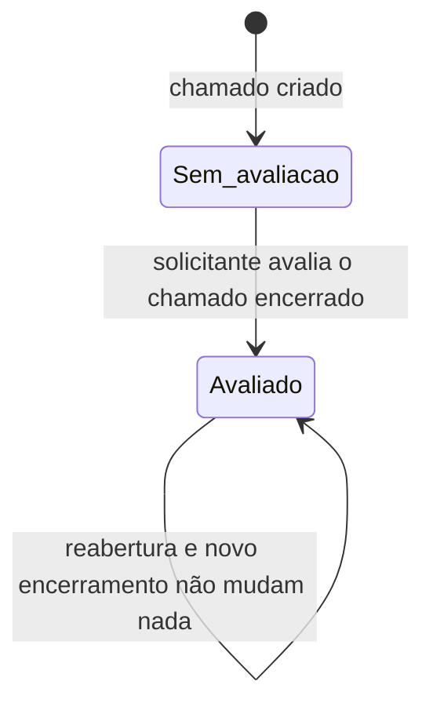
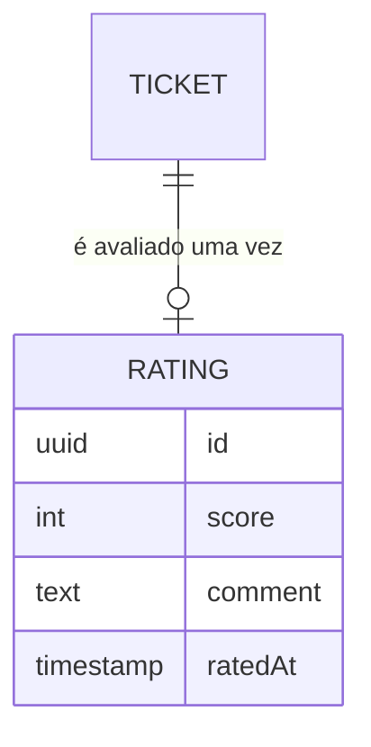

# Especificação Funcional — U5 Avaliação (`u5-rating`)

Derivado de `unit-of-work.md` e `unit-of-work-story-map.md` (em `../../../inception/units-generation/`), `requirements.md` (FR12), `components.md` e `decisions.md` (em `../../../inception/domain-design/`), `contract-summary.md` (X-01, API-U5, SVC-06, SVC-07, SVC-08, DB-01), do desenho e do código de U1, U2, U3 e U4, e das respostas confirmadas em `functional-design-questions.md`.

Este documento é a fonte da verdade dos **fluxos** e das **máquinas de estado** de U5. O modelo de dados está em `entities.md` e as regras em `rules.md`.

## Escopo da Unidade

- **História principal:** US6.3 (avaliar o atendimento).
- **Critérios de outras histórias realizados aqui:** AC5.1.1 e AC5.1.2 nas rotas novas; AC5.2.1 e AC5.2.2 no recurso de avaliação; US5.3 e US5.4 no formulário e no cartão novos.
- **Blocos:** nenhum próprio. `components.md` não declara bloco de avaliação: U5 estende os blocos Tickets (de U2) e Reporting (de U4), dentro da fronteira que ADR-005 fixa para eles, sem criar componente novo no catálogo.
- **Entidade:** Rating.
- **Fora de U5:** o encerramento em si, que continua acontecendo sem avaliação; os demais indicadores, que são de U4.

## Atores

| Ator | Perfil | O que faz em U5 |
|------|--------|-----------------|
| Solicitante | STUDENT, PROFESSOR | Avalia o próprio chamado encerrado, uma única vez, e lê a avaliação que registrou |
| Atendente e Gestor | AGENT, MANAGER | Leem a avaliação dos chamados que veem; o Gestor também vê a média no painel |
| Administrador | ADMIN | Lê a avaliação de qualquer chamado e vê a média no painel |

---

## Fluxos

### WF1 — Avaliar o atendimento

1. O solicitante abre o detalhe de um chamado seu já encerrado e vê a ação de avaliar (BR5.1).
2. Ele escolhe uma das cinco notas, com rótulo em texto, e pode escrever um comentário (BR2.1, BR2.2, BR5.3).
3. A tela avisa que a avaliação não poderá ser alterada e pede confirmação (BR5.3).
4. O sistema obtém os fatos do chamado pelo serviço de U2; chamado invisível ou de outro solicitante responde 404 (BR1.1).
5. Chamado não encerrado recebe 409 `RATING_TICKET_NOT_CLOSED` (BR1.2).
6. Chamado já avaliado recebe 409 `RATING_ALREADY_EXISTS` (BR2.3).
7. O sistema valida nota e comentário e grava a avaliação com o momento atual (BR2.1, BR2.2).
8. O sistema responde com a avaliação gravada; a tela passa a exibi-la no lugar do formulário (BR5.2).
9. Nenhuma notificação é criada (BR4.2).

### WF2 — Ler a avaliação de um chamado

1. Qualquer ator que vê o chamado abre o detalhe (BR1.3). A API responde em qualquer status do chamado; a tela mostra o bloco de avaliação só em chamado encerrado (divergência declarada abaixo).
2. O sistema aplica a visibilidade de U2; quem não vê o chamado recebe 404 idêntico ao inexistente.
3. Chamado visível e ainda não avaliado responde 404 `RATING_NOT_FOUND`, e a tela não mostra bloco de avaliação.
4. Chamado avaliado mostra nota com rótulo, comentário quando existe, e a data (BR5.2).

### WF3 — A média no painel

1. O Gestor ou o Administrador abre o painel de indicadores de U4 (BR3.1).
2. O sistema pede o resumo de avaliações do período, com a mesma visibilidade e o mesmo recorte por encerramento dos tempos médios (BR3.1, Q5).
3. Período sem avaliação devolve média vazia e quantidade zero; o cartão mostra um traço (BR3.2).
4. O comentário nunca aparece no painel (BR3.3).

### WF4 — Reabertura depois de avaliado

1. O solicitante reabre um chamado encerrado e avaliado, dentro das 72 horas (regra de U2).
2. A avaliação registrada permanece como está (BR2.4).
3. Enquanto o chamado estiver aberto, avaliar é recusado por não estar encerrado (BR1.2).
4. Encerrado de novo, uma nova tentativa de avaliar é recusada porque a avaliação já existe (BR2.3).
5. No painel, a avaliação acompanha o encerramento atual do chamado: enquanto ele estiver reaberto, sai de qualquer média; encerrado de novo, a mesma avaliação passa a contar no período do novo encerramento (BR3.1).

---

## Máquina de Estado

### SM1 — A avaliação de um chamado

<!-- Text fallback: todo chamado nasce sem avaliação. Quando o solicitante avalia um chamado encerrado, ele passa a avaliado e permanece assim para sempre: reabrir e encerrar de novo não apaga a avaliação nem permite uma segunda. Não existe caminho de volta de avaliado para sem avaliação. -->

| Situação do chamado | Avaliar | Ler a avaliação |
|---------------------|---------|-----------------|
| Aberto, Em análise, Aguardando solicitante, sem avaliação | Recusado com 409 `RATING_TICKET_NOT_CLOSED` | 404 `RATING_NOT_FOUND` |
| Encerrado, sem avaliação | Permitido ao solicitante | 404 `RATING_NOT_FOUND` |
| Qualquer status, já avaliado | Recusado com 409 `RATING_ALREADY_EXISTS` | Permitido a quem vê o chamado, na API; na tela, só no detalhe de chamado encerrado (divergência declarada abaixo) |

---

## Diagrama de Entidades (derivado de `entities.md`)

<!-- Text fallback: cada chamado tem no máximo uma avaliação, e cada avaliação pertence a exatamente um chamado. O chamado é entidade de U2; a chave estrangeira existe só na tabela de avaliações, que é de U5. Quem avaliou não é guardado, porque é sempre o solicitante do chamado. -->

## Resumo das Regras (derivado de `rules.md`)

| Grupo | Regras | Tema |
|-------|--------|------|
| BR1 | BR1.1 a BR1.4 | Quem avalia, situação do chamado, quem lê, e a avaliação como opcional |
| BR2 | BR2.1 a BR2.4 | Nota, comentário, unicidade e imutabilidade, e o efeito da reabertura |
| BR3 | BR3.1 a BR3.3 | Média e quantidade no painel, período vazio e ausência do comentário |
| BR4 | BR4.1 e BR4.2 | Extensão aditiva e ausência de notificação |
| BR5 | BR5.1 a BR5.6 | Ação no detalhe, exibição, formulário, cartão, acessibilidade e tradução de erro |

## Contratos Consumidos de Outras Unidades

| Contrato | Método | Para que U5 usa |
|----------|--------|-----------------|
| SVC-07 (U2) | `getVisibleTicket` | Existência, visibilidade, solicitante e situação do chamado (BR1.1 a BR1.3) |
| SVC-06 (U1) | Ator e decorators de rota | Perfil do ator e marcação de perfil das rotas novas (BR1.1) |
| SVC-08 (U4) | Forma dos indicadores e ponto de composição do painel | O resumo segue a mesma forma de período e a mesma visibilidade dos demais indicadores, e o cartão entra na lista existente (BR3.1, BR5.4) |

## Divergências em Relação a Artefatos Anteriores

| Artefato | O que diverge | Decisão que causa |
|----------|---------------|-------------------|
| `contract-summary.md`, API-U5 `rateTicket` | A escala fica fixada em 1 a 5, com rótulo por valor, e o comentário em até 500 caracteres. O contrato deixava os dois em aberto | Q1, Q3 |
| `contract-summary.md`, API-U5 `rateTicket` | A avaliação não pode ser substituída: a operação grava só a primeira, e a segunda tentativa recebe 409. O contrato deixava a substituição para esta etapa | Q2 |
| `contract-summary.md`, catálogo de erros | Código novo `RATING_ALREADY_EXISTS` (409), que o catálogo não previa, para distinguir "já avaliado" de "chamado não encerrado" | BR2.3 |
| `contract-summary.md`, API-U5 `getTicketRating` | A regra de ator passa a ser a visibilidade de chamado de U2, inclusive o Administrador; o contrato dizia apenas "autenticado" | Q4 |
| `contract-summary.md`, API-U5 `/reports/ratings` | O recorte de período é pelo encerramento do chamado, como nos tempos médios de U4, e não pela data da avaliação | Q5 |
| `wireframes.md` | Não existe tela de avaliação nos wireframes; a ação e a exibição vivem no detalhe do chamado encerrado | unit-of-work.md, BR5.1 |
| Código de U2, no frontend | U5 acrescenta a `TicketTabs` uma propriedade opcional de conteúdo extra (`detailsExtra`), renderizada dentro do painel Detalhes, abaixo do que já existia. **Não é o padrão `extraTabs`**, que insere uma aba irmã e é como U3 registra a aba Conversa: U5 não cria aba nova (BR5.1). Sem a propriedade, o painel Detalhes é o que sempre foi | BR4.1, BR5.1 |
| Código de U4, no frontend | Não há lista de cartões do painel que aceite registro: o cartão de avaliação entra direto na grade dos tempos médios, que passa a acomodar três cartões em telas largas, e `IndicatorsTab` importa o cartão de `features/rating`. Consequência declarada: o módulo de U4 passa a depender do de U5, e não o contrário | BR4.1, BR5.4 |
| `frontend-components.md` contra SM1 e WF2, nesta especificação | A API devolve a avaliação registrada em qualquer status do chamado; a tela mostra o bloco só em chamado encerrado. Consequência: um chamado reaberto depois de avaliado esconde a avaliação na tela, embora a API continue devolvendo-a, e o bloco volta com a mesma avaliação no encerramento seguinte. As duas metades estão implementadas como descritas aqui | BR1.3, BR5.1 |
| `contract-summary.md`, API-U5 `rateTicket` | O verbo continua `PUT`, como no contrato, mas a operação não é idempotente: a segunda chamada com o mesmo corpo responde 409 em vez de repetir o resultado da primeira. A alternativa seria trocar o verbo para `POST`, o que divergiria do contrato de outra forma; fica o verbo, com a diferença declarada | Q2, BR2.3 |

## Cobertura Parcial de Critérios

| Critério | Parte realizada em U5 | Parte realizada em outra unidade |
|----------|-----------------------|----------------------------------|
| AC5.1.1, AC5.1.2 | Teste de 403 e de acesso alheio para cada rota nova de U5 (BR1.1, BR1.3) | Mecanismo de negação por padrão e enumeração de rotas — U1 |
| AC5.3.1 a AC5.3.6, AC5.4.1 | O formulário, a exibição da avaliação e o cartão novo, no roteiro de inspeção manual e nos testes de componente (BR5.5) | Casca, tema e telas anteriores — U1 a U4 |
| AC6.3.3 | A média e a quantidade compondo o painel (BR3.1, BR5.4) | O painel e o recorte de período — U4 |

## Implicações de Segurança

| Decisão | Risco tratado | Risco que permanece |
|---------|---------------|---------------------|
| Acesso derivado de `getVisibleTicket` (BR1.1, BR1.3) | Regra de visibilidade duplicada e divergente, que é o jeito típico de vazar dado entre setores | U5 depende de U2 responder corretamente; o teste de acesso alheio existe dos dois lados |
| 404 idêntico para chamado invisível e inexistente (BR1.3) | Descoberta de chamado alheio pela rota de avaliação | — |
| Avaliação imutável e única (BR2.3) | Reescrita do julgamento depois do fato, e um mesmo chamado inflando a média | Uma avaliação enviada por engano não pode ser corrigida; é consequência aceita da Q2, e o formulário avisa antes de enviar |
| Autor não armazenado (`entities.md`) | Um segundo lugar para a mesma verdade, que poderia divergir do solicitante do chamado | — |
| Comentário fora do painel (BR3.3) | Texto pessoal aparecendo numa tela de gestão, fora do contexto do chamado | O comentário continua visível a todo o atendimento que vê o chamado, inclusive setores de passagem |
| Texto puro, sem interpretar marcação (BR2.2) | Injeção de conteúdo ativo por texto de usuário exibido a outro usuário | — |
| Resumo sem identificador de chamado (BR3.1) | Reconstruir quem avaliou o quê a partir do painel | Uma quantidade igual a 1 revela que existe exatamente uma avaliação no recorte visível ao ator; aceito, porque esse ator já pode abrir o chamado |

## Assumptions & Open Questions

- [assumption] A nota é obrigatória e o comentário é opcional: não existe avaliação só com comentário.
- [assumption] O solicitante pode ler a própria avaliação depois de enviada, na mesma tela onde a registrou.
- [assumption] A média do painel é calculada sobre as avaliações existentes no recorte; chamados encerrados sem avaliação não entram como zero nem puxam a média para baixo.
- [assumption] Como a avaliação não pode ser trocada, não há histórico de avaliação: o dado é escrito uma vez e lido dali em diante.
- [assumption] O cartão do painel mostra a quantidade de avaliações ao lado da média, pelo mesmo motivo dos cartões de tempo: uma média sobre poucas avaliações não deve ser lida como tendência.
- [assumption] A avaliação não guarda o próprio momento como recorte do painel: ela é contada pelo encerramento atual do chamado. Isso mantém um único recorte no painel e faz a avaliação de um chamado reaberto migrar de período, ou sair temporariamente, junto com os tempos médios daquele chamado.
- [assumption] A leitura da avaliação pelo Administrador, decidida na Q4, é deliberadamente diferente da conversa de U3, que ele não lê: nota e comentário julgam o serviço prestado; a conversa carrega o assunto pessoal do solicitante.

## Review

**Verdict:** READY
**Reviewer:** aidlc-architecture-reviewer-agent
**Date:** 2026-10-05T12:58:00Z
**Iteration:** 1
**Request Challenge:** review:a391305e3b79fa8edbba8982c1140121

### Findings

| ID | Severity | Location | Finding | Required action | Status |
|---|---|---|---|---|---|
| R-01 | Minor | `functional-spec.md` > Divergências (linha "Código de U2 e de U4, no frontend"); `rules.md` > BR4.1; `frontend-components.md` > parágrafo abaixo do título | A analogia continua factualmente errada: o desenho diz que o ponto de extensão da aba Detalhes é "o mesmo padrão" do `extraTabs` que U3 usa. O código construído prova o contrário — `apps/web/src/features/tickets/TicketTabs.tsx` linhas 13-23 declara `detailsExtra?: ReactNode` como "Extension point of a different shape, created by U5", renderizado dentro do painel `details` (linha 60), e `extension-points.test.tsx` linhas 34-53 afirma que nenhuma aba nova é criada. Muda a natureza do achado em relação à iteração 2: o risco de induzir uma aba "Avaliação" contrária a BR5.1 está extinto, porque o mecanismo certo já está implementado e coberto por teste. Resta um desenho desatualizado em relação ao que foi construído — defeito de documentação, não de arquitetura. | Nenhuma no código. Se o desenho for reaberto, substituir a frase da analogia pela descrição do mecanismo real (`detailsExtra`, conteúdo dentro do painel Detalhes). Enquanto congelado, o registro do plano de código prevalece. | Resolved |
| R-02 | Major | `rules.md` > BR3.1; `functional-spec.md` > WF4, passo 5 | Confirmado também contra o código: `rating.service.ts` `summarize` (linhas 134-157) filtra por `ticket.closedAt` dentro do período, com `visibilityCondition(actor)` no mesmo `where`, exatamente como BR3.1 descreve. | Nenhuma. | Resolved |
| R-03 | Minor | `functional-spec.md` > Divergências, linha sobre `rateTicket` e `PUT` | Divergência declarada e implementada como declarada: `rating.controller.ts` linhas 43-51 mantém `@Put()` e repete a não idempotência na descrição da operação. | Nenhuma. | Resolved |
| R-04 | Minor | `rules.md` > BR1.4 | A regra lista três afirmações checáveis em vez de restatar o critério de aceite. | Nenhuma. | Resolved |
| R-05 | Minor | `rules.md` > BR1.3 | Assimetria do Administrador justificada na regra e reproduzida no módulo puro `rules/rating-access.ts` linhas 37-61, com a mesma justificativa. | Nenhuma. | Resolved |
| R-06 | Minor | `frontend-components.md` > Hierarquia (nó "StatusCards", linhas 23-25) | Verificado em primeira mão: não existe componente `StatusCards` em `apps/web/src/features/reports/`. `IndicatorsTab.tsx` tem duas grades distintas — `CountCard` em `grid-cols-1 sm:grid-cols-2 xl:grid-cols-4` (linhas 66-75) e `DurationCard` em `grid-cols-1 sm:grid-cols-2 lg:grid-cols-3` (linhas 77-97). O `RatingCard` entrou na segunda, que passou a três colunas em tela larga, conforme `extension-points.test.tsx` linhas 84-95. Como em R-01, o achado deixa de ser "desenho que induz disposição errada" e passa a ser "desenho desatualizado": o código já resolveu, e resolveu bem. | Nenhuma no código. Se o desenho for reaberto, trocar o nó `StatusCards` pela grade dos cartões de tempo e registrar as três colunas em tela larga. | Resolved |
| R-07 | Major | `functional-spec.md` > SM1, última linha da tabela, e WF2 passo 1; `frontend-components.md` > Hierarquia, linha "RatingSection  só em chamado encerrado" | Contradição interna dentro do próprio desenho de U5, anterior ao código e nunca declarada: `functional-spec.md` afirma que um chamado já avaliado é legível "em qualquer status" e que "qualquer ator que vê o chamado abre o detalhe", enquanto `frontend-components.md` restringe o bloco a chamado encerrado. O código seguiu o segundo (`RatingSection.tsx` linha 28, `if (!closed) return null`) e a API seguiu o primeiro (`rating.service.ts` `getRating`, linhas 55-69, sem filtro de status). Consequência real: um chamado reaberto depois de avaliado esconde a avaliação de todos na tela, embora a API a devolva. A tabela de Divergências não tem linha para isso. | Registrar a divergência no portão: decidir se a tela deve exibir a avaliação de chamado reaberto (alinhando ao SM1) ou se SM1 e o passo 1 do WF2 é que devem ser lidos como "só no detalhe de chamado encerrado", e anotar a decisão onde o autor a encontre. | Unresolved |
| R-08 | Minor | `rules.md` > BR4.1 (trecho "uma lista de cartões do painel que aceite registro"); `frontend-components.md` > parágrafo abaixo do título; `functional-spec.md` > Divergências, mesma linha do R-01 | O segundo ponto de extensão que o desenho declara criar não foi criado, e a ausência é deliberada: `IndicatorsTab.tsx` importa `RatingCard` e `useRatingSummary` diretamente de `@/features/rating/` (linhas 5-6, 92-96), e `extension-points.test.tsx` linhas 120-130 afirma explicitamente que nada de lista registrável nem aba é acrescentado ao painel de U4. Efeito colateral verificável: o módulo de U4 passou a importar do módulo de U5, acoplamento que o texto "extensão aditiva" do BR4.1 não descreve. Comportamento existente do painel permanece intacto, então é imprecisão de documentação, não defeito funcional. | Nenhuma no código. Se o desenho for reaberto, descrever o mecanismo real (cartão acrescentado direto à grade dos tempos médios, com importação de U4 para U5) em vez de uma lista registrável. | Resolved |
| R-09 | Major | `functional-spec.md` > Contratos Consumidos de Outras Unidades, linha SVC-08, e Divergências (nenhuma linha cobre o caminho do resumo); `rules.md` > BR3.1 (trecho "com a visibilidade aplicada pelo serviço de U2") | O caminho do resumo do painel foi construído de forma diferente do que os contratos compartilhados fixam, e nada disso está declarado. Primeiro, a colocação: `contract-summary.md` § SVC-07 diz que "U5 acrescenta ao serviço público de Tickets, por adição, `getRatingSummary(actor, filter)`", e a mesma seção abre afirmando que cada bloco exporta um único serviço público; o construído cria um segundo serviço exportado, `RatingService` com o método `summarize`, registrado e exportado em `tickets.module.ts`, e `ReportingService` o injeta direto. Segundo, a fronteira de dado: `rating.service.ts` `summarize` monta o `where` sobre a relação `ticket`, combinando `visibilityCondition(actor)` com `closedAt` no período, de modo que a consulta de U5 lê as tabelas `tickets` e `ticket_sector_passages`, de U2, para filtrar. Isso contraria DB-01 e ADR-004 (ler dado de outra unidade é pela chamada ao serviço dela, nunca por consulta à tabela alheia), contraria SVC-08 (que fixa a visibilidade aplicada através de `TicketsPublicService`) e torna imprecisa a frase de BR3.1 sobre a visibilidade ser aplicada pelo serviço de U2. Não há falha de segurança: a visibilidade aplicada é a de U2, pelo módulo puro `rules/ticket-visibility.ts`, sem regra duplicada. É uma travessia de fronteira não declarada, do tipo que a correção de projeto manda estreitar ou declarar. | Nenhuma no código. Levar a divergência ao portão: decidir entre estreitar o recorte (resumo pedido a U2) e aceitar a travessia; se aceita, acrescentar linha de divergência contra SVC-07 e SVC-08 (segundo serviço público exportado, visibilidade aplicada dentro da consulta de U5) e corrigir a frase de BR3.1. | New |
| R-10 | Minor | `functional-spec.md` > Contratos Consumidos de Outras Unidades, linha SVC-08 (trecho "o cartão entra na lista existente") | Resíduo do reparo do R-08: a linha de Divergências passou a dizer corretamente que não existe lista de cartões que aceite registro, mas a célula de SVC-08 na tabela de Contratos Consumidos continua afirmando que "o cartão entra na lista existente". As duas frases do mesmo documento se contradizem, e o código confirma a segunda versão: `IndicatorsTab.tsx` linhas 92-96 põe `RatingCard` direto na grade dos cartões de tempo, sem lista registrável. | Se o desenho for reaberto, reescrever a célula de SVC-08 para dizer que o cartão é acrescentado direto à grade dos cartões de tempo. Enquanto congelado, a linha de Divergências prevalece. | New |
| R-11 | Minor | `functional-spec.md` > SM1, tabela, linha "Qualquer status, já avaliado", coluna "Avaliar" | A tabela de SM1 diz que um chamado já avaliado recusa a avaliação com 409 `RATING_ALREADY_EXISTS` em qualquer status, mas a precedência construída é a oposta para o chamado reaberto: `rules/rating-access.ts` linhas 76-84 decide o status antes de qualquer coisa, e `rating.service.ts` `rateTicket` chama `rateRefusal` (linha 83) antes da verificação de existência (linhas 96-102), então um chamado avaliado e reaberto responde 409 `RATING_TICKET_NOT_CLOSED`. O passo 3 do WF4 descreve esse caso corretamente, logo a tabela contradiz o próprio documento. A suíte cobre o reaberto-e-encerrado-de-novo (`test/integration/u5-rating/api-rating.spec.ts` linhas 275-291), não o reaberto-e-ainda-aberto. | Se o desenho for reaberto, dividir a linha por status na coluna "Avaliar": encerrado responde `RATING_ALREADY_EXISTS` e qualquer outro status responde `RATING_TICKET_NOT_CLOSED`, como no WF4 passo 3. | New |
| R-12 | Minor | `entities.md` > bloco `entities`, atributos `score` e `comment` e `entity_constraints`; relacionamento `Rating -> Ticket` | As restrições de banco construídas são mais numerosas do que o desenho registra. A migração `apps/api/prisma/migrations/20260926220811_u5_rating/migration.sql` cria dois CHECK além do índice único: `ticket_ratings_score_range_check` (nota entre 1 e 5) e `ticket_ratings_comment_length_check` (comentário de 1 a 500 caracteres depois de `btrim` com espaço, tabulação, retorno de carro e alimentação de linha). O desenho atribui ao banco apenas a unicidade por chamado. Também não registra que a chave estrangeira usa `onDelete: Restrict` (`schema.prisma` linha 298), isto é, que um chamado avaliado não pode ser apagado enquanto a avaliação existir. | Se o desenho for reaberto, registrar em `entities.md` que nota e comentário também são garantidos por CHECK no banco e que a referência ao chamado é restritiva na exclusão. | New |

### Evidência desta iteração

- **R-07, o que o reparo não alcançou.** As três declarações pedidas existem: `functional-spec.md` WF2 passo 1, a última linha da tabela de SM1 e a linha nova de Divergências contra `frontend-components.md`. O código confirma as duas metades: `RatingSection.tsx` linha 28 devolve nada fora do encerrado, e `rating.service.ts` `getRating` (linha 55 em diante) não olha o status. Resta um ponto fora do alcance do reparo: `frontend-components.md` § Fluxos de Interação § Ler, passo 1, continua dizendo sem qualificação que "quem vê o chamado e abre o detalhe de um chamado avaliado vê a avaliação registrada", o que é falso para o chamado reaberto. Por isso o achado fica `Unresolved` — não por causa da decisão deixada ao autor, que é deliberada e correta.
- **R-09, o que foi verificado.** `contract-summary.md` § "Contratos de Serviço entre Unidades" abre com a regra de que cada bloco exporta um único serviço público (Q3); a tabela de arestas da mesma seção atribui a SVC-07 o acréscimo de `getRatingSummary(actor, filter)` ao serviço público de Tickets. O construído: `tickets.module.ts` exporta `TicketsPublicService` e `RatingService`; `reporting.module.ts` importa `TicketsModule` e `reporting.service.ts` injeta `RatingService`, chamando `summarize`. `tickets-public.service.ts` não tem método algum de resumo de avaliação. O `where` de `summarize` combina `visibilityCondition(actor)` (de `tickets/rules/ticket-visibility.ts`, linhas 36-48) com `closedAt` no período, dentro da relação `ticket`.
- **Afirmação a montante acrescentada pelo orquestrador: confere.** `components.md` § Resumo dos Blocos lista sete blocos (Auth, Users, Catalog, Tickets, Conversation, Notifications, Reporting) e § Propriedade das Entidades não traz `Rating`, logo é verdade que o catálogo não declara bloco de avaliação e que U5 não cria componente novo. `decisions.md` ADR-005 decide que Reporting lê através de Tickets e de Catalog, sem acesso direto ao banco; `RatingService` vive no módulo de Tickets e é de lá que Reporting o consome, o que mantém a composição dentro dessa fronteira. A citação acrescentada ao bullet de blocos não exagera.
- **Ferramentas de validação e artefatos restantes.** A definição da etapa não lista ferramenta de linha de comando para o revisor rodar: declara apenas os sensores do motor (`required-sections`, `upstream-coverage`, `linter`, `type-check`, `traceability`), por isso não há subseção de resultados de ferramenta. Conferi à mão o que o sensor `traceability` cobre: `traceability.json` cita 19 critérios e os 19 identificadores `BRx.y` que usa existem em `rules.md`, as nove regras cobertas por critério e as dez da lista reversa somam as 19 regras de U5 sem órfã nem sobra, e BR4.3 e BR7.1 estão marcados como regras de outras unidades. Em `functional-design-questions.md`, as cinco respostas conferem com o que o desenho lhes atribui: escala de 1 a 5 com rótulo e média com uma casa (Q1), sem substituição (Q2), comentário opcional de 500 caracteres em texto puro e fora do painel (Q3), leitura por quem vê o chamado mais o Administrador (Q4) e recorte pelo encerramento (Q5).
- **Verificações que passaram sem achado.** Escala e rótulos (`rules/rating-score.ts`, `rating-labels.ts`) batem com BR2.1 e Q1, inclusive "muito ruim" a "muito bom". O comentário é normalizado antes de validar e o vazio depois do corte vira ausente, como BR2.2. Nenhuma rota de edição ou exclusão existe (`rating.controller.ts` tem apenas `@Get()` e `@Put()`), como BR2.3 exige. O envelope de erro e a conversão da violação de unicidade do Prisma ficam no serviço, sem vazamento. Os campos `from` e `to` que o resumo devolve já constam do esquema de `/reports/ratings` em `contract-summary.md`, logo não são superfície não declarada. `RATING_ALREADY_EXISTS` continua sendo o único código de erro novo além dos dois já catalogados, como a linha de Divergências diz.

### Resumo

Os dois reparos de documentação (R-01, R-06) e o registro da ausência do segundo ponto de extensão (R-08) conferem com o código e ficam `Resolved`; a declaração pedida no R-07 foi feita nos três lugares, mas o passo 1 do fluxo Ler de `frontend-components.md` continua afirmando o contrário, então o achado segue aberto. O achado novo de peso é o R-09: o caminho do resumo do painel diverge de SVC-07, de SVC-08 e da regra de fronteira de dado de DB-01, e nenhuma linha de Divergências cobre isso. Com zero Critical e dois Major, a etapa passa, e as duas decisões — exibir ou não a avaliação de chamado reaberto, estreitar ou aceitar a travessia de fronteira do resumo — são do autor no portão.
