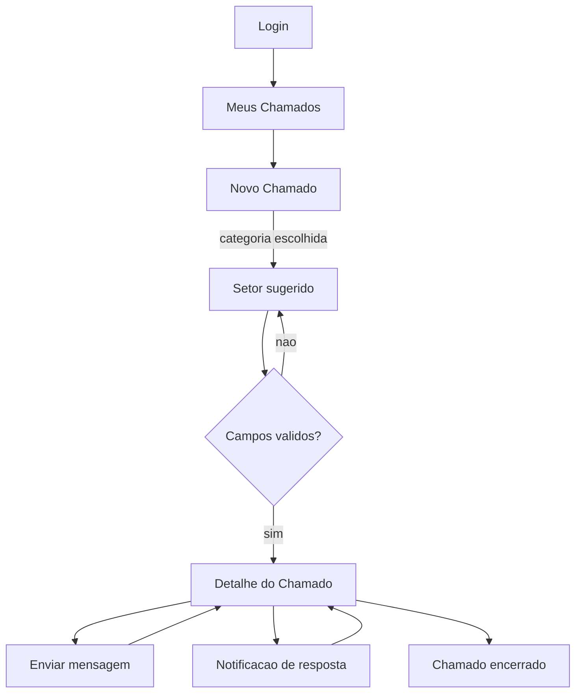
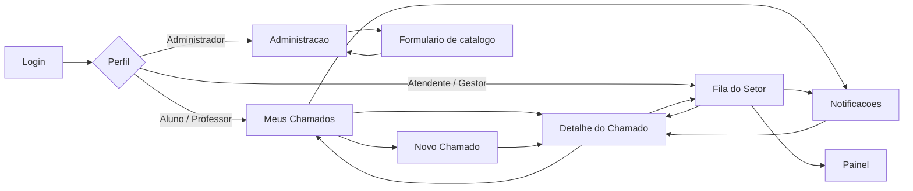

# Fluxos de Usuário — Sistema de Chamados Acadêmicos

Fluxos principais do corte mínimo definido em `../scope-definition/scope-document.md`, sobre as telas de `wireframes.md`. Os perfis vêm de `../intent-capture/intent-statement.md`; as proto-Unidades citadas (B1–B8) vêm de `../scope-definition/intent-backlog.md`.

## Fluxo 1 — Abrir e acompanhar um chamado (Aluno)

É o fluxo que resolve a dor central registrada na Captura de Intenção: saber onde está a solicitação sem precisar reabri-la por canais informais.

**Persona:** Aluno (ou Professor, que tem o mesmo comportamento como solicitante).
**Gatilho:** o aluno precisa de algo da instituição — revisão de nota, segunda via, trancamento.

| # | Tela | Ação do usuário | Resposta do sistema |
|---|------|-----------------|---------------------|
| 1 | Login | Informa e-mail e senha | Autentica e redireciona para Meus Chamados |
| 2 | Meus Chamados | Clica em "Novo Chamado" | Abre o formulário de abertura |
| 3 | Novo Chamado | Escolhe categoria | Sugere o setor responsável correspondente |
| 4 | Novo Chamado | Preenche título, descrição e prioridade | Valida cada campo ao sair dele |
| 5 | Novo Chamado | Clica em "Abrir Chamado" | Cria o chamado com status inicial, redireciona para o detalhe com confirmação |
| 6 | Detalhe (Conversa) | Acompanha; escreve mensagens quando necessário | Registra a mensagem e notifica o setor responsável |
| 7 | Notificações | Recebe aviso de resposta ou mudança de status | Contador do sino incrementa; item leva ao chamado |
| 8 | Detalhe (Histórico) | Consulta o que mudou e quando | Lista mudanças de status, atribuições e transferências |

**Resultado esperado:** o chamado existe, tem responsável definido e o aluno consegue ver seu andamento sem contatar ninguém por fora do sistema.

**Caminhos de erro:**

| Condição | O que o usuário vê | Recuperação |
|----------|--------------------|-------------|
| Credenciais inválidas | "E-mail ou senha incorretos." | Tenta novamente ou usa "Esqueci minha senha" |
| Campo obrigatório vazio | Erro específico abaixo do campo | Preenche e reenvia |
| Falha ao criar o chamado | Alerta acima dos botões, com o texto preservado | Botão "Tentar novamente" |
| Falha ao enviar mensagem | Balão marcado como "Não enviado" | Botão "Tentar novamente" no próprio balão |
| Chamado já encerrado | Campo de mensagem desabilitado com aviso | Abre um novo chamado, se necessário |

<!-- Text fallback: do Login vai para Meus Chamados, de onde se abre Novo Chamado. Escolher a categoria sugere o setor. Uma decisão de validação: se os campos não estão válidos, volta ao formulário; se estão, cria o chamado e vai para o Detalhe. No Detalhe é possível enviar mensagem e voltar ao Detalhe, receber notificação de resposta que leva de volta ao Detalhe, e finalmente chegar ao chamado encerrado. -->

## Fluxo 2 — Atender um chamado (Atendente)

**Persona:** Atendente do setor.
**Gatilho:** um chamado entra na fila do setor.

| # | Tela | Ação do usuário | Resposta do sistema |
|---|------|-----------------|---------------------|
| 1 | Login | Informa credenciais | Autentica e redireciona para a Fila do Setor |
| 2 | Fila do Setor | Abre o recorte "Não atribuídos" | Lista os chamados sem responsável |
| 3 | Fila do Setor | Clica em "Assumir" numa linha | Define o atendente como responsável e move o chamado para "Meus" |
| 4 | Detalhe (Conversa) | Escreve a resposta ao solicitante | Registra a mensagem e notifica o solicitante |
| 5 | Detalhe (cabeçalho) | Altera o status conforme o andamento | Pede confirmação, aplica e registra no histórico |
| 6 | Detalhe (cabeçalho) | Encerra o chamado quando resolvido | Confirma, encerra e desabilita novas mensagens |

**Resultado esperado:** o chamado tem responsável, foi respondido e chegou a um status final, com todo o percurso registrado.

**Caminhos de erro:**

| Condição | O que o usuário vê | Recuperação |
|----------|--------------------|-------------|
| Outro atendente assumiu primeiro | "Este chamado já foi assumido por outro atendente." | A lista recarrega com o responsável atual |
| Chamado não pertence ao setor do atendente | O chamado não aparece na fila | Solicita transferência ao gestor |
| Falha ao alterar status | Alerta inline, status anterior mantido | Botão "Tentar novamente" |

## Fluxo 3 — Transferir chamado entre setores (Atendente ou Gestor)

**Persona:** Atendente ou Gestor.
**Gatilho:** o chamado chegou ao setor errado, ou a resolução depende de outro setor.

| # | Tela | Ação do usuário | Resposta do sistema |
|---|------|-----------------|---------------------|
| 1 | Detalhe (cabeçalho) | Escolhe "Transferir de setor" | Abre diálogo com a lista de setores |
| 2 | Diálogo | Seleciona o setor de destino e justifica | Valida que o setor é diferente do atual |
| 3 | Diálogo | Confirma | Transfere, limpa o responsável, registra no histórico e notifica o solicitante |
| 4 | Fila do Setor | — | O chamado deixa a fila de origem e entra na fila do destino, sem responsável |

**Resultado esperado:** o chamado está na fila do setor correto, sem responsável, e o solicitante foi avisado da mudança.

**Caminhos de erro:**

| Condição | O que o usuário vê | Recuperação |
|----------|--------------------|-------------|
| Setor de destino igual ao atual | "Escolha um setor diferente do atual." | Seleciona outro |
| Justificativa em branco | Erro abaixo do campo | Preenche e confirma |
| Chamado encerrado | Ação de transferir indisponível | — |

## Fluxo 4 — Administrar catálogos (Administrador)

**Persona:** Administrador.
**Gatilho:** é preciso criar um setor, uma categoria, um status ou uma prioridade.

| # | Tela | Ação do usuário | Resposta do sistema |
|---|------|-----------------|---------------------|
| 1 | Login | Informa credenciais | Autentica e redireciona para Administração |
| 2 | Administração | Escolhe a aba da entidade | Lista os registros existentes |
| 3 | Administração | Clica em "Nova ..." | Abre o formulário da entidade |
| 4 | Formulário | Preenche e salva | Valida, grava e volta à lista com confirmação |
| 5 | Administração | Desativa um registro em uso | Pede confirmação explicando o efeito sobre chamados existentes |

**Resultado esperado:** o catálogo reflete a estrutura da instituição, e as telas de abertura e de fila passam a oferecer as novas opções.

**Caminhos de erro:**

| Condição | O que o usuário vê | Recuperação |
|----------|--------------------|-------------|
| Nome duplicado | "Já existe um registro com este nome." | Escolhe outro nome |
| Desativação de item em uso | Confirmação explicando que chamados existentes mantêm o valor | Confirma ou cancela |

## Mapa de Navegação

<!-- Text fallback: do Login parte uma decisão por perfil. Aluno e Professor vão para Meus Chamados; Atendente e Gestor vão para a Fila do Setor; Administrador vai para Administração. De Meus Chamados chega-se a Novo Chamado e ao Detalhe do Chamado; Novo Chamado leva ao Detalhe. Da Fila do Setor chega-se ao Detalhe. O Detalhe volta tanto para Meus Chamados quanto para a Fila. Da Administração abre-se o formulário de catálogo, que volta para a Administração. Notificações é alcançável de Meus Chamados e da Fila, e leva ao Detalhe. Da Fila do Setor chega-se ao Painel. -->

## Arquitetura da Informação

Estrutura hub-and-spoke rasa: nenhuma tela do corte mínimo está a mais de dois cliques da tela de entrada do perfil.

| Nível 1 (barra lateral) | Nível 2 | Nível 3 |
|-------------------------|---------|---------|
| Meus Chamados | Novo Chamado, Detalhe do Chamado | Abas: Conversa, Histórico, Detalhes |
| Fila do Setor | Detalhe do Chamado | Abas: Conversa, Histórico, Detalhes |
| Painel (Could have) | — | — |
| Administração | Usuários, Setores, Categorias, Status, Prioridades | Formulário de criação e edição |

Notificações não ocupa item na lateral: é um painel aberto pelo sino da barra superior, disponível em qualquer tela. Não há item "Início": a Q2 descartou a tela inicial única, então o primeiro item da lateral já é a tela de entrada do perfil, e o logotipo da barra superior cumpre o papel de voltar a ela.

## Assumptions & Open Questions

- [assumption] A transferência entre setores limpa o responsável atual e devolve o chamado à fila do destino. É o comportamento coerente com a fila por setor, mas não foi confirmado; a análise de requisitos precisa fechá-lo.
- [assumption] O fluxo de recuperação de senha não foi desenhado; o link existe no login mas seu destino está em aberto.
- [assumption] Quem pode encerrar um chamado — apenas o atendente, ou também o solicitante — foi assumido como ambos, mas depende da matriz de permissões a ser fechada em Functional Design.
