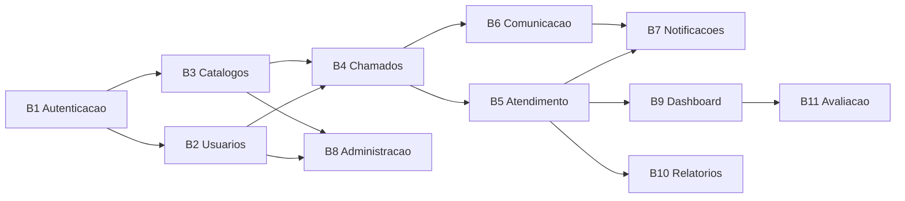

# Intent Backlog — Sistema de Chamados Acadêmicos

Backlog priorizado de proto-Unidades, derivado de `scope-document.md` e de `../intent-capture/intent-statement.md`. Cada item é um candidato a Unidade de Trabalho; a decomposição definitiva ocorre em Units Generation.

Priorização por **MoSCoW**, com a ordem interna dos Must have seguindo a estratégia de fundação primeiro. [Q3]

## Must have

| # | Proto-Unidade | Descrição | Depende de | Perfis servidos |
|---|---------------|-----------|------------|-----------------|
| B1 | Autenticação e Identidade | Login, sessão via JWT em cookie, logout, guarda de rotas por perfil. | — | Todos |
| B2 | Usuários e Perfis | Cadastro de usuários, atribuição de perfil (Aluno, Professor, Atendente, Gestor, Administrador), consulta e edição. | B1 | Administrador |
| B3 | Catálogos de Classificação | Setores, categorias, status e prioridades: modelo de dados e operações de leitura e escrita. | B1 | Administrador, todos (leitura) |
| B4 | Chamados — Ciclo de Vida | Abertura, consulta, listagem com filtros, detalhe, alteração de status e histórico de alterações. | B1, B2, B3 | Aluno, Professor |
| B5 | Atendimento | Fila do setor, assumir chamado, atribuir responsável, transferir entre setores, encerrar. | B4 | Atendente, Gestor |
| B6 | Comunicação no Chamado | Troca de mensagens entre solicitante e atendente dentro do chamado. | B4 | Aluno, Professor, Atendente |
| B7 | Notificações in-app | Geração e leitura de avisos sobre eventos dos chamados do usuário. Sem e-mail e sem canais externos. | B4, B5, B6 | Todos |

## Should have

| # | Proto-Unidade | Descrição | Depende de | Perfis servidos |
|---|---------------|-----------|------------|-----------------|
| B8 | Área Administrativa | Telas de gestão para usuários, perfis, setores, categorias, status, prioridades e configurações gerais. | B2, B3 | Administrador |

B8 é Should have e não Must have porque B2 e B3 já entregam a capacidade de administrar os dados; B8 entrega a interface dedicada para isso. O corte mínimo exige que os catálogos sejam administráveis [Q1], não que exista uma área administrativa completa.

## Could have

Nenhum destes é iniciado antes de B1 a B8 estarem concluídos e testados. [Q2]

| # | Proto-Unidade | Descrição | Depende de | Perfis servidos |
|---|---------------|-----------|------------|-----------------|
| B9 | Dashboard e Indicadores | Painéis com quantidade de chamados, chamados por status, categoria e setor, tempo de atendimento e tempo de resolução. Sem metas numéricas. | B4, B5 | Gestor, Administrador |
| B10 | Relatórios | Listagens em tela com filtros combinados. Sem exportação em arquivo. | B4, B5 | Gestor, Administrador |
| B11 | Avaliação dos Atendimentos | Nota do solicitante ao encerramento do chamado, e sua exibição nos indicadores. | B5, B9 | Aluno, Professor, Gestor |

## Won't have (this time)

| Item | Motivo |
|------|--------|
| Anexos nos chamados | Retirado desta entrega. [Q5] |
| Notificação por e-mail ou canal externo | Fora do escopo. [Q4] |
| SLA e prazos automáticos por categoria | Fora do escopo. [Q6] |
| Exportação de relatórios em PDF ou CSV | Fora do escopo. [Q6] [Q7] |
| Base de conhecimento ou FAQ | Fora do escopo. [Q6] |
| Aplicativo mobile nativo, automação por IA, integrações não especificadas | Já registrado em `../intent-capture/intent-statement.md`. |
| Implantação em servidor externo, entrega contínua, ambientes de homologação e produção | Já registrado em `../intent-capture/intent-statement.md`. |

## Caminho Crítico

<!-- Text fallback: B1 (Autenticação) é a raiz. B1 leva a B2 (Usuários) e a B3 (Catálogos). B2 e B3 convergem em B4 (Chamados). B4 leva a B5 (Atendimento) e B6 (Comunicação); ambos convergem em B7 (Notificações). B2 e B3 também levam a B8 (Administração). B5 leva a B9 (Dashboard) e B10 (Relatórios). B9 leva a B11 (Avaliação). -->

O caminho crítico é **B1 → B3 → B4 → B5 → B7**: é a cadeia mais longa entre os Must have e determina quando o corte mínimo fica pronto.

## Assumptions & Open Questions

- [assumption] B6 (Comunicação no Chamado) foi separada de B4 por ter modelo de dados próprio (mensagens) e regras de acesso distintas, mas essa separação não foi objeto de pergunta; Units Generation pode fundi-la em B4.
- [assumption] A estimativa de esforço por proto-Unidade não foi feita nesta etapa; a ordenação econômica final é trabalho de Delivery Planning.
