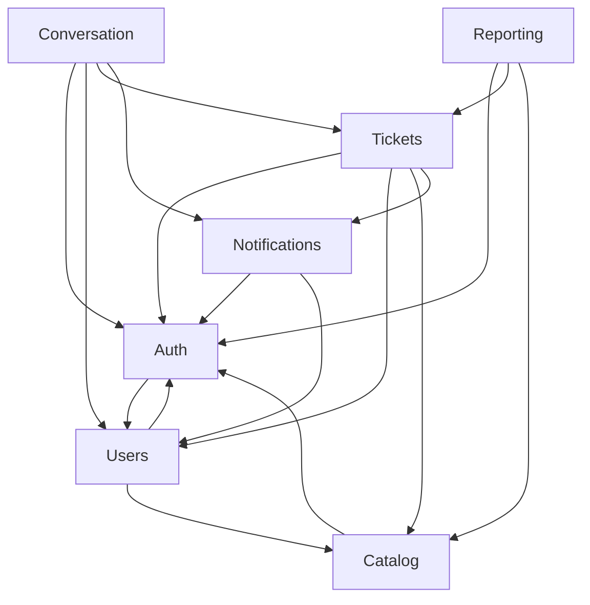

# Catálogo de Blocos — Sistema de Chamados Acadêmicos

Derivado de `../requirements-analysis/requirements.md` (FR1–FR12, NFR1–NFR9), `../user-stories/stories.md` (20 histórias, 11 critérios transversais, 5 consequências de modelo) e `../practices-discovery/team-practices.md` (camadas NestJS, glossário de identificadores, máquina de status em módulo puro).

Sete blocos lógicos, todos no backend. O frontend não entra como bloco lógico por decisão da Q8. Banco, contêineres e bibliotecas aparecem como dependências externas, nunca como blocos.

As entidades são capturadas no nível de **propriedade e forma** — quem é dono, qual o identificador, quais os nomes dos atributos e para onde apontam. Tipo de dado, validação, valores permitidos e cardinalidade pertencem ao Desenho Funcional.

## Catálogo

```yaml
components:
  - name: Auth
    summary: Autentica o usuário, mantém a sessão e aplica a autorização por perfil em toda rota.
    behaviour: >
      Verifica e-mail e senha contra o hash armazenado por Users e devolve um JWT em cookie
      httpOnly de duração média, sem refresh token. O logout apaga o cookie no navegador, sem
      invalidação no servidor. O guard global nega por padrão: uma rota sem marcação explícita
      de perfil é recusada com 403. A cada requisição autenticada, carrega o usuário através de
      Users para ler perfil e situação do banco, nunca confiando no conteúdo do token — sem
      isso, desativar um usuário ou trocar seu perfil demoraria até a expiração para valer.
      Resposta de credencial inválida é idêntica para e-mail inexistente e senha errada.
    responsibilities:
      - Autenticação por e-mail e senha
      - Emissão e expiração do token de sessão
      - Guard global de negação por padrão e verificação de perfil por rota
      - Carregamento do ator autenticado a cada requisição
    depends_on:
      - component: Users
        interaction: ler credencial, perfil e situação do usuário a cada autenticação e a cada requisição
        style: sync
    dependents:
      - component: Tickets
        interaction: obter o ator autenticado e seu perfil para aplicar a regra de visibilidade
      - component: Conversation
        interaction: obter o ator autenticado para aplicar a regra de leitura e escrita de mensagens
      - component: Users
        interaction: verificar que quem administra usuários tem perfil de administrador
      - component: Catalog
        interaction: verificar que quem administra catálogos tem perfil de administrador
      - component: Notifications
        interaction: obter o ator autenticado para listar apenas as notificações dele
      - component: Reporting
        interaction: obter o ator autenticado e seu setor para limitar o recorte dos indicadores
    external_dependencies:
      - name: PostgreSQL
        kind: database
        purpose: nenhum acesso direto; Auth lê o usuário sempre através de Users
    entities: []

  - name: Users
    summary: Dono da identidade das pessoas: cadastro, perfil de acesso, senha e situação.
    behaviour: >
      Somente o administrador cria usuários; não existe rota pública de criação de conta nem
      auto-recuperação de senha. Cada usuário tem exatamente um dos cinco perfis. Atendente e
      Gestor exigem vínculo com um setor; sem ele a criação é recusada. A desativação preserva
      o registro e todo o histórico produzido por ele, apenas impedindo a autenticação. A
      redefinição de senha pelo administrador invalida a senha anterior. E-mail é único.
    responsibilities:
      - Ciclo de vida da conta de usuário
      - Atribuição e alteração de perfil de acesso
      - Definição e redefinição de senha
      - Vínculo entre usuário e setor
    depends_on:
      - component: Auth
        interaction: verificar que o ator tem perfil de administrador antes de qualquer operação
        style: sync
      - component: Catalog
        interaction: validar que o setor informado no vínculo existe e está ativo
        style: sync
    dependents:
      - component: Auth
        interaction: fornecer credencial, perfil e situação do usuário
      - component: Tickets
        interaction: resolver solicitante e responsável de um chamado
      - component: Conversation
        interaction: resolver o autor de cada mensagem
      - component: Notifications
        interaction: resolver o destinatário de cada notificação
    external_dependencies:
      - name: PostgreSQL
        kind: database
        purpose: persistir usuários e suas credenciais
    entities:
      - name: User
        identifier: id
        attributes: [id, name, email, passwordHash, role, active, createdAt, updatedAt]
        references:
          - entity: Sector
            owned_by: Catalog
            relationship: aponta o setor de lotação, presente apenas nos perfis de atendente e gestor

  - name: Catalog
    summary: Dono da classificação administrável do sistema: setores, categorias, status e prioridades.
    behaviour: >
      As quatro entidades compartilham o mesmo comportamento de manutenção: listar, criar,
      editar e desativar, tudo restrito ao administrador. Uma categoria pertence a exatamente um
      setor, e é essa relação que determina o setor responsável de um chamado — o solicitante
      nunca escolhe o setor. Um item desativado deixa de aparecer como opção para novos
      chamados, mas os chamados existentes que o referenciam continuam exibindo-o inalterado.
      Status e Priority carregam uma chave estável em inglês além do rótulo editável, porque a
      máquina de transições é um módulo puro que não consulta o banco e precisa comparar contra
      um valor que o administrador não pode renomear. O conjunto inicial de status e prioridades
      é carregado na instalação; os valores permitidos são fixados no Desenho Funcional, a partir
      da origem registrada na nota de rastreabilidade ao fim deste documento.
    responsibilities:
      - Manutenção de setores
      - Manutenção de categorias e do vínculo categoria-setor
      - Manutenção de status, com chave estável
      - Manutenção de prioridades, com chave estável e marcação de padrão
      - Carga inicial dos status e prioridades padrão
    depends_on:
      - component: Auth
        interaction: verificar que o ator tem perfil de administrador antes de qualquer escrita
        style: sync
    dependents:
      - component: Users
        interaction: validar o setor no vínculo de atendente e gestor
      - component: Tickets
        interaction: resolver categoria, setor derivado, status e prioridade de um chamado
      - component: Reporting
        interaction: rotular os agrupamentos por categoria, setor e status
    external_dependencies:
      - name: PostgreSQL
        kind: database
        purpose: persistir os quatro catálogos
    entities:
      - name: Sector
        identifier: id
        attributes: [id, name, active, createdAt, updatedAt]
      - name: Category
        identifier: id
        attributes: [id, name, active, createdAt, updatedAt]
        references:
          - entity: Sector
            owned_by: Catalog
            relationship: aponta o setor de destino da categoria; é esta relação que deriva o setor responsável do chamado
      - name: Status
        identifier: id
        attributes: [id, key, label, active, createdAt, updatedAt]
      - name: Priority
        identifier: id
        attributes: [id, key, label, isDefault, active, createdAt, updatedAt]

  - name: Tickets
    summary: Dono do chamado e de todo o seu percurso: abertura, fila, atendimento, transições e histórico.
    behaviour: >
      Um chamado nasce em OPEN, sem responsável, com o setor derivado da categoria escolhida —
      qualquer setor enviado pelo cliente é ignorado. A fila, o assumir, o atribuir e o
      transferir são operações sobre esta mesma entidade, e não um bloco separado. Assumir e
      atribuir levam o chamado a IN_ANALYSIS. A transferência remove o responsável, devolve o
      chamado a OPEN e o coloca na fila do setor de destino, exigindo justificativa. Toda
      mudança de status obedece à tabela de transições válidas, aplicada pelo módulo puro
      TicketStatusMachine, que recebe as chaves estáveis e não consulta o banco. O solicitante
      encerra o próprio chamado a qualquer momento e pode reabri-lo dentro de 72 horas contadas
      do encerramento, voltando a OPEN com o último responsável preservado. Toda alteração de
      status, responsável, setor ou prioridade gera um registro de histórico com autor, momento,
      valor anterior e valor novo. Cada entrada e saída de setor gera um registro de passagem,
      porque um campo de setor anterior quebraria na segunda transferência. Um atendente vê os
      chamados do seu setor e também os que já passaram por ele; um solicitante vê apenas os
      seus, e um chamado que ele não pode ver responde 404, nunca 403.
    responsibilities:
      - Ciclo de vida do chamado
      - Fila do setor, atribuição e transferência
      - Aplicação da máquina de transições de status
      - Alteração de prioridade por atendente e gestor
      - Reabertura pelo solicitante dentro da janela
      - Histórico de alterações
      - Registro de passagens por setor
      - Regra de visibilidade por perfil e por setor
    depends_on:
      - component: Auth
        interaction: obter o ator autenticado e seu perfil para aplicar a regra de visibilidade
        style: sync
      - component: Users
        interaction: resolver solicitante e responsável
        style: sync
      - component: Catalog
        interaction: resolver categoria, derivar o setor, e resolver status e prioridade
        style: sync
      - component: Notifications
        interaction: gravar a notificação de cada evento notificável no momento em que ele ocorre
        style: sync
    dependents:
      - component: Conversation
        interaction: verificar que o chamado existe, que não está encerrado e que o ator pode acessá-lo
      - component: Reporting
        interaction: ler chamados e histórico para calcular volume e tempos
    external_dependencies:
      - name: PostgreSQL
        kind: database
        purpose: persistir chamados, histórico e passagens por setor
      - name: TicketStatusMachine
        kind: other
        purpose: módulo puro interno, sem NestJS e sem Prisma, que decide se uma transição é válida a partir das chaves estáveis de status
    entities:
      - name: Ticket
        identifier: id
        attributes: [id, reference, title, description, openedAt, updatedAt, closedAt]
        references:
          - entity: User
            owned_by: Users
            relationship: aponta quem abriu o chamado e quem o atende no momento
          - entity: Category
            owned_by: Catalog
            relationship: aponta a categoria escolhida na abertura
          - entity: Sector
            owned_by: Catalog
            relationship: aponta o setor responsável no momento, derivado da categoria na abertura e alterado por transferência
          - entity: Status
            owned_by: Catalog
            relationship: aponta o status atual do chamado
          - entity: Priority
            owned_by: Catalog
            relationship: aponta a prioridade atual do chamado
      - name: TicketHistoryEntry
        identifier: id
        attributes: [id, field, previousValue, newValue, occurredAt]
        references:
          - entity: Ticket
            owned_by: Tickets
            relationship: aponta o chamado a que a alteração se refere
          - entity: User
            owned_by: Users
            relationship: aponta quem provocou a alteração
      - name: TicketSectorPassage
        identifier: id
        attributes: [id, enteredAt, leftAt, justification]
        references:
          - entity: Ticket
            owned_by: Tickets
            relationship: aponta o chamado que passou pelo setor
          - entity: Sector
            owned_by: Catalog
            relationship: aponta o setor em que o chamado esteve
          - entity: User
            owned_by: Users
            relationship: aponta quem executou a transferência que encerrou a passagem

  - name: Conversation
    summary: Dono das mensagens trocadas dentro do chamado entre solicitante e atendente.
    behaviour: >
      Bloco separado do ciclo de vida do chamado por regra afirmada do projeto: tem modelo de
      dados e regras de acesso próprios. Uma mensagem é imutável depois de enviada — não há
      edição nem exclusão, e nenhuma rota para isso. Um chamado encerrado recusa novas
      mensagens. Leem as mensagens o solicitante, o responsável atual, e atendentes e gestores
      do setor atual ou de um setor por onde o chamado já passou; quem está fora desse conjunto
      recebe 404 ao acessar o recurso de mensagens diretamente, sem que nenhuma mensagem seja
      devolvida. Quando o solicitante envia mensagem num chamado em WAITING_REQUESTER, o status
      volta para IN_ANALYSIS.
    responsibilities:
      - Registro e leitura de mensagens do chamado
      - Regra de acesso à conversa, distinta da regra de acesso ao chamado
      - Recusa de mensagem em chamado encerrado
      - Disparo do retorno automático de WAITING_REQUESTER para IN_ANALYSIS
    depends_on:
      - component: Auth
        interaction: obter o ator autenticado para aplicar a regra de leitura e escrita
        style: sync
      - component: Users
        interaction: resolver o autor de cada mensagem
        style: sync
      - component: Tickets
        interaction: verificar existência, situação e visibilidade do chamado, e solicitar o retorno de status quando o solicitante responde
        style: sync
      - component: Notifications
        interaction: gravar a notificação da mensagem recebida
        style: sync
    dependents: []
    external_dependencies:
      - name: PostgreSQL
        kind: database
        purpose: persistir mensagens
    entities:
      - name: Message
        identifier: id
        attributes: [id, body, sentAt]
        references:
          - entity: Ticket
            owned_by: Tickets
            relationship: aponta o chamado em que a mensagem foi escrita
          - entity: User
            owned_by: Users
            relationship: aponta quem escreveu a mensagem

  - name: Notifications
    summary: Dono do aviso in-app: registra o que aconteceu no chamado de alguém e permite marcá-lo como lido.
    behaviour: >
      Grava a notificação no momento em que o evento ocorre, mesmo antes de existir tela para
      lê-la — sem isso, eventos anteriores à construção da tela se perderiam. Só notificações
      dentro do sistema: não existe integração de envio para fora, nem e-mail, nem qualquer
      canal externo. Um usuário lê somente as próprias notificações. A leitura pode ser
      individual ou em lote, e o contador de não lidas reflete a ação imediatamente.
    responsibilities:
      - Registro de notificação por evento notificável
      - Leitura das notificações do próprio usuário
      - Marcação de lida, individual e em lote
      - Contagem de não lidas
    depends_on:
      - component: Auth
        interaction: obter o ator autenticado para listar apenas as notificações dele
        style: sync
      - component: Users
        interaction: resolver o destinatário de cada notificação
        style: sync
    dependents:
      - component: Tickets
        interaction: gravar notificação de mudança de status, responsável, setor e de reabertura
      - component: Conversation
        interaction: gravar notificação de mensagem recebida
    external_dependencies:
      - name: PostgreSQL
        kind: database
        purpose: persistir notificações
    entities:
      - name: Notification
        identifier: id
        attributes: [id, kind, read, createdAt, readAt]
        references:
          - entity: User
            owned_by: Users
            relationship: aponta quem deve ver a notificação
          - entity: Ticket
            owned_by: Tickets
            relationship: aponta o chamado a que a notificação se refere

  - name: Reporting
    summary: Somente leitura. Calcula volume e tempos dos chamados para painel e listagens filtradas.
    behaviour: >
      Não escreve nada e não é dono de entidade alguma. Lê chamados e histórico através de
      Tickets, e rótulos de agrupamento através de Catalog. Os números respeitam o recorte de
      visibilidade do perfil que consulta: um gestor vê o seu setor, um administrador vê tudo.
      Aceita recorte por período e apresenta estado vazio explicativo quando não há chamados no
      período. Nenhum indicador é comparado a limiar ou meta — os valores são exibidos, e não
      julgados. Não existe exportação em arquivo nem rota de download.
    responsibilities:
      - Contagem de chamados por status, categoria e setor
      - Cálculo de tempo médio de atendimento e de resolução
      - Listagens com filtros combinados, em tela
    depends_on:
      - component: Auth
        interaction: obter o ator autenticado e seu setor para limitar o recorte
        style: sync
      - component: Tickets
        interaction: ler chamados e histórico para calcular volume e tempos
        style: sync
      - component: Catalog
        interaction: rotular os agrupamentos por categoria, setor e status
        style: sync
    dependents: []
    external_dependencies:
      - name: PostgreSQL
        kind: database
        purpose: nenhum acesso direto; Reporting lê sempre através de Tickets e Catalog
    entities: []
```

## Diagrama de Blocos



<!-- Text fallback: Auth e Users dependem um do outro — Auth lê credencial e perfil em Users, e Users pede a Auth a verificação de que quem administra é administrador. Users depende de Catalog para validar o setor do vínculo, e Catalog depende de Auth para verificar o perfil administrador. Tickets depende de Auth, Users, Catalog e Notifications. Conversation depende de Auth, Users, Tickets e Notifications. Notifications depende de Auth e Users. Reporting depende de Auth, Tickets e Catalog, e nada depende de Reporting nem de Conversation. -->

O grafo tem **dois ciclos deliberados**, ambos registrados em `decisions.md`: Auth ↔ Users, e o triângulo Auth → Users → Catalog → Auth. Os dois existem porque a verificação de perfil administrador é transversal e todo bloco de escrita a consome. Estão contidos: nenhum dos dois atravessa uma fronteira de dados — Auth nunca lê a tabela de usuários direto, e Catalog nunca lê a de setores por conta de Users.

## Resumo dos Blocos

| Bloco | Propósito | Depende de | Dependentes | Entidades |
|-------|-----------|------------|-------------|-----------|
| Auth | Autenticação, sessão e autorização por perfil | Users | Tickets, Conversation, Users, Catalog, Notifications, Reporting | nenhuma |
| Users | Identidade das pessoas: conta, perfil, senha, setor | Auth, Catalog | Auth, Tickets, Conversation, Notifications | User |
| Catalog | Classificação administrável do sistema | Auth | Users, Tickets, Reporting | Sector, Category, Status, Priority |
| Tickets | Chamado e todo o seu percurso | Auth, Users, Catalog, Notifications | Conversation, Reporting | Ticket, TicketHistoryEntry, TicketSectorPassage |
| Conversation | Mensagens dentro do chamado | Auth, Users, Tickets, Notifications | nenhum | Message |
| Notifications | Aviso in-app e sua leitura | Auth, Users | Tickets, Conversation | Notification |
| Reporting | Volume e tempos, somente leitura | Auth, Tickets, Catalog | nenhum | nenhuma |

## Propriedade das Entidades

| Entidade | Bloco dono | Identificador | Atributos | Referências |
|----------|-----------|---------------|-----------|-------------|
| User | Users | id | id, name, email, passwordHash, role, active, createdAt, updatedAt | Sector (Catalog) |
| Sector | Catalog | id | id, name, active, createdAt, updatedAt | nenhuma |
| Category | Catalog | id | id, name, active, createdAt, updatedAt | Sector (Catalog) |
| Status | Catalog | id | id, key, label, active, createdAt, updatedAt | nenhuma |
| Priority | Catalog | id | id, key, label, isDefault, active, createdAt, updatedAt | nenhuma |
| Ticket | Tickets | id | id, reference, title, description, openedAt, updatedAt, closedAt | User (Users), Category, Sector, Status, Priority (Catalog) |
| TicketHistoryEntry | Tickets | id | id, field, previousValue, newValue, occurredAt | Ticket (Tickets), User (Users) |
| TicketSectorPassage | Tickets | id | id, enteredAt, leftAt, justification | Ticket (Tickets), Sector (Catalog), User (Users) |
| Message | Conversation | id | id, body, sentAt | Ticket (Tickets), User (Users) |
| Notification | Notifications | id | id, kind, read, createdAt, readAt | User (Users), Ticket (Tickets) |

Dez entidades, cada uma com exatamente um dono. Nenhuma ambiguidade de propriedade sobrou.

## Dependências Externas

| Bloco | Dependência | Tipo | Propósito |
|-------|-------------|------|-----------|
| Auth | PostgreSQL | database | Nenhum acesso direto; lê o usuário sempre através de Users |
| Users | PostgreSQL | database | Persistir usuários e credenciais |
| Catalog | PostgreSQL | database | Persistir os quatro catálogos |
| Tickets | PostgreSQL | database | Persistir chamados, histórico e passagens por setor |
| Tickets | TicketStatusMachine | other | Módulo puro interno que decide se uma transição é válida |
| Conversation | PostgreSQL | database | Persistir mensagens |
| Notifications | PostgreSQL | database | Persistir notificações |
| Reporting | PostgreSQL | database | Nenhum acesso direto; lê sempre através de Tickets e Catalog |

`TicketStatusMachine` aparece como dependência externa, e não como bloco, porque não tem estado, não tem entidade e não tem ciclo de vida próprio: é uma função pura que recebe duas chaves de status e um papel, e responde se a transição vale.

## Alternativas de Decomposição Consideradas

Duas fronteiras tinham mais de uma decomposição viável. Ambas foram levadas à decisão e estão registradas em `decisions.md`.

**Fronteira do atendimento.** Opção A: bloco `Servicing` separado, com fronteira por ator — o solicitante fala com Tickets, o atendente fala com Servicing. Prós: cada bloco serve um perfil, e a fila fica isolada. Contras: os dois escrevem na mesma entidade `Ticket`, o que viola a regra de que a entidade tem um dono só, e obriga a decidir quem grava o histórico. Reversibilidade: alta, extrair depois é mecânico. Opção B (escolhida): tudo dentro de Tickets. Prós: um dono por entidade, sem coordenação de escrita. Contras: Tickets fica o maior bloco do sistema.

**Escopo de Reporting.** Opção A (escolhida): bloco somente-leitura próprio. Opção B: consultas agregadas dentro de Tickets. A opção A foi escolhida apesar de introduzir a única dependência puramente de leitura entre blocos, porque Reporting é Could have e mantê-lo separado permite cortá-lo sem tocar em Tickets.

## Justificativa por Bloco

| Bloco | Por que é bloco separado |
|-------|--------------------------|
| Auth | Concern distinto e transversal: todo bloco de escrita o consome, e nenhum outro tem motivo para conhecer emissão de token ou verificação de senha. Não é dono de entidade, o que confirma a separação por comportamento e não por dado. |
| Users | Dono de dado distinto (a pessoa), com taxa de mudança própria: o cadastro muda quando a instituição muda, não quando o processo de chamado muda. |
| Catalog | Dono da classificação, que muda por decisão administrativa e não por operação. Quatro entidades com comportamento idêntico e nenhuma regra de negócio própria além do vínculo categoria-setor — separá-las em quatro blocos multiplicaria arquivos sem separar nada. |
| Tickets | Dono do chamado e de tudo que o percorre. Absorve o atendimento porque fila, atribuição e transferência escrevem na mesma entidade; um bloco separado teria dois donos para um dado só. |
| Conversation | Modelo de dados próprio (mensagem imutável) e regra de acesso própria, mais permissiva que a do chamado — o setor de origem lê a conversa de um chamado já transferido. Separação afirmada como regra do projeto. |
| Notifications | Dono de dado próprio, com ciclo de vida independente do chamado: uma notificação sobrevive à leitura e é marcada, não apagada. Escrito por dois blocos distintos, o que confirma que não pertence a nenhum dos dois. |
| Reporting | Somente leitura, nenhuma entidade, e prioridade Could have. Separado para poder ser cortado inteiro sem tocar em nada. |

## Nota de Rastreabilidade dos Valores de Classificação

Este catálogo captura entidades no nível de propriedade e forma, e por isso não enumera valores
permitidos no corpo dos blocos nem dos ADRs. Os valores abaixo aparecem aqui apenas como registro
de origem, para que o Desenho Funcional, que é quem os fixa, saiba de onde vieram.

| Campo | Valores esperados | Origem |
|-------|-------------------|--------|
| `Status.key` | OPEN, IN_ANALYSIS, WAITING_REQUESTER, CLOSED | `../user-stories/stories.md` consequência de modelo M2, e a tabela de transições válidas do mesmo documento |
| `Priority.key` | sem origem a montante | Ver ADR-006: campo criado por simetria com `Status.key`, sem consumidor identificado hoje |

## Assumptions & Open Questions

- [assumption] O campo `reference` de `Ticket` é o identificador visível exigido por FR4.3, distinto do `id` interno. O formato — sequencial global, sequencial por ano, ou outro — não foi decidido e é questão aberta registrada nas histórias.
- [assumption] `TicketHistoryEntry` usa um par genérico `previousValue` e `newValue` com um campo `field` indicando o que mudou, em vez de uma entrada por tipo de mudança. Serve para status, responsável, setor e prioridade sem multiplicar tabelas; o Desenho Funcional pode preferir separar.
- [assumption] `TicketSectorPassage` carrega a justificativa da transferência que a encerrou. A alternativa seria guardá-la no histórico; ficou aqui por pertencer à passagem e não à mudança de campo.
- [assumption] `Priority.key` existe por simetria com `Status.key`, e não por necessidade rastreável: nenhum módulo puro consome prioridade, e não há SLA nem escalonamento automático no escopo aprovado. O Desenho Funcional decide se o campo fica ou se é adiado até haver consumidor real. Ver ADR-006.
- [assumption] O atributo `kind` de `Notification` distingue o tipo de evento (mensagem recebida, mudança de status, mudança de responsável, transferência, reabertura). Os valores exatos são trabalho do Desenho Funcional.
- [assumption] Reporting lê chamados através de Tickets, e não direto do banco. Isso mantém a regra de visibilidade num lugar só, ao custo de consultas agregadas atravessarem uma camada de serviço. Se o desempenho pesar, a alternativa é dar leitura direta a Reporting — decisão registrada em ADR-005.
- [assumption] O ciclo Auth ↔ Users é resolvido na implementação por injeção tardia ou por extração da verificação de perfil para um guard que não depende de Users. O mecanismo exato é decisão de construção, não de desenho.

## Review

**Verdict:** READY
**Reviewer:** aidlc-architecture-reviewer-agent
**Date:** 2026-09-10T02:37:22Z
**Iteration:** 1

### Findings

| ID | Severity | Location | Finding | Required action | Status |
|---|---|---|---|---|---|
| R-01 | Major | decisions.md > ADR-002 e ADR-004 | ADR-002 e ADR-004 não nomeavam implicação de segurança ou de conformidade, exigidas pela regra de fase de Inception para toda decisão arquitetural relevante. | Adicionar as seções Implicações de segurança e Implicações de conformidade a ADR-002 e ADR-004. | Resolved |
| R-02 | Minor | components.md > campo relationship de cada referência de entidade | O campo relationship de cada referência de entidade afirmava cardinalidade exata, contrariando a linha 7 do próprio artefato, que reserva cardinalidade ao Desenho Funcional. | Reescrever cada relationship para declarar apenas direção e propósito, sem cardinalidade. | Resolved |
| R-03 | Minor | components.md > entidade Priority, atributo key | Priority.key foi uma extensão sem necessidade rastreável, criada por simetria com Status.key, sem requisito ou consumidor identificado. | Registrar a suposição explicitamente e sinalizar o campo para confirmação ou remoção no Desenho Funcional. | Resolved |
| R-04 | Minor | components.md > texto de comportamento de Catalog e decisions.md > ADR-006 | O texto de comportamento de Catalog e o corpo de ADR-006 enumeravam os valores exatos permitidos de Status e Priority, o que o artefato reserva ao Desenho Funcional. | Remover a enumeração do corpo de Catalog e de ADR-006, preservando a origem em local separado, claramente rotulado como registro de rastreabilidade e não como especificação. | Resolved |
| R-05 | Minor | components.md > seção Nota de Rastreabilidade dos Valores de Classificação, coluna "Valores esperados" | A correção de R-04 moveu a enumeração para uma nova seção, mas a coluna "Valores esperados" ainda lista os valores finais exatos de Status.key (OPEN, IN_ANALYSIS, WAITING_REQUESTER, CLOSED) com uma redação que soa como especificação, apesar do parágrafo introdutório dizer que é apenas registro de origem. O conteúdo verificado bate com M2 de stories.md, então não há erro factual, mas o rótulo da coluna convida a leitura como fonte da verdade em vez de referência histórica. | Renomear a coluna de "Valores esperados" para algo como "Valor mencionado na origem", deixando explícito que a fixação definitiva é tarefa do Desenho Funcional. | New |

### Validation Tool Results

Nenhuma ferramenta de validação automatizada foi listada para esta etapa; a verificação abaixo foi feita manualmente por leitura cruzada dos três artefatos e da fonte upstream `stories.md`.

| Verificação | Resultado | Interpretação |
|---|---|---|
| Nomes de blocos únicos | PASS | Sete nomes, todos distintos. |
| Simetria depends_on/dependents | PASS | Todas as sete listas de dependents foram reconstruídas a partir dos depends_on inversos e batem exatamente. |
| Entidades com dono único e identificador | PASS | Dez entidades, cada uma sob exatamente um bloco, todas com identifier: id. |
| references.entity declarado sob o owned_by correto | PASS | Todas as catorze referências apontam para uma entidade que existe no bloco indicado em owned_by. |
| Exatamente os dois ciclos declarados em ADR-004 | PASS | Reconstrução do grafo de depends_on encontra somente Auth↔Users e Auth→Users→Catalog→Auth; nenhum ciclo adicional. |
| Diagrama mermaid, resumo, propriedade de entidades e dependências externas coerentes com o YAML | PASS | As quatro visões batem edge a edge com o catálogo YAML após as edições. |
| traceability.json — todo alvo OK aponta para componente existente | PASS | Todos os alvos de coverage (Auth, Tickets, Conversation, Notifications, Users, Catalog, Reporting) existem no catálogo; os dois Deferred têm justificativa textual, não um alvo de componente. |
| Nota de rastreabilidade — valor de Status.key confere com stories.md | PASS | M2 em stories.md lista exatamente OPEN, IN_ANALYSIS, WAITING_REQUESTER, CLOSED, batendo com a nota. |

### Summary

As quatro pendências da rodada anterior foram corrigidas de forma verificável: as duas ADRs mais sensíveis agora nomeiam risco de segurança concreto com mitigação, as referências de entidade pararam de especificar cardinalidade, `Priority.key` está marcado como suposição a confirmar, e a enumeração de valores saiu do corpo de Catalog e de ADR-006. A única questão nova é cosmética — o rótulo da coluna na nota de rastreabilidade ainda soa como especificação mesmo cumprindo a função de registro de origem — e não bloqueia aprovação.
