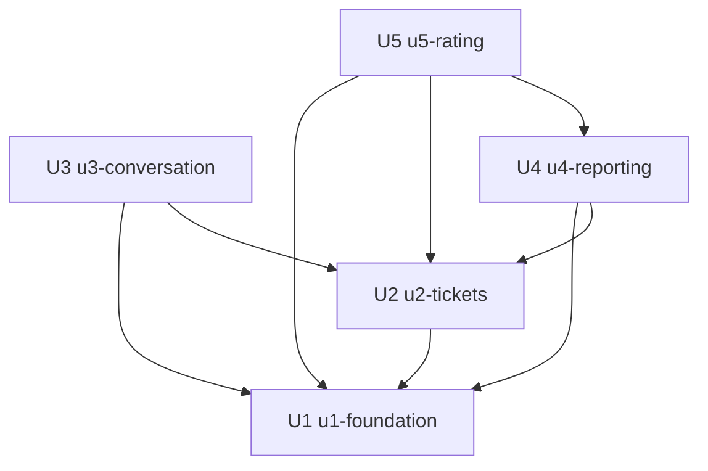

# Dependências entre Unidades — Sistema de Chamados Acadêmicos

Derivado de `unit-of-work.md` e das dependências entre blocos declaradas em `components.md` (em `../domain-design/`), com as respostas Q4 e Q5 de `units-generation-questions.md`.

Este documento descreve **topologia**: o que depende de quê, por onde as unidades se tocam e quais delas não dependem uma da outra. Ele **não** escolhe uma ordem de construção recomendada nem identifica caminho crítico — essas são decisões econômicas do Planejamento de Entrega, que usa este grafo como entrada.

## Grafo de Dependências

```yaml
units:
  - name: u1-foundation
    kind: service
    depends_on: []
  - name: u2-tickets
    kind: service
    depends_on: [u1-foundation]
  - name: u3-conversation
    kind: service
    depends_on: [u1-foundation, u2-tickets]
  - name: u4-reporting
    kind: service
    depends_on: [u1-foundation, u2-tickets]
  - name: u5-rating
    kind: service
    depends_on: [u1-foundation, u2-tickets, u4-reporting]
```

Leitura do diagrama: uma seta de A para B significa "A depende de B".



<!-- Text fallback: U1 (fundação) não depende de nenhuma unidade. U2 (chamados) depende de U1. U3 (conversa) depende de U1 e de U2. U4 (indicadores) depende de U1 e de U2. U5 (avaliação) depende de U1, de U2 e de U4. Nenhuma unidade depende de U3 nem de U5. -->

## Arestas e Origem

| Aresta | Motivo | Origem |
|--------|--------|--------|
| U2 depende de U1 | Tickets usa Auth (ator e perfil), Users (solicitante, responsável, atendente do setor) e Catalog (categoria, setor derivado, status e prioridade). Notifications usa Auth e Users. | `depends_on` de Tickets e Notifications em `components.md` |
| U3 depende de U1 | Conversation usa Auth (ator) e Users (autor da mensagem). | `depends_on` de Conversation |
| U3 depende de U2 | Conversation usa Tickets (existência, situação e visibilidade do chamado, retorno automático de status) e Notifications (mensagem recebida). | `depends_on` de Conversation |
| U4 depende de U1 | Reporting usa Auth (ator e setor) e Catalog (rótulos dos agrupamentos). | `depends_on` de Reporting |
| U4 depende de U2 | Reporting lê chamados e histórico através de Tickets. | `depends_on` de Reporting, ADR-005 |
| U5 depende de U1 | A avaliação precisa do ator e do perfil do solicitante. | FR12.1 |
| U5 depende de U2 | A avaliação se liga a um chamado encerrado do próprio solicitante e estende o bloco Tickets. | FR12.1, rastreabilidade do Desenho de Domínio |
| U5 depende de U4 | A avaliação compõe os números do painel e estende o bloco Reporting. | FR12.2, Q3 |

## Dependências entre Blocos que Não Viram Aresta

- **Auth ↔ Users** e **Auth → Users → Catalog → Auth** (ADR-004): os dois ciclos ficam inteiros dentro de U1, e por isso não aparecem no grafo de unidades.
- **Tickets → Notifications**, com a notificação apontando de volta para o chamado: as duas direções ficam dentro de U2.

## Verificação de Aciclicidade

- Cinco unidades declaradas, cada uma uma única vez; todo nome em `depends_on` é uma unidade declarada; nenhuma unidade depende de si mesma.
- U1 não tem dependência. Nenhuma unidade depende de U3 nem de U5.
- Existe ao menos uma ordenação topológica, portanto o grafo não tem ciclo. As ordenações válidas são: U1, U2, U3, U4, U5 — U1, U2, U4, U3, U5 — U1, U2, U4, U5, U3. A lista enumera o que o grafo permite; não é recomendação de ordem.

## Pontos de Integração

Toda integração entre unidades é chamada direta e síncrona de serviço (Q5 do Desenho de Domínio). Não há eventos.

| De | Para | Tipo | O que atravessa |
|----|------|------|-----------------|
| U2 | U1 | chamada de serviço | ator autenticado e perfil; resolver usuário e verificar vínculo com o setor; resolver categoria e derivar o setor; status e prioridade por chave estável |
| U2 | U1 | dado compartilhado | chave estrangeira de chamado, histórico, passagem por setor e notificação para usuário, categoria, setor, status e prioridade |
| U3 | U1 | chamada de serviço e dado compartilhado | ator; autor da mensagem; chave estrangeira de mensagem para usuário |
| U3 | U2 | chamada de serviço | obter o chamado visível ao ator, com a situação atual; pedir o retorno de Aguardando solicitante para Em análise; gravar notificação de mensagem recebida |
| U3 | U2 | dado compartilhado | chave estrangeira de mensagem para chamado |
| U4 | U1 | chamada de serviço | ator e setor; rótulos de categoria, setor e status |
| U4 | U2 | chamada de serviço | consultas agregadas sobre chamados e histórico, já filtradas pela regra de visibilidade |
| U5 | U1 | chamada de serviço | ator e perfil |
| U5 | U2 | chamada de serviço e dado compartilhado | verificar chamado encerrado do próprio solicitante; chave estrangeira da avaliação para o chamado |
| U5 | U4 | extensão de código | inclusão da avaliação nas consultas e no painel |
| U2, U3, U4, U5 | U1 | estrutura compartilhada | envelope de erro, guard global, `PrismaService`, casca e navegação do frontend, tradução de códigos de erro, teste de enumeração de rotas |
| frontend de cada unidade | backend da mesma unidade | HTTP | contrato definido na etapa de Desenho de Contratos |

Regras que valem para toda aresta:

- **Chave estrangeira só no sentido do grafo** (Q5). Uma tabela nunca aponta para tabela de uma unidade que dependa da sua.
- **Dado de outra unidade é lido pelo serviço dela** (Q5, ADR-004), inclusive em listagens: um nome de categoria ou de usuário exibido junto do chamado vem da chamada ao serviço de U1, e não de consulta à tabela de U1.
- **Nenhuma unidade reimplementa a regra de visibilidade do chamado**: U3, U4 e U5 a obtêm pelo serviço de U2 (ADR-005).

## Oportunidades de Desenvolvimento Paralelo

Paralelismo permitido onde o grafo deixa, com migrações do banco serializadas (Q4).

| Conjunto | Por que não há dependência entre elas | Restrição |
|----------|----------------------------------------|-----------|
| U3 e U4 | Nenhuma aresta entre as duas; ambas dependem apenas de U1 e U2. | U4 não tem entidade e não gera migração, então não há disputa pelo esquema. Tocam juntas o registro de módulos e a navegação do frontend. |
| U3 e U5 | Nenhuma aresta entre as duas. | As duas geram migração: só uma por vez, na ordem em que entram em `main`. Tocam juntas o módulo `tickets` — U3 pelo serviço, U5 por extensão — e a navegação do frontend. |

Não são paralelas: U1 com qualquer outra (todas dependem dela), U2 com U3, U4 ou U5 (todas dependem dela), e U4 com U5 (U5 depende de U4).

## Assumptions & Open Questions

- [assumption] Não existe aresta de U2 para U3, embora a aba de mensagens apareça no detalhe do chamado: U3 acrescenta a aba à tela que U2 entrega, e U2 funciona completa sem ela.
- [assumption] A aresta de U5 para U4 decorre de a avaliação compor os indicadores (FR12.2). Se o Planejamento de Entrega quiser U5 sem U4, a aresta obriga a rever esse requisito, e não apenas a ordem.
- [assumption] A regra "dado de outra unidade é lido pelo serviço dela, inclusive em listagens" aumenta o número de chamadas por listagem. O custo é aceito porque o sistema roda apenas localmente e não tem meta de desempenho (suposição A2 de `requirements.md`).
