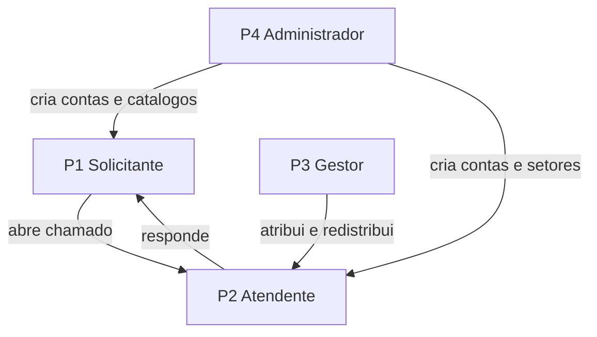

# Personas — Sistema de Chamados Acadêmicos

Derivadas de `../requirements-analysis/requirements.md` (FR2.3, cinco perfis de acesso) e do enquadramento em `../../ideation/intent-capture/intent-statement.md`. As convenções de escrita seguem `../practices-discovery/team-practices.md`.

Quatro personas, não cinco: Aluno e Professor têm comportamento idêntico como solicitantes (suposição A4 de `requirements.md`), então são uma persona única com a diferença de contexto registrada.

A revisão de design endossou essa fusão, observando que o único cenário perdido é o de alto volume de chamados simultâneos do Professor — recuperado como nota dentro de P1 em vez de uma segunda persona.

## P1 — Solicitante (Bruna)

| Campo | Conteúdo |
|-------|----------|
| Nome | Bruna, a Solicitante |
| Perfil de acesso | Aluno ou Professor |
| Papel | Abre solicitações acadêmicas e acompanha o andamento delas |
| Frequência de uso | Baixa e irregular: algumas vezes por semestre, concentrada em períodos de matrícula, notas e documentação |
| Conforto com tecnologia | Médio. Usa o sistema poucas vezes, então não decora onde as coisas ficam |

**Objetivos**

1. Registrar uma solicitação sem precisar descobrir a quem enviá-la.
2. Saber a qualquer momento em que pé está o pedido, sem perguntar a ninguém.
3. Conversar com quem está atendendo, no mesmo lugar onde o pedido foi feito.

**Dores atuais**

1. Manda por e-mail ou WhatsApp e não sabe se chegou nem quem recebeu.
2. Reabre o assunto várias vezes por canais diferentes porque não há um lugar onde consultar.
3. Quando alguém responde, a resposta se perde junto com o resto das mensagens.

**Contexto de uso**

Acessa pelo navegador, normalmente do computador, às vezes do celular entre uma aula e outra. Não tem o sistema aberto o dia todo: entra, resolve, sai. Por isso o aviso in-app precisa estar visível quando ela volta, e não apenas no momento do evento.

**Nota sobre a variação Professor**

O Professor tem exatamente as mesmas permissões e a mesma jornada. A diferença é de contexto: costuma abrir chamados sobre lançamento de notas, frequência e documentação de disciplina, e tende a ter mais chamados simultâneos. Nenhuma história distingue os dois; onde a distinção importar, ela aparece como exemplo dentro do critério de aceitação.

## P2 — Atendente (Carlos)

| Campo | Conteúdo |
|-------|----------|
| Nome | Carlos, o Atendente |
| Perfil de acesso | Atendente |
| Papel | Trabalha a fila do seu setor: assume chamados, responde, transfere quando não é do seu escopo, e encerra |
| Frequência de uso | Alta: é a ferramenta de trabalho dele, aberta o dia inteiro |
| Conforto com tecnologia | Alto no sistema que usa todo dia; baixa tolerância a passos desnecessários |

**Objetivos**

1. Ver de relance o que ainda não tem dono no seu setor.
2. Responder sem perder o histórico do que já foi dito.
3. Livrar-se do que não é do seu setor sem que o chamado se perca no caminho.

**Dores atuais**

1. Recebe pedidos por vários canais e não tem uma fila única para trabalhar.
2. Não sabe se um colega já está tratando o mesmo assunto.
3. Perde tempo reconstruindo o que já foi respondido antes.

**Contexto de uso**

Fica no sistema durante o expediente, alternando entre a fila e o detalhe do chamado. Trabalha no desktop. Volume de chamados simultâneos é o fator que mais afeta sua produtividade, então filtro e recorte da fila importam mais para ele do que para qualquer outra persona.

## P3 — Gestor (Denise)

| Campo | Conteúdo |
|-------|----------|
| Nome | Denise, a Gestora |
| Perfil de acesso | Gestor |
| Papel | Responde pelo setor: distribui carga entre atendentes e acompanha se o setor está dando conta |
| Frequência de uso | Média: entra algumas vezes ao dia para verificar e redistribuir |
| Conforto com tecnologia | Médio-alto |

**Objetivos**

1. Saber se há chamado parado sem dono no setor.
2. Redistribuir carga quando um atendente acumula e outro está livre.
3. Enxergar volume e tempo de atendimento para justificar decisões.

**Dores atuais**

1. Não tem visão de conjunto: descobre gargalo quando alguém reclama.
2. Não consegue redistribuir sem pedir por mensagem a cada atendente.
3. Não tem número nenhum para mostrar que o setor está sobrecarregado.

**Contexto de uso**

Faz tudo o que o Atendente faz, e mais a atribuição de chamados a terceiros. Os indicadores que ela quer são Could have: se não forem construídos, ela ainda opera pela fila, com menos visibilidade.

## P4 — Administrador (Eduardo)

| Campo | Conteúdo |
|-------|----------|
| Nome | Eduardo, o Administrador |
| Perfil de acesso | Administrador |
| Papel | Mantém o sistema utilizável: cadastra usuários, define setores e categorias, ajusta status e prioridades |
| Frequência de uso | Baixa e concentrada: intensa na implantação e no início de semestre, rara no resto do tempo |
| Conforto com tecnologia | Alto |

**Objetivos**

1. Colocar o sistema em uso: criar os setores, as categorias e as contas iniciais.
2. Manter o catálogo aderente à estrutura da instituição conforme ela muda.
3. Destravar quem perdeu o acesso, sem depender de recuperação automática.

**Dores atuais**

1. Estrutura organizacional muda e o sistema fica desatualizado.
2. Precisa acionar suporte técnico para tarefas de rotina.

**Contexto de uso**

Como não há auto-cadastro nem auto-recuperação de senha (FR2.2 e FR1.4), ele é o único caminho para uma pessoa entrar no sistema ou voltar a entrar. Isso torna a gestão de usuários uma capacidade obrigatória, mesmo estando dentro de um bloco Should have.

## Relação e Prioridade entre Personas

| Ordem | Persona | Por quê |
|-------|---------|---------|
| 1 | Solicitante (P1) e Atendente (P2), empatados | A Captura de Intenção fixou os dois com peso equivalente: o valor central é a comunicação entre eles |
| 2 | Administrador (P4) | Sem ele ninguém entra no sistema e não há catálogo; é pré-condição para P1 e P2 existirem |
| 3 | Gestor (P3) | Amplia o que o Atendente faz; o sistema funciona sem ele, com menos visibilidade |

O Administrador aparece em segundo lugar por dependência, não por valor: ele não é o alvo de otimização, mas nada funciona antes dele.

<!-- Text fallback: o Administrador habilita tanto o Solicitante quanto o Atendente, criando contas e catálogos. O Solicitante abre chamado para o Atendente, que responde de volta. O Gestor atua sobre o Atendente, atribuindo e redistribuindo chamados. -->

## Assumptions & Open Questions

- [assumption] Bruna, Carlos, Denise e Eduardo são nomes ilustrativos para dar concretude às personas; não correspondem a pessoas reais e o sistema não será operado por uma instituição real.
- [assumption] O Atendente pertence a exatamente um setor (suposição A3 de `requirements.md`). Se um atendente puder atuar em vários setores, o contexto de uso de P2 muda.
- [assumption] A frequência e o conforto com tecnologia atribuídos a cada persona são inferências do enquadramento, não resultado de pesquisa com usuários — não houve levantamento com usuários reais neste projeto.
