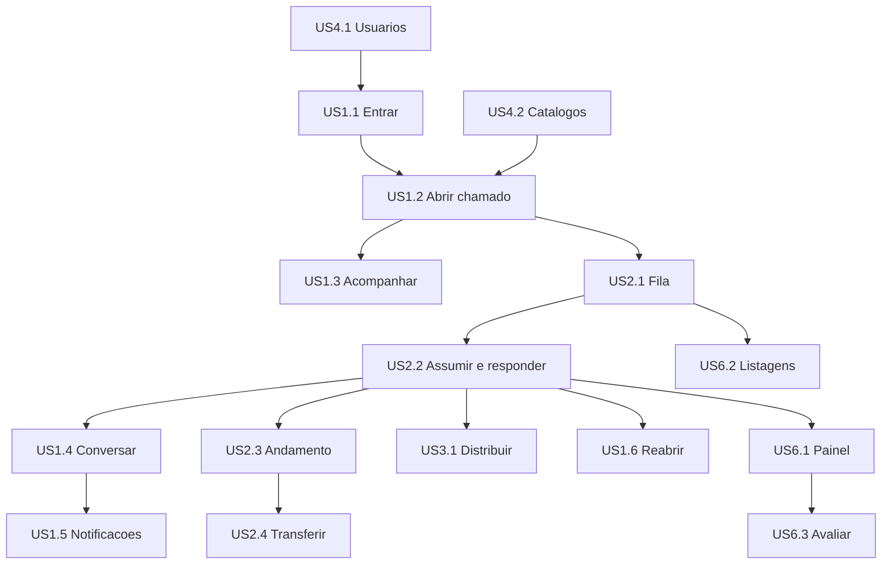

# Histórias de Usuário — Sistema de Chamados Acadêmicos

Derivadas de `../requirements-analysis/requirements.md`, com as personas de `personas.md` e as convenções de `../practices-discovery/team-practices.md`.

Agrupamento por persona: US1 Solicitante, US2 Atendente, US3 Gestor, US4 Administrador, US5 requisitos não funcionais com ator de usuário. Granularidade média — uma história por capacidade coerente. Identificadores `US{grupo}.{sequência}` e `AC{grupo}.{sequência}.{ordem}` são permanentes.

Prioridade herda o grupo de requisitos de origem: Must (FR1–FR8), Could (FR10–FR12). FR9 (área administrativa), classificado Should have em `requirements.md`, foi promovido a Must por decisão do autor do projeto nesta etapa — ver a nota de escopo em US4.1. O corte de MVP é decidido no Planejamento de Entrega.

Este documento incorpora três revisões independentes — design, desenvolvimento e qualidade — registradas em `contributions/`, e quatro decisões do autor tomadas na triagem dessas revisões.

## Critérios Transversais

Valem para toda história, e não são repetidos em cada uma. Cobrem os cinco requisitos não funcionais sem ator de usuário.

| ID | Critério | Origem |
|----|----------|--------|
| CT1 | Nenhuma consulta devolve recurso de outro dono, qualquer que seja o caminho de acesso. O comportamento observável está em AC1.3.5, AC2.1.2 e AC5.2.1; o meio (filtrar o ator dentro da própria cláusula de consulta, nunca buscar e comparar depois) é exigência de revisão de código, não critério de teste. | NFR1 |
| CT2 | Toda resposta de erro usa o envelope `{ error: { code, message, details, traceId } }`; nenhum erro nativo do Prisma vaza. | NFR3 |
| CT3 | Senhas são armazenadas com hash resistente a força bruta, nunca em texto claro. | NFR7 |
| CT4 | O sistema sobe por completo com um único comando de composição de contêineres. | NFR8 |
| CT5 | Nenhum segredo é versionado; a aplicação falha na inicialização se faltar variável de ambiente obrigatória. | NFR9 |
| CT6 | Uma ação negada por perfil responde **403**; um recurso que o ator não pode nem enxergar responde **404**. Onde um critério diz "a ação não está disponível", a resposta esperada da API é 403; onde diz "não vê", é 404. | NFR2, NFR4, revisão de qualidade |
| CT7 | Toda tela que carrega dados de rede tem estado de carregamento (esqueleto), estado vazio explicativo e estado de erro com ação de repetir. | Revisão de design |
| CT8 | Todo formulário valida ao sair do campo, exibe o erro abaixo do campo em texto específico, e mantém o texto digitado quando o envio falha. | Revisão de design |
| CT9 | Todo evento que a US1.5 lista como notificável grava a notificação no momento em que ocorre, mesmo que a tela de notificações ainda não exista. | Revisão de desenvolvimento |
| CT10 | O perfil e a situação (ativo ou inativo) do usuário são lidos do banco a cada requisição autenticada, não confiados ao conteúdo do token. | Revisão de desenvolvimento |
| CT11 | As mensagens exibidas ao usuário derivam do `code` do envelope de erro, traduzido no frontend. Nenhum critério exige uma string em português vinda do backend. | Revisão de qualidade |

## US1 — Solicitante

### US1.1 — Entrar no sistema (Must)

**Como** Solicitante, **quero** entrar no sistema com meu e-mail e senha, **para** acessar meus chamados com segurança.

| ID | Critério de aceitação |
|----|----------------------|
| AC1.1.1 | **Dado** que tenho conta ativa, **quando** informo e-mail e senha corretos, **então** passo a estar autenticado e sou levado à tela de entrada do meu perfil. |
| AC1.1.2 | **Dado** que informo credenciais incorretas, **quando** tento entrar, **então** a resposta traz um único `code` de credencial inválida, idêntico para e-mail inexistente e para senha errada. |
| AC1.1.3 | **Dado** que minha conta foi desativada, **quando** informo credenciais corretas, **então** não entro no sistema, e uma sessão já aberta deixa de funcionar na requisição seguinte (ver CT10). |
| AC1.1.4 | **Dado** que estou no sistema, **quando** saio, **então** o cookie de sessão é apagado e uma nova requisição sem novo login retorna 401. |
| AC1.1.5 | **Dado** que minha sessão expirou, **quando** faço uma requisição, **então** recebo 401 e sou levado à tela de login. |
| AC1.1.6 | **Dado** que estou na tela de login, **quando** a observo, **então** não há link de recuperação de senha. |
| AC1.1.7 | **Dado** que autentico com sucesso, **quando** inspeciono o cabeçalho `Set-Cookie` da resposta, **então** o cookie de sessão traz o atributo `HttpOnly`, e o `SameSite` configurado. |

Cobre: FR1.1, FR1.2, FR1.3, FR1.4, FR2.6.
INVEST: depende de US4.1 apenas para existir uma conta; nenhuma outra história é pré-requisito. Pequena, e testável por resposta HTTP observável.

### US1.2 — Abrir um chamado (Must)

**Como** Solicitante, **quero** abrir um chamado escolhendo a categoria e descrevendo o problema, **para** registrar minha solicitação sem precisar descobrir a quem enviá-la.

| ID | Critério de aceitação |
|----|----------------------|
| AC1.2.1 | **Dado** que estou no formulário de abertura, **quando** escolho uma categoria, **então** o setor responsável aparece preenchido e não editável. |
| AC1.2.2 | **Dado** que preencho categoria, título e descrição, **quando** envio, **então** o chamado é criado com status Aberto, sem responsável, e sou levado ao detalhe dele. |
| AC1.2.3 | **Dado** que não escolho prioridade, **quando** envio, **então** o chamado é criado com prioridade Normal. |
| AC1.2.4 | **Dado** que deixo título ou descrição em branco, **quando** envio, **então** vejo erro no campo correspondente e o chamado não é criado. |
| AC1.2.5 | **Dado** que envio um setor diferente na requisição, **quando** o servidor processa, **então** o setor gravado é o derivado da categoria, e não o enviado. |
| AC1.2.6 | **Dado** que uma categoria está inativa, **quando** abro o formulário, **então** ela não aparece entre as opções. |

Cobre: FR4.1, FR4.2, FR3.6, FR3.7.

### US1.3 — Acompanhar meus chamados (Must)

**Como** Solicitante, **quero** listar e consultar meus chamados com o histórico completo, **para** saber em que pé está cada um sem perguntar a ninguém.

| ID | Critério de aceitação |
|----|----------------------|
| AC1.3.1 | **Dado** que tenho chamados, **quando** abro a listagem, **então** vejo apenas os meus, com identificador, título, categoria, setor, status e data da última atualização. |
| AC1.3.2 | **Dado** que aplico filtro por status, categoria ou setor, **quando** a lista recarrega, **então** apenas os chamados correspondentes aparecem, e o filtro persiste ao trocar de página. |
| AC1.3.3 | **Dado** que não tenho nenhum chamado, **quando** abro a listagem, **então** vejo uma mensagem explicativa e um botão para abrir o primeiro. |
| AC1.3.4 | **Dado** que abro o detalhe de um chamado meu, **quando** a tela carrega, **então** vejo descrição, metadados, mensagens e histórico de alterações em abas separadas. |
| AC1.3.5 | **Dado** o identificador de um chamado de outro solicitante, **quando** tento abri-lo, **então** recebo 404. |
| AC1.3.6 | **Dado** que o chamado teve alterações, **quando** abro a aba de histórico, **então** vejo cada alteração com autor, momento, valor anterior e valor novo, em ordem cronológica. |
| AC1.3.7 | **Dado** que tenho mais chamados do que cabem numa página, **quando** navego entre páginas, **então** a contagem total é exibida e os filtros são preservados. |
| AC1.3.8 | **Dado** que a listagem não pôde ser carregada, **quando** a tela abre, **então** vejo mensagem de erro com ação de tentar novamente. |

Cobre: FR4.3, FR4.4, FR4.5, FR4.6, FR4.8.

### US1.4 — Conversar dentro do chamado (Must)

**Como** Solicitante, **quero** trocar mensagens com quem está atendendo, dentro do próprio chamado, **para** não perder o fio da conversa em outro canal.

| ID | Critério de aceitação |
|----|----------------------|
| AC1.4.1 | **Dado** que estou no detalhe de um chamado meu não encerrado, **quando** envio uma mensagem, **então** ela aparece na conversa com meu nome e o momento do envio. |
| AC1.4.2 | **Dado** que o chamado está encerrado, **quando** abro a conversa, **então** o campo de envio está desabilitado com aviso, e uma tentativa de envio pela API é recusada. |
| AC1.4.3 | **Dado** que enviei uma mensagem, **quando** procuro editá-la ou apagá-la, **então** não existe essa ação nem rota correspondente. |
| AC1.4.4 | **Dado** que o chamado ainda não tem mensagens, **quando** abro a conversa, **então** vejo um estado vazio convidando a escrever a primeira. |
| AC1.4.5 | **Dado** que envio uma mensagem, **quando** o chamado tem responsável, **então** o responsável recebe notificação. |

Cobre: FR6.1, FR6.2, FR6.3, FR6.4, FR7.2.

### US1.5 — Ser avisado do que muda (Must)

**Como** Solicitante, **quero** ser avisado dentro do sistema quando algo muda no meu chamado, **para** não precisar entrar toda hora para verificar.

| ID | Critério de aceitação |
|----|----------------------|
| AC1.5.1 | **Dado** que meu chamado recebe mensagem, muda de status, de responsável ou de setor, **quando** o evento ocorre, **então** uma notificação é criada para mim. |
| AC1.5.2 | **Dado** que tenho notificações não lidas, **quando** entro no sistema, **então** o contador do sino mostra a quantidade. |
| AC1.5.3 | **Dado** que abro uma notificação, **quando** clico nela, **então** sou levado ao chamado correspondente e ela é marcada como lida. |
| AC1.5.4 | **Dado** que tenho várias não lidas, **quando** escolho marcar todas como lidas, **então** o contador zera. |
| AC1.5.5 | **Dado** qualquer evento do sistema, **quando** ele gera notificação, **então** nenhum e-mail nem mensagem por canal externo é enviado. |
| AC1.5.6 | **Dado** um chamado de outro solicitante, **quando** ele muda, **então** eu não recebo notificação. |

Cobre: FR7.1, FR7.4, FR7.5.

### US1.6 — Reabrir um chamado encerrado (Must)

**Como** Solicitante, **quero** reabrir um chamado encerrado quando a resposta não resolveu, **para** retomar o assunto sem começar do zero.

| ID | Critério de aceitação |
|----|----------------------|
| AC1.6.1 | **Dado** um chamado meu encerrado há menos de 3 dias corridos, **quando** peço a reabertura, **então** ele volta ao status Aberto mantendo o último responsável. |
| AC1.6.2 | **Dado** um chamado meu encerrado há 72 horas ou mais, contadas do momento do encerramento, **quando** peço a reabertura, **então** ela é recusada com o código de erro de prazo vencido. O limite é exatamente 72 horas: em 71h59 a reabertura é aceita, em 72h00 é recusada. |
| AC1.6.3 | **Dado** que reabri um chamado, **quando** a reabertura é concluída, **então** o último responsável recebe notificação. |
| AC1.6.4 | **Dado** um chamado encerrado de outro solicitante, **quando** tento reabri-lo, **então** recebo 404. |
| AC1.6.5 | **Dado** que reabri um chamado, **quando** abro o histórico, **então** a reabertura consta como transição de Encerrado para Aberto, com meu nome e o momento. |
| AC1.6.6 | **Dado** que sou Atendente ou Gestor, **quando** tento reabrir um chamado encerrado, **então** a API responde 403. |
| AC1.6.7 | **Dado** um chamado meu em qualquer status não encerrado, **quando** o encerro, **então** o status passa a Encerrado e o responsável, se houver, recebe notificação. |

Cobre: FR8.3, FR8.4, FR7.3.

## US2 — Atendente

### US2.1 — Trabalhar a fila do setor (Must)

**Como** Atendente, **quero** ver e filtrar a fila do meu setor, **para** saber o que precisa de mim agora.

| ID | Critério de aceitação |
|----|----------------------|
| AC2.1.1 | **Dado** que pertenço a um setor, **quando** abro a fila, **então** vejo os chamados desse setor com recortes "não atribuídos", "meus" e "todos". |
| AC2.1.2 | **Dado** um chamado de setor ao qual não pertenço e pelo qual meu setor nunca passou, **quando** consulto a fila ou tento abri-lo, **então** ele não aparece e o acesso direto retorna 404. |
| AC2.1.3 | **Dado** um chamado que passou pelo meu setor antes de ser transferido, **quando** consulto, **então** ele permanece visível para mim, em leitura, incluindo suas mensagens. |
| AC2.1.4 | **Dado** que não tenho setor vinculado, **quando** tento abrir a fila, **então** o acesso é negado com mensagem explicando a falta de vínculo. |
| AC2.1.5 | **Dado** que aplico filtro por status ou categoria, **quando** troco de página, **então** o recorte e os filtros são preservados e a contagem total é exibida. |
| AC2.1.6 | **Dado** que a fila não pôde ser carregada, **quando** a tela abre, **então** vejo mensagem de erro com ação de tentar novamente. |
| AC2.1.7 | **Dado** um chamado que não é meu, não é do meu setor e nunca passou por ele, **quando** acesso diretamente o recurso de mensagens desse chamado pelo identificador, **então** recebo 404 e nenhuma mensagem é devolvida. |

Cobre: FR5.1, FR5.6, FR2.7, FR4.8, FR6.5.

### US2.2 — Assumir e responder (Must)

**Como** Atendente, **quero** assumir um chamado e responder ao solicitante, **para** ficar claro que estou tratando aquele caso.

| ID | Critério de aceitação |
|----|----------------------|
| AC2.2.1 | **Dado** um chamado Aberto sem responsável no meu setor, **quando** o assumo, **então** eu me torno o responsável e o status passa a Em análise. |
| AC2.2.2 | **Dado** um chamado já assumido por outro atendente, **quando** tento assumi-lo, **então** a ação é recusada com mensagem informando o responsável atual. |
| AC2.2.3 | **Dado** que sou o responsável, **quando** envio uma mensagem, **então** ela aparece na conversa e o solicitante recebe notificação. |
| AC2.2.4 | **Dado** que sou o responsável, **quando** encerro o chamado, **então** o status passa a Encerrado e o solicitante recebe notificação. |
| AC2.2.5 | **Dado** que o chamado está Encerrado, **quando** tento enviar mensagem, **então** a ação é recusada. |

Cobre: FR5.2, FR5.7, FR8.2, FR6.1, FR7.1, FR7.2.

### US2.3 — Controlar o andamento do chamado (Must)

**Como** Atendente, **quero** mover o chamado entre os estados de andamento e ajustar sua prioridade, **para** que a fila reflita a situação real de cada caso.

| ID | Critério de aceitação |
|----|----------------------|
| AC2.3.1 | **Dado** que sou o responsável e preciso de informação do solicitante, **quando** marco o chamado como Aguardando solicitante, **então** o status muda e o solicitante recebe notificação. |
| AC2.3.2 | **Dado** um chamado em Aguardando solicitante, **quando** o solicitante envia uma mensagem, **então** o status volta automaticamente para Em análise e o responsável recebe notificação. |
| AC2.3.3 | **Dado** que sou Atendente ou Gestor, **quando** altero a prioridade de um chamado do meu setor, **então** a nova prioridade vale e a alteração consta no histórico com meu nome e o momento. |
| AC2.3.4 | **Dado** que sou Solicitante, **quando** tento alterar a prioridade de um chamado já criado, **então** a API responde 403. |
| AC2.3.5 | **Dado** um chamado em qualquer status, **quando** tento uma transição fora da tabela de transições válidas deste documento (seção "Consequências para Artefatos Anteriores"), **então** a ação é recusada com código de erro de transição inválida. |
| AC2.3.6 | **Dado** qualquer mudança de status, responsável, setor ou prioridade, **quando** ela ocorre, **então** o histórico registra autor, momento, valor anterior e valor novo. |

Cobre: FR4.7, FR8.1, FR8.5, FR4.6, e fecha as lacunas R-01 (alteração de prioridade) e R-03 (ator das transições de Aguardando solicitante).

### US2.4 — Transferir para outro setor (Must)

**Como** Atendente, **quero** transferir um chamado para o setor correto com uma justificativa, **para** que ele chegue a quem sabe resolver sem se perder no caminho.

| ID | Critério de aceitação |
|----|----------------------|
| AC2.4.1 | **Dado** um chamado do meu setor em qualquer status não encerrado, **quando** transfiro para outro setor com justificativa, **então** o responsável é removido, o status volta para **Aberto**, e o chamado aparece como não atribuído na fila de destino. |
| AC2.4.2 | **Dado** que escolho o mesmo setor atual, **quando** confirmo, **então** a transferência é recusada com mensagem específica. |
| AC2.4.3 | **Dado** que deixo a justificativa em branco, **quando** confirmo, **então** a transferência é recusada. |
| AC2.4.4 | **Dado** que a transferência ocorreu, **quando** consulto o histórico, **então** ela consta com setor de origem, setor de destino, justificativa, autor e momento. |
| AC2.4.5 | **Dado** que a transferência ocorreu, **quando** o evento é processado, **então** o solicitante recebe notificação. |
| AC2.4.6 | **Dado** um chamado Encerrado, **quando** tento transferi-lo, **então** a API responde 403. |
| AC2.4.7 | **Dado** um chamado transferido mais de uma vez, **quando** consulto o registro de passagens por setor, **então** cada setor por onde ele passou consta com momento de entrada e de saída. |

Cobre: FR5.4, FR5.5, FR4.6, FR7.1.

## US3 — Gestor

**Herança de capacidades.** A Gestora executa tudo o que o Atendente executa (US2.1 a US2.4) dentro do seu setor, mais o que segue. As histórias de US2 não são repetidas aqui; onde um critério de US2 diz "Atendente", leia "Atendente ou Gestor" salvo indicação contrária.

### US3.1 — Distribuir a carga do setor (Must)

**Como** Gestora, **quero** atribuir um chamado a um atendente do meu setor, **para** equilibrar a carga sem depender de cada um assumir por conta.

| ID | Critério de aceitação |
|----|----------------------|
| AC3.1.1 | **Dado** um chamado Aberto do meu setor, **quando** o atribuo a um atendente do setor, **então** ele passa a ser o responsável e o status muda para Em análise. |
| AC3.1.2 | **Dado** um atendente de outro setor, **quando** tento atribuir a ele, **então** a ação é recusada. |
| AC3.1.3 | **Dado** um chamado já com responsável, **quando** o reatribuo a outro atendente do setor, **então** o responsável é substituído e a mudança consta no histórico. |
| AC3.1.4 | **Dado** que sou Atendente e não Gestor, **quando** tento atribuir um chamado a outra pessoa, **então** a API responde 403. |
| AC3.1.5 | **Dado** que a atribuição ocorreu, **quando** o evento é processado, **então** o solicitante recebe notificação de mudança de responsável. |

Cobre: FR5.3, FR4.6, FR7.1, e fecha a lacuna R-04 (a atribuição pelo gestor transiciona o chamado para Em análise, igual a assumir).

## US4 — Administrador

### US4.1 — Gerenciar usuários e acessos (Must)

**Como** Administrador, **quero** cadastrar e manter as contas dos usuários, **para** que as pessoas consigam entrar no sistema, já que não há auto-cadastro nem recuperação automática.

| ID | Critério de aceitação |
|----|----------------------|
| AC4.1.1 | **Dado** que informo nome, e-mail, perfil e senha inicial, **quando** salvo, **então** o usuário é criado e consegue entrar com essa senha. |
| AC4.1.2 | **Dado** um e-mail já cadastrado, **quando** tento criar outro usuário com ele, **então** a criação é recusada com erro específico. |
| AC4.1.3 | **Dado** um usuário existente, **quando** altero seu perfil, **então** a mudança vale na requisição autenticada seguinte dele. |
| AC4.1.4 | **Dado** um usuário que perdeu o acesso, **quando** redefino a senha dele, **então** a senha anterior deixa de autenticar e a nova funciona. |
| AC4.1.5 | **Dado** um usuário existente, **quando** o desativo, **então** ele não consegue mais entrar, mas seus chamados e mensagens permanecem visíveis no histórico. |
| AC4.1.6 | **Dado** que crio um Atendente ou Gestor, **quando** não informo o setor, **então** a criação é recusada. |
| AC4.1.7 | **Dado** que não sou Administrador, **quando** tento acessar a gestão de usuários, **então** recebo 403. |
| AC4.1.8 | **Dado** o conjunto de rotas públicas da aplicação, **quando** ele é enumerado, **então** não existe nenhuma rota de criação de conta por conta própria. |
| AC4.1.9 | **Dado** o formulário de criação de usuário, **quando** escolho o perfil, **então** as opções são exatamente cinco: Aluno, Professor, Atendente, Gestor e Administrador, e cada usuário recebe exatamente um. |

Cobre: FR2.1, FR2.2, FR2.3, FR2.4, FR2.5, FR2.6, FR2.7, FR9.1.
**Nota de escopo.** `requirements.md` classifica FR9 como Should have, e uma regra afirmada em `project.md` diz que o corte mínimo exige apenas administrabilidade pelo modelo de dados. Ambas foram superadas por decisão do autor do projeto nesta etapa: **toda a interface administrativa entra no corte mínimo**, porque sem auto-cadastro (FR2.2) e sem auto-recuperação de senha (FR1.4), essa interface é o único caminho para alguém entrar ou voltar a entrar no sistema. A regra em `project.md` que classifica a área administrativa como Should have **permanece na memória do projeto e não foi corrigida**: no ritual de aprendizados desta etapa o autor optou por não registrar a correção. Quem ler aquela regra numa etapa seguinte encontrará a classificação antiga; esta nota é o único registro de que ela foi superada.

### US4.2 — Manter os catálogos de classificação (Must)

**Como** Administrador, **quero** manter setores, categorias, status e prioridades, **para** que o sistema reflita a estrutura real da instituição.

| ID | Critério de aceitação |
|----|----------------------|
| AC4.2.1 | **Dado** que crio um setor com nome, **quando** salvo, **então** ele passa a estar disponível como destino de categorias. |
| AC4.2.2 | **Dado** que crio uma categoria, **quando** não escolho um setor, **então** a criação é recusada. |
| AC4.2.3 | **Dado** um setor ou categoria inativo, **quando** um solicitante abre o formulário de chamado, **então** ele não aparece entre as opções. |
| AC4.2.4 | **Dado** um item de catálogo em uso por chamados existentes, **quando** o desativo, **então** os chamados existentes continuam exibindo-o inalterado. |
| AC4.2.5 | **Dado** o sistema recém-instalado, **quando** consulto os catálogos, **então** existem exatamente quatro status (Aberto, Em análise, Aguardando solicitante, Encerrado) e três prioridades (Baixa, Normal, Alta), com Normal como padrão. |
| AC4.2.6 | **Dado** que desativo um item em uso, **quando** confirmo, **então** uma confirmação explica antes o efeito sobre chamados existentes. |

Cobre: FR3.1, FR3.2, FR3.3, FR3.4, FR3.5, FR3.6, FR3.7, FR9.2, FR9.3.
**Nota de escopo.** Must pela mesma decisão registrada em US4.1.

## US5 — Qualidades com Ator de Usuário

Histórias derivadas dos requisitos não funcionais que têm ator e valor observável. Os demais NFR estão nos Critérios Transversais no topo deste documento.

**Por que continuam histórias e não critérios transversais.** A revisão de desenvolvimento objetou que US5.1 a US5.4 se comportam como critérios transversais: não entram no grafo de dependências e se aplicam a todas as demais. A objeição é procedente quanto ao comportamento. Elas permanecem histórias por dois motivos deliberados. Primeiro, a Q7 desta etapa decidiu exatamente isso: os quatro NFR com ator viram história. Segundo, a rastreabilidade individual a NFR2, NFR4, NFR5 e NFR6 se perde se elas virarem linhas de uma tabela transversal — e cobertura por requisito é o critério principal de teste afirmado neste projeto. O custo aceito é a assimetria apontada: quatro histórias fora do grafo de construção.

### US5.1 — Não ver o que não é meu (Must)

**Como** Solicitante, **quero** ter certeza de que ninguém acessa meus chamados sem direito, **para** confiar em registrar assuntos pessoais no sistema.

| ID | Critério de aceitação |
|----|----------------------|
| AC5.1.1 | **Dado** qualquer endpoint não público, **quando** um perfil sem direito o acessa, **então** a resposta é 403 e nenhum dado do recurso é devolvido. |
| AC5.1.2 | **Dado** um recurso com dono, **quando** outro usuário o acessa pelo identificador, **então** ele não obtém o conteúdo. |
| AC5.1.3 | **Dado** uma rota autenticada sem marcação explícita de perfil, **quando** qualquer perfil a acessa, **então** a resposta é 403. |
| AC5.1.4 | **Dado** o conjunto de rotas registradas na aplicação, **quando** ele é enumerado, **então** nenhuma rota não pública está sem marcação de perfil. |

Cobre: NFR2, FR1.5.

### US5.2 — Não revelar o que existe (Must)

**Como** Solicitante, **quero** que o sistema não revele sequer a existência de chamados alheios, **para** que ninguém descubra assuntos de terceiros por tentativa.

| ID | Critério de aceitação |
|----|----------------------|
| AC5.2.1 | **Dado** um recurso que existe mas que não posso ver, **quando** o acesso por identificador, **então** a resposta é 404, e não 403. |
| AC5.2.2 | **Dado** um identificador inexistente e um identificador existente porém inacessível, **quando** comparo as duas respostas, **então** elas são indistinguíveis. |

Cobre: NFR4.

### US5.3 — Usar o sistema só pelo teclado (Must)

**Como** Solicitante que não usa mouse, **quero** completar as tarefas principais apenas pelo teclado, **para** conseguir usar o sistema.

| ID | Critério de aceitação |
|----|----------------------|
| AC5.3.1 | **Dado** qualquer tela do corte mínimo, **quando** navego apenas com Tab, Enter, Espaço, setas e Escape, **então** consigo alcançar e acionar todos os elementos interativos. |
| AC5.3.2 | **Dado** qualquer elemento com foco, **quando** o observo, **então** o indicador de foco está visível. |
| AC5.3.3 | **Dado** qualquer campo de formulário, **quando** o observo, **então** ele tem rótulo visível associado, não apenas texto de exemplo dentro do campo. |
| AC5.3.4 | **Dado** qualquer informação transmitida por cor (status, prioridade), **quando** a observo, **então** ela também é transmitida por texto. |
| AC5.3.5 | **Dado** qualquer par de texto e fundo nas telas do corte mínimo, **quando** o contraste é medido, **então** ele atende o mínimo de WCAG 2.1 nível A. |
| AC5.3.6 | **Dado** o tema padrão do Shadcn, **quando** o código é revisado, **então** nenhuma cor de texto ou de fundo sobrescreve a paleta do tema — o contraste de AC5.3.5 vem do tema, e desviar dele exige justificativa registrada. |

**Onde isto é verificado.** Não há ferramenta de teste de navegador neste projeto. AC5.3.1, AC5.3.2, AC5.3.5 e AC5.3.6 são verificados por **inspeção manual**, com um roteiro datado versionado no repositório listando cada tela do corte mínimo e o resultado da passagem. AC5.3.3 e AC5.3.4 têm parte automatizável em teste de componente: presença de rótulo associado ao campo, e presença de texto além da cor.

Cobre: NFR5.

### US5.4 — Usar pelo celular (Must)

**Como** Solicitante entre uma aula e outra, **quero** abrir e acompanhar chamados pelo celular, **para** não depender de estar no computador.

| ID | Critério de aceitação |
|----|----------------------|
| AC5.4.1 | **Dado** uma largura de tela de 375px, **quando** abro qualquer tela do **Solicitante** (login, meus chamados, novo chamado, detalhe do chamado, notificações), **então** não há rolagem horizontal. |
| AC5.4.4 | **Dado** uma largura de 375px nas telas de trabalho (fila do setor, administração, painel), **quando** as abro, **então** a rolagem horizontal é aceita dentro do próprio contentor da tabela, sem que a página inteira role na horizontal. Essas telas são de uso em desktop, conforme as personas P2, P3 e P4. |
| AC5.4.2 | **Dado** a listagem de chamados em 375px, **quando** a observo, **então** ela se apresenta como cartões, e não como tabela com colunas cortadas. |
| AC5.4.3 | **Dado** a navegação em 375px, **quando** a observo, **então** a barra lateral está recolhida em menu acionável. |

**Onde isto é verificado.** Também por inspeção manual, no mesmo roteiro datado. O ambiente de teste do frontend não tem motor de layout, então nenhum destes três critérios tem casa automatizada. Isto é consequência aceita de não haver teste de navegador no projeto, e não uma omissão.

Cobre: NFR6.

## US6 — Indicadores e Avaliação (Could)

Construídas apenas se houver folga, e nunca antes de US1 a US5 estarem concluídas e testadas.

### US6.1 — Acompanhar o desempenho do setor (Could)

**Como** Gestora, **quero** ver volume e tempos dos chamados do meu setor, **para** identificar gargalos e justificar decisões.

| ID | Critério de aceitação |
|----|----------------------|
| AC6.1.1 | **Dado** que abro o painel, **quando** ele carrega, **então** vejo quantidade de chamados por status, por categoria e por setor. |
| AC6.1.2 | **Dado** que escolho um período, **quando** o painel recarrega, **então** os números refletem apenas aquele período. |
| AC6.1.3 | **Dado** um período sem chamados, **quando** o painel carrega, **então** vejo um estado vazio explicativo em vez de zeros sem contexto. |
| AC6.1.4 | **Dado** que sou Gestora, **quando** vejo os números, **então** eles correspondem apenas aos chamados visíveis ao meu perfil. |
| AC6.1.5 | **Dado** o tempo médio de atendimento e de resolução, **quando** os vejo, **então** nenhum limiar ou meta é apresentado junto. |

Cobre: FR10.1, FR10.2, FR10.3.
Pendência conhecida: os marcos de início e fim de "tempo de atendimento" e "tempo de resolução" não estão definidos (achado R-06 da revisão dos requisitos). Precisam ser definidos antes de esta história ser construída.

### US6.2 — Consultar listagens filtradas (Could)

**Como** Gestora, **quero** consultar listagens de chamados com filtros combinados, **para** responder perguntas pontuais sem pedir ajuda.

| ID | Critério de aceitação |
|----|----------------------|
| AC6.2.1 | **Dado** que combino filtros de status, categoria, setor e período, **quando** aplico, **então** a listagem reflete a combinação. |
| AC6.2.2 | **Dado** qualquer listagem, **quando** procuro exportar em arquivo, **então** não existe essa ação nem rota correspondente. |

Cobre: FR11.1.

### US6.3 — Avaliar o atendimento (Could)

**Como** Solicitante, **quero** avaliar o atendimento quando o chamado é encerrado, **para** registrar se fui bem atendido.

| ID | Critério de aceitação |
|----|----------------------|
| AC6.3.1 | **Dado** um chamado meu encerrado, **quando** o abro, **então** posso registrar uma avaliação. |
| AC6.3.2 | **Dado** que não avalio, **quando** o chamado é encerrado, **então** o encerramento acontece normalmente. |
| AC6.3.3 | **Dado** que avaliei, **quando** o painel de indicadores é gerado, **então** minha avaliação compõe os números. |

Cobre: FR12.1, FR12.2.
Pendência conhecida: a escala e a semântica da avaliação não estão definidas em `requirements.md`. Precisam ser definidas antes de esta história ser construída.

## Consequências para Artefatos Anteriores

A decisão do autor na triagem do grupo invalidou parte de um artefato já aprovado. Registrado aqui para que o desenho funcional não reproduza a versão antiga.

| Artefato | O que muda | Origem |
|----------|-----------|--------|
| `../requirements-analysis/requirements.md` FR8.1 | A lista de transições válidas precisa ganhar **Em análise → Aberto** e **Aguardando solicitante → Aberto**, ambas disparadas exclusivamente pela transferência entre setores. Sem elas, AC2.3.5 (que recusa toda transição fora de FR8.1) contradiz AC2.4.1, e o beco sem saída que a decisão pretendia fechar apenas muda de lugar. | AC2.4.1, decisão da triagem sobre transferência |
| `../requirements-analysis/requirements.md` FR5.7 | O encerramento deixa de ser exclusivo de atendente e gestor: o solicitante encerra o próprio chamado a qualquer momento. | AC1.6.7, decisão da triagem sobre encerramento |
| `../requirements-analysis/requirements.md` FR9 | Deixa de ser Should have. Toda a interface administrativa passa ao corte mínimo. | US4.1, US4.2, decisão da triagem sobre a área administrativa |

A lista completa de transições válidas, já com as duas acrescentadas, é esta:

| De | Para | Disparada por |
|----|------|---------------|
| Aberto | Em análise | atendente assume, ou gestor atribui |
| Em análise | Aguardando solicitante | atendente marca que aguarda o solicitante |
| Aguardando solicitante | Em análise | solicitante responde (automático) |
| Em análise | Aberto | transferência entre setores |
| Aguardando solicitante | Aberto | transferência entre setores |
| Aberto | Encerrado | atendente, gestor ou solicitante encerra |
| Em análise | Encerrado | atendente, gestor ou solicitante encerra |
| Aguardando solicitante | Encerrado | atendente, gestor ou solicitante encerra |
| Encerrado | Aberto | solicitante reabre, dentro de 72 horas |

## Consequências de Modelo que Estas Histórias Implicam

Levantadas pelas revisões de desenvolvimento e qualidade. Não são requisitos novos: são coisas que o desenho de domínio será obrigado a inventar se não forem ditas aqui.

| # | Consequência | Qual critério a exige |
|---|--------------|----------------------|
| M1 | **Registro de passagem por setor.** Um campo "setor anterior" quebra na segunda transferência. É preciso uma tabela de passagens com setor, entrada e saída. | AC2.1.3, AC2.4.7 |
| M2 | **Chave estável de status.** Status é tabela administrável (FR3.3), mas a máquina de transições é módulo puro sem Prisma. As duas coisas só convivem se cada status tiver uma chave estável em inglês (`OPEN`, `IN_ANALYSIS`, `WAITING_REQUESTER`, `CLOSED`) além do rótulo editável. | AC2.3.5, FR3.3, FR8.1 |
| M3 | **Relógio injetável.** A janela de 72 horas não é testável com relógio do sistema em teste de integração com Postgres real. O serviço precisa receber a fonte de tempo. | AC1.6.1, AC1.6.2 |
| M4 | **Perfil lido por requisição.** Desativar um usuário ou trocar seu perfil precisa valer imediatamente, o que exige carregar o usuário do banco a cada requisição em vez de confiar no token. | CT10, AC1.1.3, AC4.1.3, AC4.1.5 |
| M5 | **Enumeração de rotas.** Verificar que nenhuma rota não pública ficou sem marcação de perfil exige percorrer as rotas registradas em tempo de teste. | AC5.1.4, AC4.1.8 |

## Dependências entre Histórias

O grafo abaixo é de **ordem de construção**, não de dependência de sentido. A US1.5 (notificações) não bloqueia as histórias que geram eventos: pelo CT9, cada evento grava a notificação assim que ocorre, mesmo antes de existir tela para lê-la.

<!-- Text fallback: US4.1 (gestão de usuários) habilita US1.1 (entrar), e US4.2 (catálogos) habilita US1.2 (abrir chamado). US1.1 leva a US1.2. De US1.2 partem US1.3 (acompanhar) e US2.1 (fila do setor). US2.1 leva a US2.2 (assumir e responder), que por sua vez habilita US1.4 (conversar), US2.3 (andamento), US3.1 (distribuir), US1.5 (notificações), US1.6 (reabrir) e US6.1 (painel). US2.3 leva a US2.4 (transferir). US6.1 leva a US6.3 (avaliar). US2.1 leva a US6.2 (listagens). As histórias US5.1 a US5.4 são transversais e não aparecem no grafo: seus critérios se aplicam a todas as demais. -->

Caminho crítico: **US4.1 → US1.1 → US1.2 → US2.1 → US2.2**. É a cadeia que precisa existir antes de qualquer outra coisa funcionar de ponta a ponta.

## Conformidade INVEST

| Critério | Como foi atendido |
|----------|-------------------|
| Independent | Cada história entrega valor por si; as dependências do grafo são de ordem de construção, não de sentido. A exceção declarada é US6.3, que só faz sentido com US6.1. |
| Negotiable | Os critérios descrevem resultado observável, não implementação. Nenhum critério nomeia tabela, rota ou componente. |
| Valuable | Cada história nomeia o benefício. As quatro de US5 derivam de qualidade, e por isso o benefício é de confiança ou de acesso, não de funcionalidade nova. |
| Estimable | Granularidade média, dimensionável por quem vai construir. A contagem de critérios varia de 2 (US6.2) a 9 (US4.1): as histórias de qualidade e as Could have são naturalmente mais curtas que as do núcleo, e isso reflete o escopo de cada uma, não falta de detalhe. |
| Small | Nenhuma história abrange mais de uma capacidade coerente. US4.2 é a maior, com seis critérios cobrindo quatro entidades de catálogo com comportamento idêntico. |
| Testable | Quase todo critério tem resultado verificável automaticamente: código HTTP, presença de registro, estado após ação, ou ausência de rota. As exceções estão declaradas: AC5.3.1, AC5.3.2, AC5.3.5, AC5.4.1, AC5.4.2, AC5.4.3, CT1 e CT4 são verificados por inspeção manual ou revisão de código, porque não há teste de navegador neste projeto. Cada um traz a sua casa de verificação escrita ao lado. |

## Assumptions & Open Questions

Quatro decisões do autor do projeto, tomadas na triagem do grupo, estão incorporadas acima e não são suposições:

- A transferência devolve o chamado ao status Aberto além de remover o responsável (AC2.4.1). Fecha o beco sem saída em que um chamado transferido ficava em Em análise sem dono e sem ninguém poder assumi-lo.
- Toda a interface administrativa entra no corte mínimo (US4.1, US4.2), superando a classificação Should have de FR9 e a regra correspondente em `project.md`.
- O solicitante pode encerrar o próprio chamado a qualquer momento (AC1.6.7), e continua podendo reabri-lo dentro da janela.
- A regra em `project.md` sobre a área administrativa **não foi corrigida**: no ritual de aprendizados desta etapa o autor optou por não registrá-la. A contradição entre aquela regra e esta decisão permanece, e a nota de escopo em US4.1 é o único lugar onde ela está registrada.

Suposições que permanecem:

- [assumption] AC2.3.2 define que o chamado volta automaticamente de Aguardando solicitante para Em análise quando o solicitante responde. Fecha a lacuna R-03 da revisão dos requisitos, mas o retorno automático é decisão do redator: a alternativa seria o atendente mover manualmente. O autor da transição automática no histórico fica em aberto.
- [assumption] AC3.1.1 define que a atribuição pelo gestor transiciona o chamado para Em análise, por simetria com assumir. Fecha a lacuna R-04.
- [assumption] AC2.3.3 restringe a alteração de prioridade a Atendente e Gestor, e apenas no próprio setor. Fecha a lacuna R-01; a restrição ao setor é inferência da regra de visibilidade.
- [assumption] AC2.1.3 concede ao setor de origem leitura das mensagens de um chamado transferido, resolvendo no sentido permissivo a ambiguidade apontada em R-05 entre FR5.6 e FR6.5.
- [assumption] A matriz completa de perfil × recurso × operação continua sendo trabalho do desenho funcional. As permissões afirmadas aqui são as que cada história exigiu, não um mapa completo.
- [assumption] AC1.6.7 permite ao solicitante encerrar em qualquer status não encerrado. A alternativa considerada era permitir apenas em Aguardando solicitante.
- [assumption] O número de reaberturas por chamado não é limitado. Nenhuma resposta tratou disso; cada reabertura reinicia a janela de 72 horas a partir do novo encerramento.

Questões em aberto levantadas pelas revisões e não fechadas aqui:

| Questão | Resolve em |
|---------|-----------|
| A busca textual desenhada na barra superior dos wireframes não tem requisito nem história. Ela existe? Sobre o quê? | Functional Design |
| O item "Meus Chamados" aparece para Atendente, Gestor e Administrador, que não abrem chamados pelo fluxo desenhado. Eles abrem? | Functional Design |
| Limite de caracteres de título e descrição. `requirements.md` registrou 2000 como ilustrativo. | Functional Design |
| Formato do identificador visível do chamado (sequencial por ano, global, ou outro). | Domain Design |
| Marcos de início e fim de "tempo de atendimento" e "tempo de resolução" (achado R-06). | Functional Design, se US6.1 entrar |
| Escala e semântica da avaliação de atendimento. | Functional Design, se US6.3 entrar |
| Se um roteiro manual datado conta como requisito coberto sob a regra de cobertura por requisito. | Build and Test |

## Review

**Verdict:** READY
**Reviewer:** aidlc-product-lead-agent
**Date:** 2026-09-09T04:20:21Z
**Iteration:** 1

### Findings

| ID | Severity | Location | Finding | Required action | Status |
|---|---|---|---|---|---|
| R-01 | Critical | stories.md > AC2.4.1 vs AC2.3.5 vs requirements.md FR8.1 | A tabela de transições completa em "Consequências para Artefatos Anteriores" acrescenta Em análise → Aberto e Aguardando solicitante → Aberto, e AC2.3.5 agora aponta para essa tabela local em vez de FR8.1. A contradição original está fechada. | Nenhuma. | Resolved |
| R-02 | Major | stories.md > US1.1 | AC1.1.7 foi adicionado e testa o atributo HttpOnly no cabeçalho Set-Cookie da resposta de login. | Nenhuma. | Resolved |
| R-03 | Major | stories.md > US2.1 | AC2.1.7 foi adicionado: acesso direto ao recurso de mensagens de um chamado fora do setor e nunca passado por ele retorna 404 e nenhuma mensagem. | Nenhuma. | Resolved |
| R-04 | Major | stories.md > US1.3 | AC1.3.7 (contagem total, filtros preservados) e AC1.3.8 (erro de carregamento com repetir) foram adicionados, equiparando US1.3 a US2.1. | Nenhuma. | Resolved |
| R-05 | Major | stories.md > US5.4 | AC5.4.1 foi delimitado às telas do Solicitante, nomeadas uma a uma, e AC5.4.4 foi adicionado para as telas de trabalho (fila, administração, painel), aceitando rolagem horizontal contida no contentor da tabela. As duas deixaram de se contradizer. | Nenhuma. | Resolved |
| R-06 | Major | stories.md > US5.3, traceability.json > NFR5 | AC5.3.6 foi adicionado, cobrindo contraste via revisão de código do tema padrão do Shadcn, e entrou na lista de verificação manual/automática. NFR5 → US5.3 em traceability.json agora tem suporte real. | Nenhuma. | Resolved |
| R-07 | Major | stories.md > Critérios Transversais > CT1 | CT1 foi reescrito: o comportamento observável está em AC1.3.5, AC2.1.2 e AC5.2.1, e o meio (filtro na cláusula de consulta) foi movido explicitamente para exigência de revisão de código, não critério de teste. A linha "Testable" do INVEST já lista CT1 entre os itens verificados por revisão de código, então a contradição com "nenhum critério nomeia tabela, rota ou componente" está fechada. | Nenhuma. | Resolved |
| R-08 | Minor | stories.md > Conformidade INVEST > Estimable | A faixa foi corrigida para "de 2 (US6.2) a 9 (US4.1)", que confere com a contagem real de critérios de cada história. | Nenhuma. | Resolved |
| R-09 | Minor | stories.md > US5 | Foi adicionado o parágrafo "Por que continuam histórias e não critérios transversais", que reconhece a objeção da revisão de desenvolvimento como procedente quanto ao comportamento e explica a decisão deliberada de mantê-las como histórias (Q7 e rastreabilidade individual por NFR), nomeando o custo aceito. | Nenhuma. | Resolved |
| R-10 | Minor | stories.md > AC1.1.1, US1.1 (nota INVEST) | AC1.1.1 não termina mais em "vejo a lista dos meus chamados" (agora "sou levado à tela de entrada do meu perfil"), e a nota de independência foi reescrita para declarar a única dependência real (US4.1, para a conta existir), compatível com o grafo. | Nenhuma. | Resolved |
| R-11 | Major | stories.md > "Consequências para Artefatos Anteriores" (linha sobre `requirements.md` FR8.1) | A tabela completa de transições impressa logo abaixo inclui a linha **Aguardando solicitante → Encerrado** (disparada por atendente, gestor ou solicitante), mas o próprio FR8.1 em `requirements.md` também não lista essa transição — ele só tem Em análise → Encerrado e Aberto → Encerrado — e a linha "O que muda" para FR8.1 nesta seção menciona apenas as duas adições Em análise → Aberto e Aguardando solicitante → Aberto, omitindo esta terceira. Quem aplicar a correção descrita em `requirements.md` a partir desta nota deixará FR8.1 incompleto mesmo depois de "corrigido". | Acrescentar à linha de "O que muda" para FR8.1 a transição que falta: **Aguardando solicitante → Encerrado**, disparada por atendente, gestor ou solicitante (mesmo gatilho de encerramento das outras duas). | New |

### Summary

As dez pendências da rodada anterior foram corrigidas de forma verificável: a tabela de transições ficou internamente completa e é usada consistentemente por US1.6, US2.2, US2.3, US2.4 e US3.1 (nenhum status sem saída fora do previsto, nenhuma história contradiz a tabela), e `traceability.json` continua batendo com as histórias após os novos critérios — nenhum alvo "OK" ficou sem suporte. A única lacuna nova encontrada é pontual: a nota "Consequências para Artefatos Anteriores" para FR8.1 esqueceu de listar uma terceira transição (Aguardando solicitante → Encerrado) que a própria tabela completa do documento já assume como válida e que o FR8.1 atual também não contém. Quanto ao ponto 3 pedido na verificação, a contradição sobre a área administrativa em `project.md` está registrada com honestidade: a nota de escopo e a lista de Assumptions afirmam explicitamente que a regra antiga permanece na memória do projeto e que o autor optou por não corrigi-la nesta etapa, sem prometer nenhuma correção futura. Com zero Critical e um único Major novo e isolado (R-11), o documento está pronto para seguir; a correção de R-11 é simples e não bloqueia o avanço.
